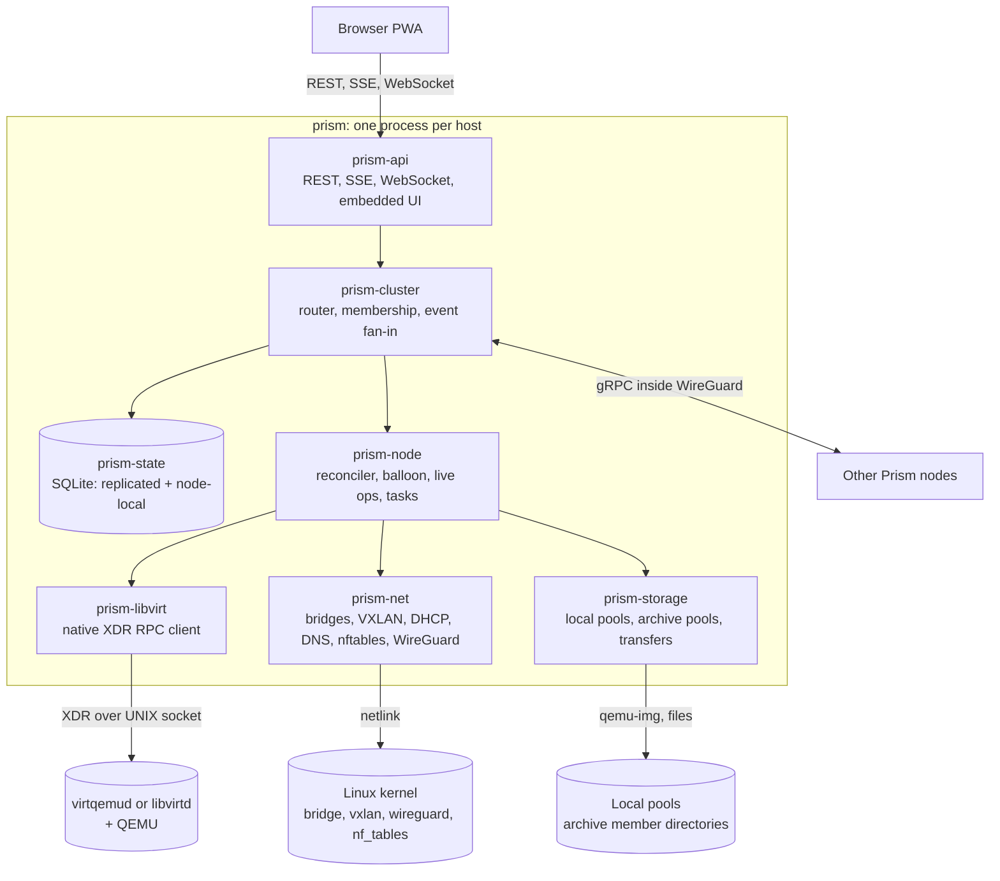
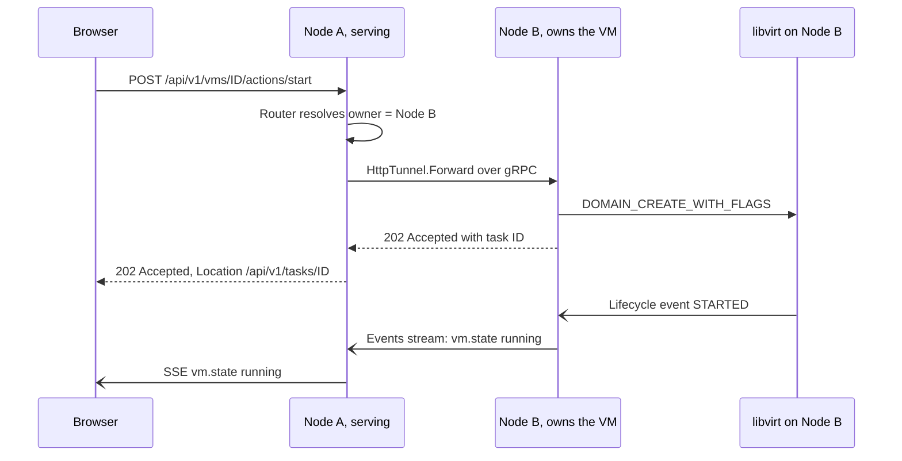
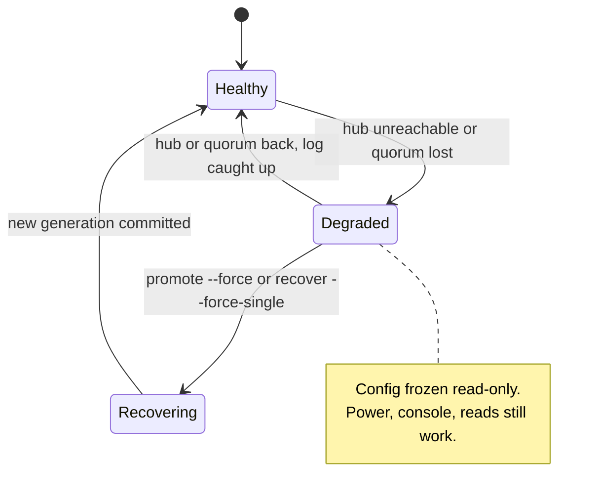
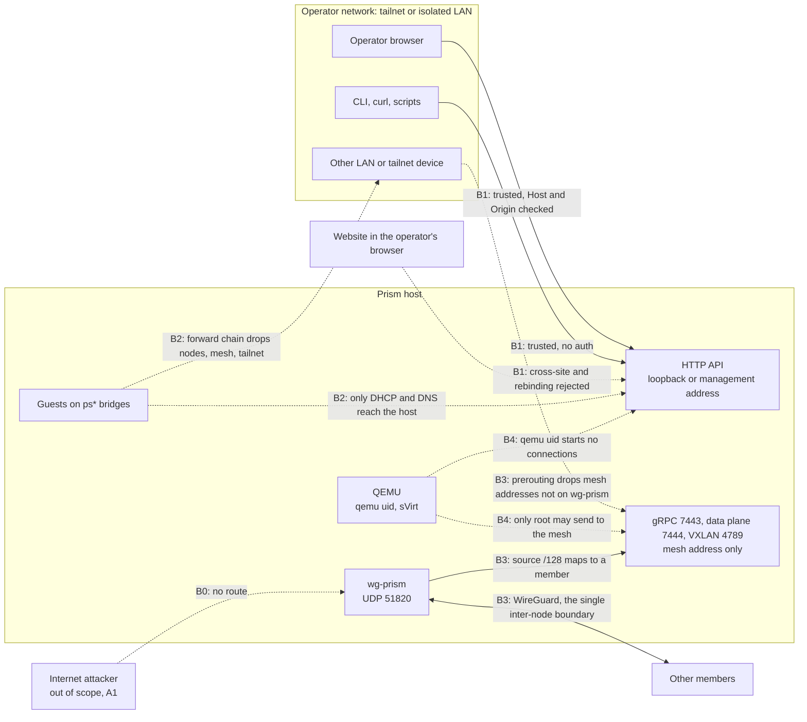
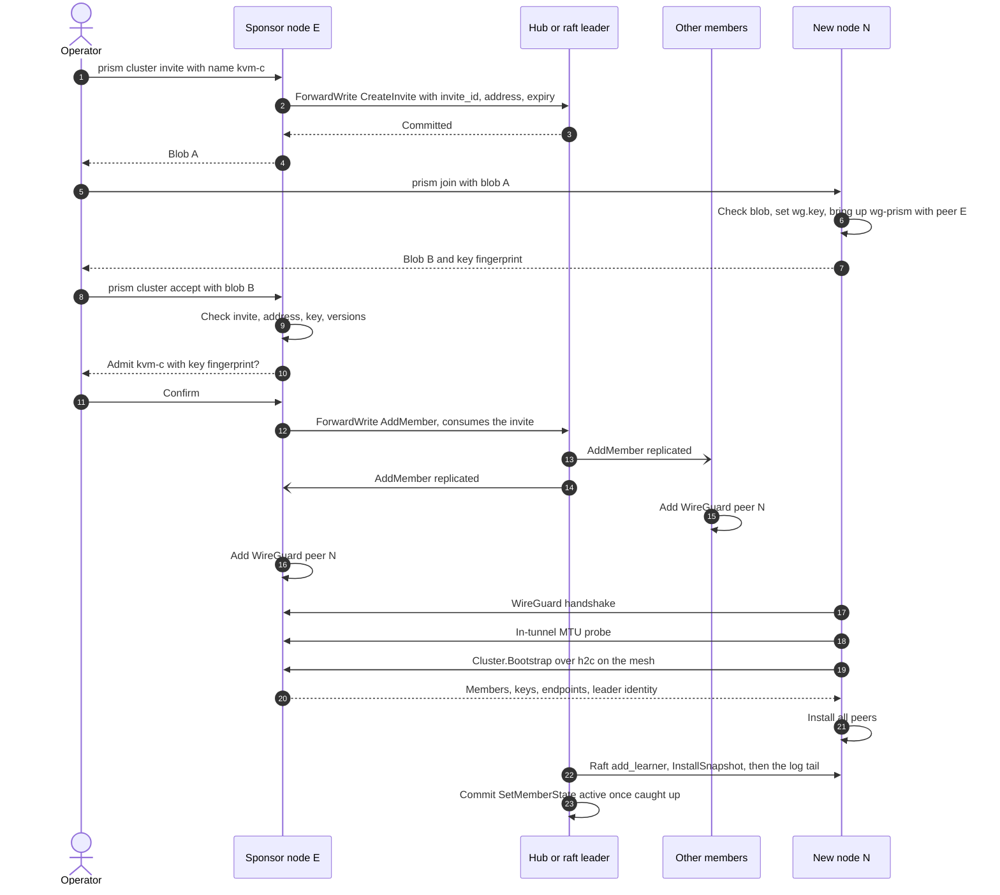
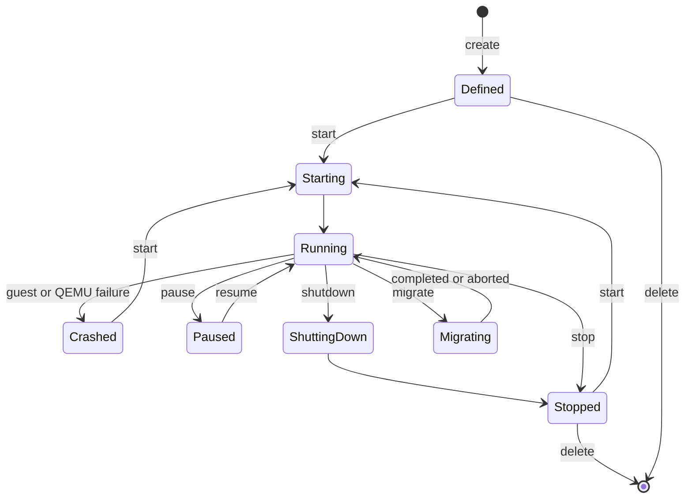
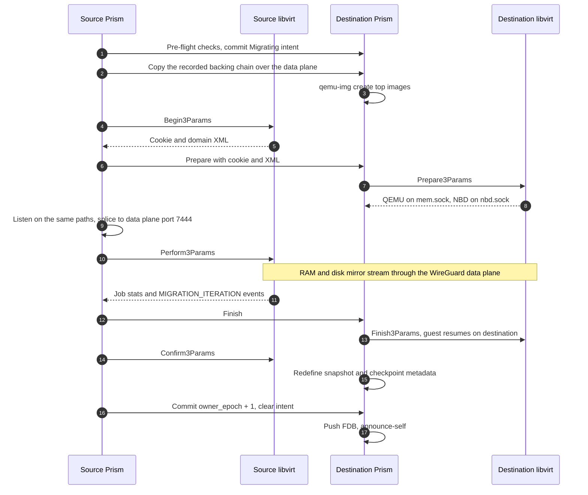
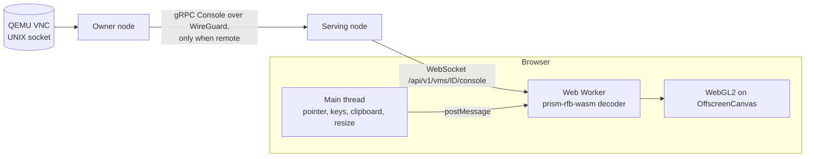
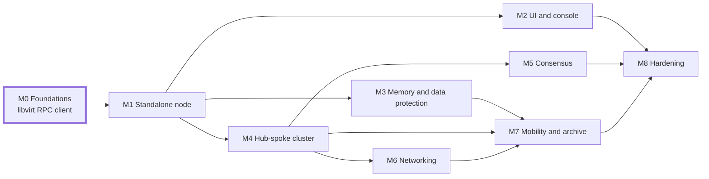

# Prism — libvirt/KVM Cluster Manager: Design

**Status:** Draft for approval · **Updated:** 2026-10-15 · **Owner:** Brenden Forward

## Contents

1. [Summary, goals and non-goals](#summary-goals-and-non-goals)
2. [System architecture](#system-architecture)
3. [Dependency strategy and static build](#dependency-strategy-and-static-build)
4. [Config directory and persistence](#config-directory-and-persistence)
5. [Clustering](#clustering)
6. [Threat model and security](#threat-model-and-security)
7. [Inter-node transport and security](#inter-node-transport-and-security)
8. [VM lifecycle and memory ballooning](#vm-lifecycle-and-memory-ballooning)
9. [Storage](#storage)
10. [Live operations](#live-operations)
11. [Networking](#networking)
12. [HTTP API and SSE event stream](#http-api-and-sse-event-stream)
13. [Web UI](#web-ui)
14. [Build, packaging, testing and quality](#build-packaging-testing-and-quality)
15. [Implementation milestones](#implementation-milestones)
16. [Risks and open questions](#risks-and-open-questions)

## Summary, goals and non-goals

Prism is one static Rust binary, `prism`, that runs on every KVM host. It talks to the local libvirt daemon over libvirt's own RPC protocol, implemented natively in Rust, so the libvirt C library is never linked. Each node serves a REST + SSE API and an embedded React/Tailwind PWA. Clustered nodes talk plaintext gRPC inside an IPv6 WireGuard mesh, which is the only trust boundary between nodes.

**Non-goals** (as specified): auth, users, HTTP TLS termination, HTTP load balancing. Every HTTP request is trusted, including `X-Forwarded-*` headers. Guests and websites are not trusted clients; see [Threat model](#threat-model-and-security).

**Feasibility corrections the research surfaced:**

- The `virt` crate links C libvirt (plus glib, gnutls, libxml2), so it is rejected in favour of a native RPC client.
- H.264/WebCodecs console streaming is impossible with QEMU's VNC server, which never sends H.264.
- A bridged-mode per-NIC egress override cannot stay on the same L2 segment as the rest of its switch.
- libvirt networks (dnsmasq) and libvirt storage drivers are avoided: they are host-local and depend on external binaries.

### Requirements traceability

| Requirement | How it is met | Section |
| --- | --- | --- |
| Static binary, almost any modern Linux | musl + cargo-zigbuild; only SQLite and mimalloc as static C; kernel ≥ 5.6 | Dependencies |
| React + Tailwind SPA/PWA, accelerated displays | Rust→WASM RFB decoder in a worker, WebGL2 on OffscreenCanvas | Web UI |
| Full API with SSE, no polling | `/api/v1` REST, snapshot-then-stream SSE with replay | API |
| Optional clustering, any node serves any request | Ownership router forwards over gRPC; cluster-wide event fan-in | Clustering |
| Memory ballooning | virtio-balloon with free page reporting and a PSI-driven auto loop | VM lifecycle |
| File-level archive load balancing | Archive pools place whole files by weighted free space | Storage |
| ~~gRPC + Protobuf over self-signed TLS~~ **Superseded** (owner decision, 2026-10-15) | Plaintext h2c gRPC + Protobuf inside the `wg-prism` WireGuard mesh, the single inter-node boundary | Transport |
| Portable config dir as argument | `prism serve --config <dir>`; copy the dir to move a node | Config |
| Easily move VMs and files | Live migration, cold move, archive drain and transfers | Live ops, Storage |
| Storage and pools managed in UI | Local pools and archive pools screens | Web UI, Storage |
| Move and snapshot without downtime | Managed migration (≤ 300 ms pause), live external snapshots, push backups | Live ops |
| Host and bridge networking | NAT and bridged switch types, safe host-bridge wizard | Networking |
| Cluster virtual switch with remote egress | VXLAN overlay; per-NIC egress via per-node gateway VIPs | Networking |
| Internal VM-to-VM switches | Isolated switches, VLAN access/trunk ports | Networking |
| Idiomatic Rust, 0 clippy warnings | `clippy -D warnings` gate, workspace lints | Build |
| Few non-pure-Rust crates, no OpenSSL | cargo-deny bans and a static-ELF check in CI | Dependencies |
| Hub-spoke and consensus clusters, degraded spokes | Single-voter raft + learners, or 3/5-voter raft; frozen read-only cache | Clustering |
| Disks local to the VM's host | Ownership invariant; migration copies disks via NBD | Storage, Live ops |
| Backups on any node, for any VM | Backups stream into any archive pool | Storage, Live ops |
| No auth on a private network (non-goal) | Two boundaries: WireGuard between nodes, the operator network for HTTP; guest, browser and local-process isolation | Threat model |
| Copy-paste cluster join (owner direction) | Two secret-free base64 blobs: an invite from any member, a reply from the new node | Transport |

## System architecture

Prism is a single process on a tokio runtime, built from one Cargo workspace. Every node runs the same binary with the same features; cluster role is data, not a build option.



Any node can serve any request. The router resolves which node owns the target and forwards the call there; events flow back so every node's SSE stream sees the change.



| Crate | Role |
| --- | --- |
| `prism-xdrgen` | Build-time parser and code generator for libvirt `.x` files (about 1.5k lines; existing XDR crates are stale) |
| `prism-libvirt` | Async libvirt RPC client: framing, serial dispatch, keepalive, events, streams |
| `prism-proto` | `.proto` files compiled with tonic-prost-build + protox (no protoc) |
| `prism-state` | Replicated `Command` log applied to SQLite; VM ownership and epochs; archive index |
| `prism-cluster` | Mode policy, membership and invites, membership reconciler, degraded-mode gate, request router, event fan-in |
| `prism-node` | VM reconciler, domain XML renderer, balloon loop, migration/snapshot/backup orchestration, tasks |
| `prism-storage` | Local disk pools, archive pools, BLAKE3 chunked transfer, ISO cache |
| `prism-net` | Bridges, VXLAN, FDB reconciler, embedded DHCP/DNS, nftables-netlink layer, WireGuard |
| `prism-api` | axum REST, SSE, WebSockets, OpenAPI (utoipa), embedded UI assets |
| `prism-rfb-wasm` | Rust→WASM VNC (RFB) decoder used by the browser console |
| `prism` (bin) | clap CLI: `serve --config <dir>`, `init`, `join [--abort]`, `leave [--force]`, `cluster invite`, `cluster accept`, `cluster remove`, `cluster promote`, `cluster recover`, `doctor`, `backup-config`, `install` |
| `web/` | React + TypeScript + Vite + Tailwind SPA |

**Request flow.** The browser calls the HTTP API on any node. Local requests go through `prism-node` to `prism-libvirt` and the libvirt daemon. Remote ones are forwarded over gRPC to the owner and run through the same handlers there.

**Event flow.** libvirt domain events, task progress and state changes enter a per-node event bus. Each node subscribes to every peer's bus, so any node's SSE stream covers the whole cluster.

## Dependency strategy and static build

Prism builds as a fully static musl binary with two statically compiled C components: SQLite and mimalloc. Nothing links OpenSSL, any TLS library or libvirt, and the binary has no `NEEDED` entries.

### Reaching libvirt without linking it

Prism speaks libvirt's remote RPC protocol (XDR frames over the local UNIX socket) directly. This is the approach DigitalOcean's pure-Go `go-libvirt` uses in production.

- **Codegen.** `prism-xdrgen` parses vendored `remote_protocol.x`, `qemu_protocol.x` and `virkeepaliveprotocol.x` from a pinned libvirt tag. It emits structs, XDR encode/decode traits and typed async stubs for an allowlist of about 70 procedures, not all 450+.
- **Wire layer.** Frames carry a length and a header (`prog, vers, proc, type, serial, status`). One reader task dispatches replies by serial, so long calls like `Perform3` run while `GetJobStats` and `AbortJob` proceed.
- **Keepalive.** The reader answers server PINGs immediately and sends its own every 5 s. After 5 misses it reconnects and re-registers event callbacks.
- **Socket.** Prism tries `/run/libvirt/virtqemud-sock` first, then `/run/libvirt/libvirt-sock`. It uses only the QEMU driver, so it never needs virtnetworkd or virtstoraged.
- **Auth.** Prism runs as root; polkit and none are accepted. SASL-only setups fail fast with a remediation message.
- **Events.** `DOMAIN_EVENT_CALLBACK_REGISTER_ANY` covers lifecycle, reboot, balloon change, job completed, block job, migration iteration, device add/remove and agent lifecycle.

libvirt maintainers call this protocol private, but procedures are only ever appended. Prism pins libvirt ≥ 8.0, feature-detects newer calls and tests against a version matrix.

### Crates

| Crate | Purpose | C code? |
| --- | --- | --- |
| tokio, tokio-util, bytes | Runtime and codecs | No |
| axum, tower-http, rust-embed | REST, SSE, WebSocket, embedded UI | No |
| tonic 0.14 (no TLS features), tonic-prost, prost, protox | gRPC (h2c) without protoc | No |
| rusqlite (`bundled`) | Local and replicated state | SQLite amalgamation, static |
| openraft 0.9.x (pinned) | Consensus and hub-spoke replication | No |
| rtnetlink, netlink-packet-route, netlink-packet-wireguard | Bridges, VXLAN, FDB, VLANs, WireGuard | No |
| quick-xml + serde | Domain XML | No |
| blake3, lz4_flex | Checksums, transfer compression | No (blake3 `pure` optional) |
| rustix | Sockets, `SEEK_DATA/HOLE`, statx | No |
| dhcproto, hickory-proto | Embedded DHCP and DNS | No |
| zbus | NetworkManager checkpoints | No |
| mimalloc | Global allocator | Vendored C, static |
| tracing, clap, thiserror, uuid, serde_json, getrandom, secrecy | Basics, key generation, secret handling | No |

mimalloc replaces musl's malloc, whose global lock throttles migration and transfer throughput; it stays behind a default-on feature so it can be benchmarked. Prism needs no TLS or Curve25519 crate: WireGuard private keys come from `getrandom`, and the kernel derives the public key.

### Build and enforcement

- `cargo-zigbuild` targets `x86_64-unknown-linux-musl` and `aarch64-unknown-linux-musl` with no Docker.
- Release profile: `lto = "fat"`, `codegen-units = 1`, `panic = "abort"`.
- cargo-deny bans `openssl*`, `native-tls`, `aws-lc*`, `ring`, `rustls`, `rcgen`, `libz-sys`, `zstd-sys`, `virt*`, `bindgen` and `pkg-config`. Only `libsqlite3-sys` and `libmimalloc-sys` may be `-sys` crates.
- `cargo build --locked`, `npm ci --ignore-scripts`, and GitHub Actions pinned by commit SHA.
- CI runs `readelf -d` on the binary and fails on any `NEEDED` entry.

### Host prerequisites

`prism doctor` checks each of these and prints a fix:

| Requirement | Standalone | Clustered |
| --- | --- | --- |
| libvirt ≥ 8.0, QEMU ≥ 6.2, `qemu-img` | Yes | Yes |
| Kernel | ≥ 5.6 (openat2) | ≥ 5.6 (openat2, WireGuard) |
| Modules: bridge, vxlan, tun, vhost_net, nf_tables (+ nat, masq, ct) | Yes | Yes |
| Module: wireguard | No | Yes |
| IPv6 enabled in the kernel (no `ipv6.disable=1`) | No | Yes (mesh is IPv6) |
| PSI (`/proc/pressure/memory`) | Optional | Optional |
| Root | Yes | Yes |
| `qemu.conf`: non-root `user`, `security_driver` not `none`, `seccomp_sandbox = 1` | Yes | Yes |
| Pool and VM directories root-owned, not writable by the qemu uid | Yes | Yes |
| `inet prism` boundary rules from [Threat model](#threat-model-and-security) present | Yes | Yes |

Prism does not need IPv6 forwarding, and its boundary rules hold when forwarding is on.

## Config directory and persistence

The config directory, passed as `prism serve --config <dir>`, is the node's entire identity: copying it to new hardware moves the node. Only bootstrap settings are hand-edited; everything else is desired state changed through the API. The directory is 0700, and Prism runs with `umask 0077`.

```text
<config>/
  prism.toml          # node-local bootstrap only (operator-edited)
  wg/                 # wg.key (0600), the node's only secret — clustered nodes only
  data/
    identity          # node UUID + machine-id fingerprint
    state.db          # replicated state machine (SQLite, WAL)
    raft.db           # raft log, vote, snapshot metadata (absent when standalone)
    node.db           # node-local: tasks, upload sessions, ISO cache index, event ring
  cache/              # content-addressed ISO cache (path overridable)
  run/prism.lock      # flock; refuses a second instance
```

```toml
[node]
name = "kvm-a"

[http]
listen = ["127.0.0.1:8080"]   # default; use tailscale serve or a management address, never 0.0.0.0
allowed_hosts = ["kvm-a.example.ts.net"]   # IP literals, localhost and the hostname are always allowed
allowed_origins = []

[cluster]               # topology, mesh prefix and wg-prism MTU live in data/, not here
advertise = ["192.168.10.11", "100.101.102.103"]   # underlay endpoints, preference order
wireguard_port = 51820

[libvirt]
socket = "auto"         # virtqemud-sock, then libvirt-sock

[pools.default]         # local VM disk pool
type = "dir"
path = "/var/lib/prism/pools/default"
format = "qcow2"

[archive_members.a1]    # contributes a directory to a cluster archive pool
pool = "archive"
path = "/srv/archive"
weight = 1.0
reserve = "50GiB"
```

### What lives where

| Data | Location | Changed by |
| --- | --- | --- |
| Listen addresses, libvirt socket, local pool and archive-member paths | `prism.toml` | Operator |
| Cluster mode, membership, mesh prefix and addresses | `data/state.db` | `prism init / join / cluster …` |
| VMs, switches, archive pools, schedules, IPAM, invites, tombstones, `wg-prism` MTU | `data/state.db` (replicated) | API |
| Tasks, uploads, ISO cache index, SSE replay ring | `data/node.db` | Prism |
| Raft log | `data/raft.db` | Prism |

Cluster mode is never in the toml, so the toml and the stored state cannot disagree. Schema changes run as forward-only SQLite migrations, keyed by `user_version`, at startup.

### Portability and safety

- `identity` records the machine-id. On a mismatch Prism refuses to start unless run with `--adopt`, so a cloned directory cannot run as two nodes.
- `prism backup-config <file>` takes a consistent SQLite online backup plus `wg/`, for disaster recovery of a node. The file is written 0600, and the CLI warns that it holds the node's private key.

## Clustering

All three modes share one replicated-state engine; they differ only in who may vote. Every config write is a versioned protobuf `Command` applied deterministically to `state.db`, in the same transaction that records `applied_index`.

| Mode | Voters | Other nodes | Writes go to |
| --- | --- | --- | --- |
| Standalone | None; commands apply directly | — | Local node |
| Hub-spoke | The hub only | Spokes, as raft learners | Hub |
| Consensus | 3 or 5 peers | Extra nodes, as learners | Raft leader |

Hub-spoke is a single-voter openraft group. That gives spokes the required "pull all config from the hub" for free: a learner that falls behind log compaction receives `InstallSnapshot`, then the tail. Every node, including the hub, runs VMs. Clustering requires the WireGuard mesh described under [Transport](#inter-node-transport-and-security). Membership is full trust: any member is root on every member, and removal is the containment control.

### Desired vs runtime state

- **Replicated (desired):** VM specs, VM ownership `(host_node, owner_epoch)`, migration intents, switches and VNIs, IPAM, archive pools and file index, schedules, members with their mesh addresses, WireGuard public keys and states (`invited`, `joining`, `active`), the cluster `wg-prism` MTU, open invites, tombstones `{node_id, wg_pubkey, mesh_addr}`.
- **Node-authoritative (runtime):** power state, stats, pool usage, free space, task progress. These never enter raft.

Each node pushes runtime deltas to every peer over `NodeStatus.Stream` and keeps an in-memory cluster view. The full mesh is supported up to 32 nodes.

Writes carry an `expected_revision`, which appears in HTTP as `ETag` / `If-Match`.

### Degraded mode

A node is degraded when a spoke cannot reach the hub, or when consensus quorum is lost. Config freezes to the last applied revision. Responses carry `X-Prism-Degraded: true` and `stale_since`.



| Allowed while degraded | Denied (503 `cluster_degraded`) |
| --- | --- |
| All reads, from cache, marked stale | Create, edit or delete anything |
| Power actions on existing VMs (start, shutdown, stop, reboot, reset, pause, resume) on reachable owners | Move or migrate |
| Console and serial | Snapshot and backup creation |
| Archive downloads, ISO cache use | Archive upload and delete |
| Task cancel, local event stream | Invite, accept, leave, remove, pool changes |

Scheduled backups that fall in a degraded window are recorded as failed tasks.

### Changing the hub and recovering quorum

- **Planned:** `prism cluster promote <node>` adds the target as a voter, removes the old hub's vote and demotes the old hub to learner. These are two membership changes with no data loss.
- **Forced:** `prism cluster promote --force` (hub dead) or `prism cluster recover --force-single` (quorum lost) re-initialises membership from the most up-to-date survivor and bumps `cluster_generation`.
- **Fencing:** a returning node that sees a higher generation demotes itself. It writes any un-replicated entries to `data/lost-<gen>.jsonl`; they are reported, never merged.

### Any node serves any request

The router resolves the owner of each request:

| Target | Owner |
| --- | --- |
| VM operation | `host_node` |
| Local pool or volume | Its node |
| Archive file read | A healthy replica holder |
| Config write | Hub or raft leader |
| Task | The node running it |

REST calls are forwarded verbatim over `HttpTunnel.Forward` and run through the owner's own axum handlers. `X-Prism-Forwarded-By` enforces a one-hop limit. Console, serial and file streams are proxied byte-for-byte over bidirectional gRPC streams with backpressure.

### Cluster-wide events

Each node subscribes to every peer with `Events.Subscribe(since = node, boot_epoch, seq)` and merges those streams with its own. After a reconnect it resumes from the last sequence. If the peer's buffer has rolled over, it fetches that peer's runtime snapshot and emits `resync`.

### A VM never runs on two nodes

1. A node starts a VM only if committed state says it owns that VM at the current epoch and no `Migrating` intent covers it. Ownership is frozen while degraded.
2. A cold move commits `owner_epoch + 1` for the destination before the destination defines the domain.
3. A live migration first commits a `Migrating{src, dst}` intent, which allows the domain on both nodes for the duration. After `Confirm3`, Prism commits `owner_epoch + 1` for the winning side and clears the intent. If quorum is lost mid-migration, or `src` or `dst` becomes unreachable, the intent stays until quorum and both nodes are back. Prism then resolves it from which node actually runs the domain, commits `owner_epoch + 1` for that node and clears the intent. A partitioned destination may already run the guest after `Finish3`, so Prism never resumes the source while the destination is unreachable.
4. A reconciler runs at boot and every 30 s. It force-stops and quarantines any Prism domain the node does not own and that no intent covers, keeping its disks.
5. libvirt autostart is never used; Prism decides what starts after a host reboot.

## Threat model and security

Prism has two trust boundaries: the `wg-prism` WireGuard mesh between nodes, and the operator's access-controlled network for HTTP. Prism adds no authentication, no user accounts and no PKI of its own. Cheap kernel-level rules stop guests, websites and LAN devices from passing as the parties those boundaries trust.

### Assumptions

| ID | Assumption | Consequence |
| --- | --- | --- |
| A1 | Prism runs only on an access-controlled network, such as a Tailscale tailnet or an isolated LAN. No Prism port, HTTP or otherwise, is reachable from the internet. | Internet attackers are out of scope. Tailnet ACLs or LAN firewalls are the HTTP access control. |
| A2 | Every HTTP request from the operator network is trusted, including `X-Forwarded-*`. | No auth, users, multi-tenancy, HTTP TLS or HTTP load balancing. Any operator-network device can admit a node. |
| A3 | Member hosts are dedicated hypervisors. Local root is fully trusted. | Untrusted local accounts are unsupported. The qemu uid is the only untrusted local principal. |
| A4 | Guests, guest workloads and websites are not part of the trusted network. | Prism keeps them from reaching the API and the mesh, even though guests run on every host. |
| A5 | Cluster membership is all-or-nothing. | A member is root on every member. Removal is the containment control. |

### Assets

| Asset | Where | Why it matters |
| --- | --- | --- |
| HTTP API | Every node; `127.0.0.1:8080` by default | Full control of every VM and, through host paths, root on every host |
| Membership (WireGuard peer set) | Replicated state, `wg-prism` | One admitted key is root everywhere |
| `wg.key` | `<config>/wg/wg.key`, 0600 | The node's mesh identity and the only secret Prism stores |
| Desired state, including cloud-init user-data | `state.db`, `raft.db` on every node | Guest passwords and keys |
| VM disks, RAM and backups | Local pools, archive members, the data plane in flight | Guest data; backups land on any node |
| Switch isolation | `ps*` bridges, VXLAN VNIs | L2 separation between switches |
| Host files and devices | Root-owned paths | Prism runs as root |

### Actors

| Actor | Trust | Reaches |
| --- | --- | --- |
| Operator (browser, CLI, curl) | Trusted (A2) | HTTP API |
| Other tailnet or LAN device | Trusted for HTTP (A2), not a member | HTTP API if routed, UDP 51820, any host address |
| Website open in the operator's browser | Untrusted | HTTP API through the browser |
| Guest VM or its workload | Untrusted (A4) | Gateway VIPs, DHCP, DNS, masqueraded egress; console, serial, agent and balloon output |
| Escaped QEMU (qemu uid, sVirt) | Untrusted | Loopback, local sockets, its own image files, the host's mesh source address |
| Member node | Fully trusted (A5) | Every gRPC service |
| Joining node | Trusted after `active` | Cluster.Bootstrap and Cluster.Status only |
| Removed member or holder of a stolen `wg.key` | Untrusted | UDP 51820 |
| Internet attacker | Out of scope (A1) | Nothing |

### Trust boundaries

Solid edges are allowed. Dashed edges are blocked.



| Boundary | Between | Enforced by |
| --- | --- | --- |
| B0 Internet | The internet and everything | A1. `prism doctor` warns about globally routable listen or `advertise` addresses |
| B1 HTTP | Operator network and the API | Loopback default or explicit management address; Host allowlist; Origin and `Sec-Fetch-Site` checks |
| B2 Guest | Guest bridges, the host and the operator network | `inet prism` input and forward chains; `bridge prism` table |
| B3 Mesh | Members and everything else | WireGuard cryptokey routing; prerouting interface rule; forward drop on `wg-prism`; source /128 mapped to member and state |
| B4 Local process | QEMU and Prism's services | sVirt and seccomp; output rules on socket uid; root-owned pool directories; 0700 socket directories with `SO_PEERCRED` |

### Scope

| Item | In scope | Reason |
| --- | --- | --- |
| Guests reaching the API, mesh or operator network | Yes | A4: guests are untrusted and Prism builds their networks |
| Websites driving the API through an operator's browser | Yes | The request comes from outside the trusted network |
| LAN or tailnet devices spoofing mesh or VXLAN traffic, directly or through a forwarding node | Yes | A1 trusts them for HTTP, not as members |
| Escaped QEMU reaching Prism services or host files | Yes | QEMU runs non-root; Prism must not hand it root |
| Join blob leakage | Yes | Blobs travel through chat and logs |
| Removed node returning; stolen `wg.key` | Yes | The peer set is the whole credential |
| Root file handling: paths and image headers | Yes | Prism runs as root |
| Guest resource abuse: disk, memory, agent, floods | Yes | Availability for other VMs |
| Internet attacker on any port | No | A1: never exposed |
| Misuse by anyone on the trusted network, including admitting a node or altering a pasted blob | No | A2: every request reaching Prism is trusted; use tailnet ACLs |
| Authentication, users, multi-tenancy, HTTP TLS, load balancing | No | A2: non-goals by requirement |
| A compromised member acting as root | Accepted | A5: removal contains it |
| Untrusted non-root local users on a member host | No | A3. The output rules still block non-root sockets toward the mesh |
| Strong isolation between guests on one switch | No | No multi-tenancy. The cheap `bridge prism` rules still apply |
| Physical theft of disks | No mechanism | Recommend LUKS; no Prism crypto at rest |
| Post-quantum recording of mesh traffic | No | No WireGuard PSK in v1 |

### Threats

| ID | Threat | Boundary | Mitigation | Status |
| --- | --- | --- | --- | --- |
| S1 | A guest calls the API at its gateway VIP or any host address (weak-host model) | B2 | `inet prism` input: from `ps*` accept only UDP 67, UDP/TCP 53 to the VIP, ICMP echo, ICMPv6 ND and established traffic, then drop. HTTP defaults to `127.0.0.1:8080`. Prism refuses listen addresses on `ps*`, `vx*`, `pn*` and `wg-prism`. `prism doctor` fails if the API answers from a bridge | New, M1 and M6 |
| S2 | A guest reaches other nodes' APIs or tailnet devices through masquerade | B2 | Forward chain drops `ps*` traffic to `wg-prism`, `tailscale0`, the mesh /48, `100.64.0.0/10`, `fd7a:115c:a1e0::/48` and `@node_addrs`. Masquerade only on the switch's uplink. Per-switch `allow_prefixes` opts back in | New, M6 |
| S3 | A bridged guest on the management LAN reaches the API | B1, B2 | A bridged switch on the management LAN puts guests on the trusted network. The wizard warns, and it refuses without `--i-know` to enslave the interface that carries the HTTP listen address or the `wg-prism` underlay route | New, M6 |
| S4 | A LAN device, tailnet device or guest injects VXLAN into a switch through UDP 4789 | B3 | Prerouting: `udp dport 4789 iifname != "wg-prism" drop`. e2e test sends VXLAN from a guest and from the LAN | New, M6 |
| S5 | A LAN or tailnet device spoofs a member's mesh address, either directly or through a node with IPv6 forwarding that then encrypts the packet as itself | B3 | Prerouting drops mesh-prefix source or destination unless the packet arrives on `wg-prism` or `lo`. Forward drops everything entering or leaving `wg-prism`. e2e test sends a spoofed packet through a node with `net.ipv6.conf.all.forwarding=1` | New, M4 |
| S6 | A non-root local process or escaped QEMU sends gRPC, data-plane or VXLAN traffic to a peer from the node's own mesh address | B4 | Output: `ip6 daddr <mesh>/48 meta skuid != 0 drop`, on every protocol. Kernel VXLAN and WireGuard packets have no file-backed socket and are unaffected. e2e test sends VXLAN as an unprivileged user | New, M4 |
| S7 | An escaped QEMU reaches the API on loopback, on a management address or through `tailscale serve` | B4 | Output: `meta skuid <qemu uid> ct state new drop`, with the uid resolved from `qemu.conf`. `prism doctor` fails on `user = "root"`, `security_driver = "none"` or `seccomp_sandbox = 0` | New, M4 |
| S8 | A website sends cross-site POSTs, opens console or serial WebSockets, or uses DNS rebinding | B1 | Host allowlist (421); Origin or `Sec-Fetch-Site` check on unsafe methods, WebSocket upgrades and SSE; JSON or tus Content-Type on writes; `X-Forwarded-Host` checked against the allowlist; relative `Location` | New, M1 |
| S9 | XSS or clickjacking through guest-controlled strings | B1 | Concrete CSP with `frame-ancestors 'none'`; `X-Frame-Options: DENY`; lint ban on `dangerouslySetInnerHTML`; hrefs built only from IDs; guest strings capped and stripped of control characters | New, M2 |
| S10 | Stored XSS from an archive file served inline | B1 | Downloads are `application/octet-stream`, `Content-Disposition: attachment`, `nosniff`, `Content-Security-Policy: sandbox` | New, M7 |
| S11 | Guest terminal or RFB abuse: OSC 52 clipboard writes, OSC 8 links, huge framebuffers | B1 | No xterm ClipboardAddon; links allow only http and https and ask first; framebuffer capped at 8192x8192 and cursor at 256x256; per-rectangle decompression cap | New, M2 |
| S12 | Path traversal, symlinks or option injection in pool, archive, upload or volume names | Root files | `openat2` with `RESOLVE_BENEATH`, `RESOLVE_NO_SYMLINKS`, `RESOLVE_NO_MAGICLINKS` and `RESOLVE_NO_XDEV` from root fds. Names match `[A-Za-z0-9._-]{1,128}` with no leading `-` or `.`. Children get an argv list, never a shell, with `--` before positional arguments | New, M1 and M7 |
| S13 | An escaped QEMU swaps a checked image path for a symlink before `qemu-img` or libvirt opens it | B4 | Pool and VM directories are root-owned and not writable by the qemu uid; libvirt relabels only image files. `qemu-img` gets fds through `json:{"driver":"file","filename":"/dev/fd/N"}`. `prism doctor` checks directory ownership | New, M1 |
| S14 | A malicious qcow2 header (backing file `/dev/sda`, a data-file) from an upload or an escaped QEMU | B4 | Explicit `-f` and `-F`, never probing. Chains are recorded in state, and only recorded paths are copied. Unexpected references are rejected. Imports are flattened. `qemu-img` runs under rlimits | New, M1 and M7 |
| S15 | A guest spoofs other guests on a shared switch: rogue DHCP, RA, ARP for the VIP, MAC spoofing, double tagging | B2 | `bridge prism`: per-tap MAC and lease binding; drop UDP sport 67 and ICMPv6 type 134 from `pn*`; drop tagged ingress on access ports; static FDB. Per-NIC `trusted` opt-out | New, M6 |
| S16 | A guest abuses embedded DNS or DHCP: open resolver, tailnet name recon, floods | B2 | Sockets bound per VIP with `SO_BINDTODEVICE`. `.ts.net`, search domains and `100.100.100.100` are never forwarded by default. Per-tap `limit rate` | New, M6 |
| S17 | A guest abuses the agent, balloon or disk: a freeze it never thaws, fake stats, a full pool | B2 | Agent timeouts with `FSTHAW` in a finally path; agent data is display-only; host PSI is authoritative; `balloon_unresponsive` flag; per-pool `reserve`; ENOSPC pause alert | New, M3 |
| S18 | A local process hijacks migration splice sockets | B4 | 0700 root directory under `/run/prism/mig`; `SO_PEERCRED` must match the domain's QEMU PID; expected connection count, then unlink; no loopback-TCP fallback | New, M7 |
| S19 | A device on the operator network creates and accepts its own invite | B1 | Accepted (A2): it could call any other API too. Tailnet ACLs limit who reaches the API. `member.added` is an event and a UI banner | Accepted |
| S20 | A blob leaks through chat or logs | B1 | Neither blob holds a secret. An invite is single-use, expires after 1 h and is consumed on accept | Mitigated by design, M4 |
| S21 | A joining node uses services before it is confirmed | B3 | A `joining` member may call only `Cluster.Bootstrap` and `Cluster.Status` | New, M4 |
| S22 | A removed node returns, or a member that was offline during the removal still trusts it | B3 | Peers come only from committed state, reconciled on apply and at boot. Tombstones block reuse of keys, node IDs and addresses. Removal status lists members that have not applied it. The window until a lagging member catches up is accepted | Partly accepted, M4 |
| S23 | A stolen `wg.key` or `backup-config` file | B3 | `umask 0077`; config dir 0700; start refused if `wg.key` is group- or world-readable; `backup-config` written 0600 with a warning. Response: remove, `prism leave --force`, re-invite | New, M4 |
| S24 | A compromised member | B3 | Accepted (A5). Blob and Tunnel are size- and rate-limited; `prism cluster remove` | Accepted |
| S25 | An eavesdropper or tamperer on the underlay | B3 | WireGuard: ChaCha20-Poly1305, Curve25519 peers, replay counters, 2-minute rekey | Mitigated by design |
| S26 | Secrets in cloud-init or logs | Data | SSE `vm.config` carries only a hash of user-data; `secrecy::SecretString`; no request bodies logged; seed ISO 0600; user-data is visible cluster-wide | New, M1 |
| S27 | Disks at rest on any node; residual data in thick LVs | Data | Recommend LUKS; `BLKZEROOUT` on thick-LV delete; doctor checks thin-pool zeroing | New, M1 |
| S28 | A replica altered on one archive member | Data | The BLAKE3 in the replicated index is the trust anchor; verify before restore, import or attach | Clarified, M7 |
| S29 | Resource exhaustion through uploads, SSE or tasks | B1 | `Upload-Length` required and reserved; partial uploads garbage-collected after 24 h; SSE and WebSocket caps; per-kind task queues | New, M1 and M7 |
| S30 | A compromised build dependency | Build | `cargo build --locked`, `npm ci --ignore-scripts`, Actions pinned by SHA, GitHub artifact attestations | New, M0 |

### Hardening defaults

- HTTP listens on `127.0.0.1:8080` unless configured. Remote access uses `tailscale serve` or an explicit management address.
- One middleware enforces the Host allowlist and the Origin and `Sec-Fetch-Site` checks. The CSP is concrete and includes `frame-ancestors 'none'`.
- `inet prism` prerouting accepts mesh addresses and VXLAN only on `wg-prism` (and `lo` for mesh addresses). Forward never routes into or out of `wg-prism`.
- `inet prism` output lets only root sockets reach the mesh, and the qemu uid starts no connections.
- Guest bridges reach only DHCP, DNS and ND on the host. The forward chain keeps guests away from nodes, the mesh and the tailnet.
- `bridge prism` binds each tap to its MAC and lease, and drops rogue DHCP, RAs and tagged ingress on access ports.
- `openat2` confinement, root-owned pool directories, explicit image formats and argv-only children.
- `umask 0077`, a 0700 config dir, and `wg.key` as the only secret.
- Downloads are attachments with `nosniff` and a sandbox CSP.
- `prism doctor` verifies all of the above, plus sVirt and seccomp in `qemu.conf`.

## Inter-node transport and security

Clustering requires a kernel WireGuard mesh, `wg-prism`, and it is the only trust and encryption boundary between nodes. gRPC, the bulk data plane and the VXLAN overlay run in plaintext inside it. Standalone nodes need none of this.

This supersedes the original requirement "gRPC over a TLS socket (self-signed cert)". WireGuard already provides what TLS added: AEAD confidentiality and integrity, mutual authentication, replay protection and forward secrecy. Dropping TLS removes the cluster CA, node certificates, renewal, revocation, CA rotation, the public join port and join tokens. It also removes rustls, tokio-rustls, ring, rcgen and x509-parser from the build. No Prism release shipped the TLS design, so no transition is needed.

### Layers

| Layer | Carries | Port | Protection |
| --- | --- | --- | --- |
| WireGuard `wg-prism` | Everything below | UDP 51820 on the underlay, IPv4 or IPv6 | Curve25519 static keys, ChaCha20-Poly1305, replay counters, 2-minute rekey |
| gRPC control plane (h2c) | Raft, status, events, forwarding, console | TCP 7443 on the mesh address | WireGuard; source /128 mapped to a member |
| Data plane | Migration RAM, NBD disk copy, blobs, cold-move extents | TCP 7444 on the mesh address | WireGuard; session ID bound to the opener's address |
| VXLAN overlay | VM switch traffic | UDP 4789 | WireGuard; accepted only from `wg-prism` |

### What makes WireGuard the boundary

Linux uses the weak-host model, IPv6 has no `rp_filter`, and the kernel VXLAN socket binds the wildcard address. So "addressed to the mesh" does not mean "came through WireGuard". Three controls close the gap. They ship in the same change that removes TLS.

1. **Interface rule (prerouting).** A packet with a mesh-prefix source or destination is accepted only on `wg-prism` or `lo`. UDP 4789 is accepted only from `wg-prism`. The forward chain drops everything entering or leaving `wg-prism`, because the mesh never routes. These rules must sit before routing. Otherwise a node with IPv6 forwarding enabled would encrypt a spoofed LAN packet to its peers as itself.
2. **Cryptokey routing.** Every peer has `AllowedIPs` = exactly its /128, with no overlaps. WireGuard drops any inner packet whose source is not the sending peer's /128. A mesh source address therefore identifies one key.
3. **Process rule (output).** WireGuard authenticates hosts, not processes. Only root sockets may send to the mesh, on every protocol, and the qemu uid may not start any connection. Prism resolves the qemu uid from `user` in `/etc/libvirt/qemu.conf` at startup.

Handlers map `remote_addr()` to a committed member and its state. Unknown addresses get `PERMISSION_DENIED`. A `joining` member may call only `Cluster.Bootstrap` and `Cluster.Status`. Raft RPCs carry no role filter: openraft's term and vote rules decide, and a member is fully trusted (A5).

Prism generates these rules over netlink in its own `inet prism` table. With the example mesh prefix `fd12:3456:789a::/48` and qemu uid 64055:

```text
table inet prism {
    chain prerouting {
        type filter hook prerouting priority raw; policy accept;
        iifname != { "wg-prism", "lo" } ip6 saddr fd12:3456:789a::/48 drop
        iifname != { "wg-prism", "lo" } ip6 daddr fd12:3456:789a::/48 drop
        iifname != "wg-prism" udp dport 4789 drop
    }
    chain forward {
        type filter hook forward priority filter; policy accept;
        iifname "wg-prism" drop
        oifname "wg-prism" drop
    }
    chain output {
        type filter hook output priority filter; policy accept;
        ip6 daddr fd12:3456:789a::/48 meta skuid != 0 drop
        meta skuid 64055 ct state new drop
    }
}
```

- A drop in any nftables base chain is final, so these rules hold next to Docker and firewalld.
- Kernel WireGuard and VXLAN packets have no file-backed socket, so `meta skuid` does not match them and the output chain lets them through.
- In v1, QEMU uses only taps and UNIX sockets, so it never needs to start a network connection.
- The rules use only `meta skuid`, `iifname` and `ct`, which kernel 5.6 supports.
- `prism doctor` and CI check that the rules are present. e2e tests send spoofed mesh packets through a forwarding node, and VXLAN from an unprivileged local user.

### Ports

| Port | Bound to | Reachable from |
| --- | --- | --- |
| UDP 51820 (`wireguard_port`) | Wildcard, kernel WireGuard | Other members' underlay addresses. Silent to unknown keys |
| TCP 7443 gRPC h2c | Node mesh /128 | Members, through `wg-prism` |
| TCP 7444 data plane | Node mesh /128 | Members, through `wg-prism` |
| UDP 4789 VXLAN | Kernel wildcard | `wg-prism` only (prerouting) |
| TCP 8080 HTTP | `127.0.0.1` by default, or `[http] listen` | Operator network only; never the mesh or bridges |
| UDP 67, UDP/TCP 53 | Switch VIPs, `SO_BINDTODEVICE=ps<id>` | Guests on that switch |

**Firewall result:** between nodes, only UDP 51820 must be open on the underlay. There is no join port. On a tailnet, the ACL must allow `udp:51820` between Prism hosts.

**gRPC without TLS:** tonic serves HTTP/2 with prior knowledge (h2c). Prism builds the listener with socket2 (bound to the mesh /128, `IPV6_V6ONLY`) and passes it to `serve_with_incoming`. `remote_addr()` then comes from `TcpConnectInfo`. Clients need no source binding, because `wg-prism`'s only global address is the mesh /128. The router never dials its own node; it short-circuits locally.

**Data plane without TLS:** WireGuard already protects it, and HTTP/2 framing caps gRPC bulk throughput at about 1–3 Gb/s. `Tunnel.Open` returns a 128-bit session ID. The 7444 listener accepts one connection carrying that ID, from the mesh address that opened it, within 30 s. The ID only matches a stream to its session; it is not a credential.

### Mesh addressing (IPv6)

- `prism init` generates a random IPv6 Unique Local Address prefix per [RFC 4193](https://www.rfc-editor.org/rfc/rfc4193): `fdXX:XXXX:XXXX::/48`, with a 40-bit random Global ID. The mesh uses subnet `:1::/64` of it.
- Each node gets `fdXX:XXXX:XXXX:1::<n>/128`, allocated sequentially in replicated state when an invite is created. Addresses are never reused, including after removal or an expired invite.
- `wg-prism` peers use `AllowedIPs = <peer address>/128`.
- **Why IPv6:** an IPv4 mesh would compete with Tailscale (`100.64.0.0/10`), Docker (`172.17.0.0/16`) and site RFC 1918 ranges. A random ULA /48 avoids them, including Tailscale's own `fd7a:115c:a1e0::/48`. `prism init` and `prism join` refuse a prefix already routed on the host.
- Only the mesh is IPv6. Underlay endpoints (`advertise`, UDP 51820) may be IPv4 or IPv6, and guest networks on switches are independent of the mesh.
- `PersistentKeepalive = 25` keeps peers behind NAT reachable. At least one side of each peer pair needs a reachable endpoint.

### MTU

The `wg-prism` MTU, W, is one replicated, cluster-wide value. It defaults to 1420, which fits a 1500-byte underlay of either address family.

| Underlay | WireGuard overhead | Outer packet at W = 1420 | VXLAN over IPv6 | Switch MTU at W = 1420 |
| --- | --- | --- | --- | --- |
| IPv4 | 60 B | 1480 | 70 B | 1350 |
| IPv6 | 80 B | 1500 | 70 B | 1350 |

- Switch MTU = min(1500, W − 70), and 4 B less on switches with VLANs (1346 by default). Guest IPv6 needs ≥ 1280, so W must be ≥ 1350.
- `prism init --mtu <W>` raises W for a jumbo-frame underlay. W must be between 1350 and the smallest underlay MTU minus 80. Guests keep 1500 once W ≥ 1570, which takes an underlay ≥ 1650 on every path.
- Changing W later needs a maintenance window, because every switch MTU follows it.
- After a peer's first handshake, and whenever its endpoint changes, Prism pings the peer's mesh address over `wg-prism` with a full-size, unfragmentable inner packet (W − 48 bytes of ICMPv6 payload). This exercises the real outer path.
- Each peer gets one of three flags: `direct` when the route MTU to its endpoint carries W plus overhead; `fragmented` when it does not but the ping succeeds; `unhealthy` when the ping fails. The UI shows the flags, and none of them blocks a join.

#### Prism over Tailscale

Running `wg-prism` over `tailscale0` (MTU 1280) is supported through outer IPv4 fragmentation, with a warning.

- Without fragmentation, W would be 1280 − 60 = 1220 over a `100.x` address, or 1280 − 80 = 1200 over `fd7a:`. Both are below 1280, so the IPv6 mesh could not come up.
- Prism therefore keeps W = 1420. Kernel WireGuard sends outer IPv4 without DF, so the kernel splits each 1480-byte outer datagram into 2 fragments for `tailscale0`. The peer reassembles them, and guests keep 1350.
- Advertise the node's `100.x` IPv4 tailnet address for this path, not `fd7a:`. Outer IPv6 adds 20 B, and its local fragmentation is unverified.
- Costs: about 2 tailnet packets per full-size frame, double encryption, and loss of the whole packet when one fragment is lost. DERP-relayed paths are slow.
- Prefer direct LAN endpoints whenever nodes share a network, even when operators reach the hosts over Tailscale. List them first in `advertise`. Prism configures each peer with the first endpoint that completes a handshake, and WireGuard roaming then follows the peer's real source.
- The e2e suite runs a "mesh over Tailscale" scenario. It must confirm that non-initial fragments cross `tailscaled` and its ACL filter.
- Using the tailnet as the boundary, with no `wg-prism`, is rejected. The tailnet's peer set is not Prism membership, so any tailnet device could reach raft and VXLAN.

### Joining

A node joins by a copy-paste exchange of two blobs, neither of which contains a secret. The operator copies an invite from any member to the new node, then copies the reply back. Each side generates its own WireGuard private key, and the key never leaves its host.

Admission is an ordinary API action. Any device on the operator network can create and accept an invite (A2), so the blobs need integrity against typos, not against attackers.

**Encoding.** Each blob is a text prefix, then base64url without padding. The base64 encodes a deterministic CBOR map with integer keys, followed by the first 4 bytes of BLAKE3 over the CBOR. The prefix names the blob type and major version: `prism-invite1.` or `prism-reply1.`. Key 0 is the minor version. Readers ignore unknown keys. An unknown prefix or major version is refused. Whitespace and line breaks in a paste are stripped before decoding. Blob A is about 300 characters; blob B is about 200.

**Blob A, the invite**, from `prism cluster invite [--name kvm-c] [--ttl 1h]` or the UI:

| Key | Field | Notes |
| --- | --- | --- |
| 0 | Minor version | 0 |
| 1 | `cluster_id` | UUID from `prism init` |
| 2 | `cluster_name` | Display only |
| 3 | `invite_id` | 128-bit random. Not a secret: it names the reservation |
| 4 | `exp` | Unix seconds, default 1 h. The accepting member enforces it |
| 5 | `mesh_prefix` | `fdXX:XXXX:XXXX::/48` |
| 6 | `assigned_addr` | `fdXX:XXXX:XXXX:1::<n>`, reserved for this invite |
| 7 | `wg_mtu` | The cluster's W |
| 8 | `sponsor` | `{node_id, name, wg_pubkey, mesh_addr, endpoints [host:port, …]}` |
| 9 | `versions` | Cluster `feature_level` and the sponsor's Prism version |
| 10 | `name_hint` | Optional suggested node name |

Creating an invite commits `CreateInvite{invite_id, assigned_addr, exp, created_by}` through raft. Concurrent invites therefore never share an address, and any member can accept the reply. Invites are refused while the cluster is degraded. The sponsor needs a reachable endpoint. Invite from the hub or another node with a stable address.

**On the new node,** `prism join <blob A>` does the following:

1. Verifies the checksum and major version. It warns, without refusing, if `exp` has passed by its own clock, and shows the skew.
2. Checks that IPv6 and the `wireguard` module are present, that the mesh prefix is not already routed, and that the node is not already a member.
3. Records a pending join in `data/`, with a new `node_id` unless a pending join already exists.
4. Creates `wg-prism` with `assigned_addr` and MTU W. It writes 32 bytes from `getrandom` to `wg/wg.key` (0600), or reuses the key from an earlier attempt, and sets it over netlink. It reads the public key back with `WG_CMD_GET_DEVICE`.
5. Adds the sponsor as the only peer (`AllowedIPs` = its /128, `PersistentKeepalive = 25`).
6. Prints blob B and the new key's fingerprint (its first 8 base64 characters), then shows progress until the node is active.

Ctrl-C leaves the pending join for `prism serve` to finish. `prism join --abort` removes `wg-prism` and the pending record but keeps the key.

**Blob B, the reply:**

| Key | Field | Notes |
| --- | --- | --- |
| 0 | Minor version | 0 |
| 1 | `cluster_id` | Echoed |
| 2 | `invite_id` | Echoed |
| 3 | `assigned_addr` | Echoed |
| 4 | `node_id` | UUID from the pending join |
| 5 | `name` | Node name |
| 6 | `wg_pubkey` | 32 bytes |
| 7 | `endpoints` | `[host:port, …]`, preference-ordered. Empty behind NAT; peers learn it by roaming |
| 8 | `versions` | Prism version, `feature_level`, architecture |

**Acceptance.** The operator pastes blob B into any member, with `prism cluster accept <blob B>` or the paste box on the UI's Cluster screen (`POST /api/v1/cluster/invites/{id}/accept`). The member refuses with a named error unless all of the following hold:

- `cluster_id` matches.
- The invite exists, is unexpired by the cluster's clock and is unconsumed.
- `assigned_addr` matches the reservation.
- `wg_pubkey` and `node_id` are neither members nor tombstoned.
- Versions are within one minor version.

The member then shows "Admit kvm-c (192.168.10.13:51820, key Xr3fQ9aL)?". The key fingerprint matches what the new node printed, which catches a reply pasted into the wrong cluster. On confirmation, the member sends `AddMember{node_id, name, wg_pubkey, endpoints, mesh_addr, invite_id}` through `ForwardWrite` to the hub or leader. The same command consumes the invite. Accepting the same blob B again returns success without a change. A different blob B for a consumed invite is refused.



**After acceptance:**

1. Every node's reconciler applies `AddMember`. It adds the WireGuard peer: the new key, `AllowedIPs` = its /128, and its first endpoint if it has one.
2. The new node completes a handshake with the sponsor and runs the in-tunnel MTU probe.
3. The new node calls `Cluster.Bootstrap`. Its source maps to a `joining` member, which may call only `Bootstrap` and `Status`.
4. Bootstrap returns every member's node ID, key, endpoints and mesh address, plus the leader's identity. The new node installs all peers with `PersistentKeepalive = 25`, so peers learn its endpoint by roaming even behind NAT.
5. On the leader, a membership reconciler task calls openraft `add_learner(blocking = false)`. It runs only after the leader has applied `AddMember` and installed the peer, never from inside state-machine apply. It retries until the node is reachable.
6. The node receives `InstallSnapshot`, then the log tail. When its `applied_index` reaches the commit index of `AddMember`, the leader commits `SetMemberState{active}`.
7. Only `active` members get full gRPC access, VMs, archive placement or a vote. Promotion to voter in consensus mode stays a separate, explicit step.

Member states: `invited` (reservation), then `joining`, then `active`, then `removed` (tombstone).

**Failure and expiry:**

| Situation | Behaviour |
| --- | --- |
| Truncated or mistyped paste | Checksum fails: "blob damaged, copy it again" |
| Wrong blob in the wrong command | The prefix mismatch names the expected blob |
| Unknown major version | "Upgrade prism to read `prism-invite2` blobs" |
| Blob A past `exp` on the new node's clock | Warning with the clock skew; the accepting member decides |
| Blob B after expiry | Refused `invite_expired`. The leader garbage-collects with `ExpireInvite`, and the address is not reused |
| Fingerprints differ | The operator declines and revokes with `prism cluster invite --revoke <id>` |
| Key or node ID already present | Refused `member_exists` |
| Key or node ID tombstoned | Refused `member_tombstoned`: "run `prism leave --force` on the node, then join with a new invite" |
| Cluster degraded | Invite and accept return 503 `cluster_degraded` |
| No handshake within 120 s of acceptance | The new node prints per-endpoint UDP reachability. The member stays `joining` in the UI; `prism cluster remove` clears it |
| In-tunnel MTU probe fails | The peer is marked `unhealthy` and the UI names the path. The join continues |
| Sponsor unreachable before Bootstrap | The new node keeps retrying. If the sponsor is gone for good, remove the `joining` member and invite again from another node |
| New node killed mid-join | Re-running `prism join` with the same blob A reuses the key and the pending record |
| Version skew over one minor | Refused on both sides |

### Removal

`prism cluster remove <node>` cuts a node off by deleting its peer everywhere. No other credential exists to revoke.

1. Drain or move the node's VMs first.
2. If the node is a voter, openraft runs a membership change first (joint consensus, needs quorum).
3. Prism commits `RemoveMember{node_id}` with a tombstone `{node_id, wg_pubkey, mesh_addr}`. Tombstoned keys, node IDs and addresses are never accepted again.
4. Every node deletes the WireGuard peer, its FDB entries and its VXLAN all-zeros entry. From then on, the kernel drops that key's packets.
5. Peers come only from committed state, reconciled on every apply and at boot.
6. The removal status in the CLI and UI lists members that have not yet applied the removal, from their reported `applied_index`.
7. `prism leave` on the removed node wipes `data/` and `wg/`. `--force` does this offline. Security does not depend on it running.

A member that was offline during the removal still trusts the removed key until it catches up from another member. If the removed node is suspected to be compromised, catch up or isolate the lagging members listed in step 6 before the removed node can reach them. Risks records this window.

### Key compromise

Prism has no in-place key rotation in v1. WireGuard rotates session keys every 2 minutes. A static key rotation that swaps the peer key on commit would cut the rotating node off from the commit it is waiting for.

After a suspected compromise of `wg.key`, treat the host as compromised:

1. `prism cluster remove <node>` on any member.
2. `prism leave --force` on the host, or reinstall it.
3. `prism cluster invite` and join again. The node gets a new node ID, key and mesh address.

There is no WireGuard preshared key in v1. One can be added later as an optional blob field.

### gRPC services (package `prism.v1`)

Every call is plaintext h2c on the mesh. The caller is the member that owns the source /128. A `joining` member may call only `Cluster.Bootstrap` and `Cluster.Status`.

| Service | Purpose |
| --- | --- |
| `Raft` | AppendEntries, Vote, chunked InstallSnapshot; openraft's term rules decide |
| `Cluster` | Status, Bootstrap (members for a `joining` node), Leave, Promote, ForwardWrite |
| `NodeStatus` | Bidirectional heartbeats and runtime-state deltas, including `applied_index` |
| `Events` | Subscribe(since) server stream |
| `HttpTunnel` | Forward one REST request as a bidirectional stream |
| `Console` | Bidirectional VNC and serial byte stream |
| `Blob` | Stat, Delete and metadata for archive files; bytes move on the data plane. Size- and rate-limited |
| `Tunnel` | Open a data-plane session; returns a 128-bit session ID bound to the caller's address |

The `Join` service, `Cluster.RenewCert` and `Cluster.RotateWgKey` are removed. Bulk sessions use 4 MiB chunks, resumable offsets and a final whole-file BLAKE3.

### Rolling upgrades

- Proto changes are additive only and never reuse field numbers.
- Each node advertises `{version, feature_level}`. The cluster uses the minimum and raises it explicitly, so new `Command` variants appear only once every node supports them.
- Join blobs follow the same rule. New CBOR keys are additive within a major version, and a major bump changes the prefix (`prism-invite2.`).
- Join is refused across more than one minor version. Upgrade learners and spokes first, then voters, then the hub or leader.

## VM lifecycle and memory ballooning

Prism stores a typed, versioned `VmSpec` as the source of truth and renders libvirt domain XML from it; users never edit XML. Ballooning is on by default, and an optional Auto mode returns idle guest memory to the host based on kernel pressure signals.

### VmSpec

- **Identity:** UUID, name, `generation` counter, owning node and `owner_epoch`.
- **CPU:** current and max vCPUs. The model is `HostModel` or `ClusterBaseline`, computed via `CONNECT_BASELINE_HYPERVISOR_CPU` across nodes so migration works on mixed hardware.
- **Memory:** `max_mib` (boot size), `min_mib` (balloon floor), `initial_mib`, balloon mode `Off | Manual | Auto`, `headroom_pct`.
- **Machine:** type pinned at creation (for example `pc-q35-8.2`, never the `q35` alias); BIOS or UEFI.
- **Disks:** virtio-blk or virtio-scsi; qcow2 or raw; `cache=none`, `io=native`, `discard=unmap`. Always in a pool on the owning node.
- **NICs:** switch, MAC, optional VLAN and egress override (see [Networking](#networking)).
- **Devices:** VNC on a UNIX socket, serial console, qemu-guest-agent channel, virtio-rng, `usb-tablet` for absolute pointer.
- **CD-ROM:** an archive file reference; the ISO is cached locally before attach (see [Storage](#storage)).
- **Cloud-init:** a NoCloud seed ISO built by Prism's own small ISO9660 writer. User-data is held as `secrecy::SecretString`, SSE `vm.config` carries only its hash, and the seed ISO is written 0600. User-data is visible to every member.

### Rendering and reconciling

`render(VmSpec) -> DomainXml` is a pure function over serde structs serialised with quick-xml, tested against golden files. The XML carries `<metadata><prism:vm generation="…" xmlns:prism="urn:prism:1"/></metadata>`.

A per-host reconciler compares desired and actual state on every change and libvirt event:

- **Hot-applied:** balloon target, current vCPUs, NIC and disk hotplug (`ATTACH_DEVICE_FLAGS` / `DETACH_DEVICE_FLAGS`), CD-ROM media changes.
- **Restart required:** everything else is flagged `pending_restart` and shown in the UI.

### Lifecycle states

Each transition comes from a libvirt lifecycle event and is published as an SSE `vm.state` event; nothing polls.



A domain the reconciler finds on a node that does not own it moves to `Quarantined` from any state (see [Clustering](#a-vm-never-runs-on-two-nodes)).

### Balloon device

```xml
<memballoon model='virtio' autodeflate='on' freePageReporting='on'>
  <stats period='5'/>
</memballoon>
```

- `autodeflate` deflates the balloon when the guest is close to OOM.
- `freePageReporting` (libvirt ≥ 6.9, QEMU ≥ 5.1) returns freed guest pages to the host automatically.
- Stats for all VMs come from one batched `CONNECT_GET_ALL_DOMAIN_STATS(BALLOON)` call every 5 s.
- Free page reporting and Auto mode are disabled for VMs with VFIO passthrough, locked memory or hugepages.

### Auto-balloon policy

A per-host loop runs every 10 s. It reads host PSI (`/proc/pressure/memory` `some` and `full` avg10), `MemAvailable` and per-VM cgroup `memory.pressure`. From each guest it reads `usable`, `available`, `disk_caches`, and deltas of `major_fault` and `swap_in`.

| Host state | Trigger | Action |
| --- | --- | --- |
| Green | `some` < 1% and MemAvailable > 15% | Only grow VMs under guest pressure, by 10% |
| Yellow | `some` 1–10%, or MemAvailable 5–15% | Reclaim from VMs above their target |
| Red | `full` > 2%, `some` > 10%, or MemAvailable < 5% | Reclaim toward `min_mib`; refuse new starts and inbound migrations; alert |

- **Per-VM target:** clamp(`min_mib`, in-use × (1 + headroom), `max_mib`), where in-use = available − usable.
- **Guardrails:** at most 256 MiB or 5% per VM per tick; 30 s hysteresis; skip VMs whose stats are more than 3 periods old; stop reclaiming from a VM whose major-fault rate spikes.
- **Untrusted guest data:** growth requires guest stats to agree with the VM's own cgroup memory pressure. A VM that misses its balloon target for 6 ticks is marked `balloon_unresponsive` and alerted. Guest-agent data is display-only and never feeds IPAM, FDB, firewall or placement.
- **Apply:** `DOMAIN_SET_MEMORY_FLAGS(AFFECT_LIVE)`. The change appears as a `BALLOON_CHANGE` event, then an SSE update.
- **No PSI:** some kernels need `psi=1`. Without `/proc/pressure`, the loop falls back to MemAvailable only.

Manual mode exposes a target slider in the UI and `PATCH /api/v1/vms/{id}` with `memory.target_mib`.

## Storage

Prism has two storage kinds. **Local pools** hold live VM disks and are always on the VM's host. **Archive pools** hold everything else (ISOs, backups, templates, exports) and are load-balanced at the file level across directories on any nodes.

### Local VM disk pools

| Pool type | Formats | Provisioning | v1 |
| --- | --- | --- | --- |
| `dir` | qcow2 (default), raw | Sparse files | Yes |
| `lvm` | raw | Thin LV when a thin pool exists, else thick | Yes |
| ZFS dataset / zvol | raw | Thin | Deferred |

- Prism manages volumes itself with `qemu-img` and rustix, not through libvirt's storage driver. That removes any virtstoraged dependency and lets the same code run on modular and monolithic libvirt.
- Operations: create, resize (online via `BLOCK_RESIZE`), clone, import from an archive file, upload, download, delete.
- **Online move between local pools:** `blockcopy` to the new pool, wait for the READY event, then pivot. The guest keeps running.
- A disk can only belong to a VM owned by the same node; the API rejects anything else.
- Each local pool has a `reserve`. When a pool reaches it, affected VMs pause with an ENOSPC alert instead of filling the host. Thick-LV delete issues `BLKZEROOUT`.

### File confinement

Prism runs as root, so every file it touches on behalf of the API is confined.

- Every file operation under a pool, archive member or ISO cache uses `openat2` with `RESOLVE_BENEATH`, `RESOLVE_NO_SYMLINKS`, `RESOLVE_NO_MAGICLINKS` and `RESOLVE_NO_XDEV` from a root directory fd opened at startup. Commits use `renameat2(RENAME_NOREPLACE)`.
- API paths are relative UTF-8 with no NUL, `.` or `..` components and no `.prism-partial` prefix. Volume and LV names match `[A-Za-z0-9._-]{1,128}` with no leading `-` or `.`. Pools created through the API live under base directories allowlisted in `prism.toml`.
- Pool and VM directories are root-owned and not writable by the qemu uid; libvirt relabels only image files. `qemu-img` receives inputs as fds through `json:{"driver":"file","filename":"/dev/fd/N"}`.
- Image metadata is untrusted. Prism always passes `-f` and `-F` and never probes. Each disk chain is recorded in state, unexpected backing-file or data-file references are rejected, imports are flattened, and `qemu-img` runs under rlimits.
- Children get an argv list, never a shell, with `--` before positional arguments.

### Archive pools

An archive pool is a cluster-wide namespace, `archive://<pool>/<path>`, over member directories declared in each node's `prism.toml`. In standalone mode it is simply one or more local directories.

**Replicated index:**

- `files(id, pool, path, size, blake3, kind, created)`
- `replicas(file_id, member_id, state: pending | ok | missing | corrupt)`
- `members(id, node, path, weight, reserve, state: active | draining | disabled)`

Free space per member is runtime state, reported by each node.

**Placement.** Each file is stored whole on one member. Prism picks two members at random, weighted by `weight × free`, and takes the better one ("power of two choices"); members below their `reserve` are excluded. Optional replicas (default 1 copy) go on distinct nodes. Users can pin a file to a member or tag.

**Writing a file:**

1. Stream into `<member>/.prism-partial/<upload-id>` while hashing with BLAKE3.
2. fsync, then rename into place.
3. Commit `AddFile` to the index.
4. Fill extra replicas in the background over the data plane.

**Lifecycle and health:**

- **Member offline:** its files return 503 `replica_unavailable`. After a 24 h grace period, under-replicated files are copied elsewhere.
- **Draining:** a mover task copies files off, commits each replica swap, then deletes the source.
- **Rebalancing:** an optional task moves files from members above the pool's mean fill toward lighter ones.
- **Scrub:** weekly BLAKE3 re-hash; corrupt replicas are marked and repaired from a good copy.
- **Quotas:** optional per-pool byte limit; capacity is reported per member and per pool.

### Moving files between nodes

- **Uploads through any node:** tus-compatible resumable `POST /api/v1/uploads`, `PATCH` with `Upload-Offset`, `HEAD` for the current offset. `Upload-Length` is required and its space is reserved at `POST`; idle partial uploads are deleted after 24 h. The receiving node streams chunks to the chosen member's node over the data plane.
- **Downloads:** `GET` with `Range`, proxied from a healthy replica, served as an attachment (see [Threat model](#threat-model-and-security), S10).
- **Integrity:** the BLAKE3 in the replicated index is the trust anchor. Prism verifies it before restore, import or attach.
- **Move or copy** between pools or members runs as a task with resumable offsets and end-to-end BLAKE3.

### ISOs used by a VM on another node

The attach task fetches the ISO into the host's content-addressed cache, `cache/blake3/<hash>`, verifies it, then attaches it. The cache is refcounted by attached VMs and evicted LRU. If a replica already sits on the host, it is attached in place. Streaming over remote NBD was rejected: guest I/O would then depend on another node staying up.

### Backups

Backups are written locally by libvirt (see [Live operations](#backups-1)), then streamed into any archive pool chosen by the user. A backup directory can therefore hold any node's VMs. Each backup set records the VM spec, its chain (full + incrementals) and checksums, so it can be restored on any node. Data from any VM may rest on any node with an archive member, so use LUKS on such nodes.

## Live operations

Migration, snapshots and backups all run while the VM keeps running. The only pause is QEMU's final switchover, capped at 300 ms for migration. Each operation is a task with SSE progress and cancellation.

| Operation | Guest pause | Mechanism |
| --- | --- | --- |
| Live migration (local disks) | Typically 50–300 ms switchover | Managed V3 migration, NBD disk mirror, data-plane tunnel |
| Disk-only snapshot | Effectively none (ms with fsfreeze) | Atomic `blockdev-snapshot` transaction |
| Snapshot with memory | About 0.1–1 s, scales with dirty rate | External memory file written live, then a final pause |
| Snapshot delete | Milliseconds at pivot | `SNAPSHOT_DELETE` or block commit + pivot |
| Backup (full or incremental) | None; optional fsfreeze < 1 s | `BACKUP_BEGIN` push mode + checkpoints |
| Cold move | VM is off | Sparse extent copy |

### Live migration with local disks

Prism does not use libvirt peer-to-peer migration, which would need libvirt-to-libvirt connectivity. Instead it re-implements libvirt's client-side V3 managed migration, holding one local libvirt connection on each node and coordinating over gRPC.

1. **Pre-flight:** check the CPU baseline and machine type, destination memory (above the balloon floor) and disk space. Refuse VMs with VFIO devices. Commit the `Migrating{src, dst}` intent. Save the snapshot and checkpoint XML, then delete that metadata on the source with `SNAPSHOT_DELETE_METADATA_ONLY` / `CHECKPOINT_DELETE_METADATA_ONLY`, because `Begin3` refuses a domain with snapshots. An abort redefines it on the source.
2. **Prepare disks:** copy the read-only backing chain recorded in state to the destination, then pre-create the top images with `qemu-img create` at the same virtual size.
3. **Begin:** `src.Begin3Params` returns a cookie and the domain XML.
4. **Prepare:** `dst.Prepare3Params` starts the destination QEMU listening on `/run/prism/mig/<id>/mem.sock`, and libvirt's NBD server on `nbd.sock`.
5. **Tunnel:** the source Prism listens on the **same paths** locally and splices each connection over the WireGuard data plane to the real sockets. This is the contract libvirt documents for `disks_uri`.
6. **Perform:** `src.Perform3Params` with `LIVE | PERSIST_DEST | UNDEFINE_SOURCE | NON_SHARED_INC | AUTO_CONVERGE | ABORT_ON_ERROR`, `migrate_uri=unix://…/mem.sock`, `disks_uri=unix://…/nbd.sock` and `migrate_disks`. `MIGRATE_SET_MAX_DOWNTIME` is 300 ms.
7. **Finish and confirm:** `dst.Finish3Params`, then `src.Confirm3Params`, replicating libvirt's success and failure matrix exactly.
8. **Commit:** redefine snapshot and checkpoint metadata on the destination with `REDEFINE`, using the snapshot and checkpoint XML Prism saved before `Begin3Params`, since libvirt does not migrate it. Commit `owner_epoch + 1` for the destination and clear the intent, push FDB updates, then send QMP `announce-self`.



Details:

- **Progress:** `GET_JOB_STATS` every second plus `MIGRATION_ITERATION` events give remaining RAM, dirty rate and a downtime estimate.
- **Postcopy:** opt-in per task. Prism calls `MIGRATE_START_POST_COPY` if the dirty rate outpaces bandwidth, and uses `POSTCOPY_RESUME` (libvirt ≥ 8.5) after a network failure. Once postcopy starts, the guest runs on the destination before `Finish3` while the source still holds part of its RAM. From then on, recovery and the reconciler never resume the source or kill either side; Prism only retries `POSTCOPY_RESUME`, and the intent stays until it succeeds.
- **Multifd:** for 25 GbE and faster, `parallel.connections` opens one data-plane stream per channel.
- **Crash safety:** the migration phase is persisted. A restarted Prism asks the peer whether `Finish3` completed. If the destination domain is running, Prism kills the source; otherwise it kills the destination and resumes the source. While the peer is unreachable, the source stays paused, because resuming it could run the guest twice. After a postcopy switchover the destination always wins (see Postcopy).
- **Splice sockets:** they live in a 0700 root directory under `/run/prism/mig`, labelled `svirt_socket_t`. Each accept checks `SO_PEERCRED` against the domain's QEMU PID, accepts 1 + multifd connections, then unlinks the socket. If labelling fails, the migration fails with a remediation message; there is no loopback-TCP fallback.
- **Pre-flight failure leaves nothing behind:** destination images and domains are removed and the intent is cleared on abort.

### Cold move

The VM is shut off. Prism copies the whole disk chain using `SEEK_DATA` / `SEEK_HOLE` sparse extents, lz4 framing and per-extent BLAKE3, over the data plane. A per-extent manifest in `node.db` makes the copy resumable. It then commits the ownership change, defines the VM on the destination and deletes the source.

### Snapshots

- Created with `SNAPSHOT_CREATE_XML` and `LIVE`, as external snapshots: disk overlays, plus an external memory file when memory is included.
- `QUIESCE` (guest-agent fsfreeze) is used for disk-only snapshots when the agent is up.
- Guest-agent calls use `DOMAIN_AGENT_SET_RESPONSE_TIMEOUT`, and `FSTHAW` always runs in a finally path, so an unresponsive guest cannot stay frozen.
- **Delete:** native `SNAPSHOT_DELETE` on libvirt ≥ 9.0. On older libvirt: `BLOCK_COMMIT(ACTIVE)`, wait for `BLOCK_JOB_2` READY, `BLOCK_JOB_ABORT(PIVOT)`, then delete the metadata only.
- **Revert** of a running VM asks for typed confirmation in the UI.
- Snapshots form a tree, and the chain is shown as one in the UI.
- **Known issue, memory-snapshot revert after a move.** Two libvirtd segfaults were seen on a testbed node when reverting a memory snapshot after a cold move. Re-testing with a real Ubuntu cloud-image guest (memory snapshots taken before and after moves, round trips between both nodes, revert of each) did not reproduce it. If it recurs, capture `coredumpctl` output; the mitigation to apply is to refuse reverting a memory snapshot on a moved VM unless the caller confirms discarding its memory state. No guard is in place today. Separately, live migration of a VM that has snapshots fails when the cloud-init seed image is missing from the destination pool.

### Backups

1. Optional `FSFREEZE` through the guest agent.
2. `BACKUP_BEGIN` in push mode to local staging, with a new checkpoint (a persistent dirty bitmap). Incremental backups reference the previous checkpoint (libvirt ≥ 7.6, QEMU ≥ 6.1).
3. `FSTHAW` as soon as the call returns, in a finally path that also runs on error or timeout.
4. On `JOB_COMPLETED`, stream the result into the chosen archive pool on any node, then clear staging.

After a migration, the next backup is a full one, because checkpoint bitmaps are not guaranteed to survive non-shared-disk migration. Restore creates a new VM on any node, or replaces the VM in place.

### Tasks

- Every long operation is a task with a UUIDv7 ID, stored in the executing node's `node.db`.
- States: `Pending → Running → Succeeded | Failed`, with `Cancelling` in between.
- Progress fields: phase, bytes done and total, rate, and for migrations dirty rate and downtime estimate. Published as SSE `task.progress`.
- Cancel maps to `ABORT_JOB` or `BLOCK_JOB_ABORT`. On restart, Prism recovers running tasks by inspecting libvirt's job state.

## Networking

Every VM network is a Prism **switch**: a cluster-wide L2 segment built from a Linux bridge on each node, joined by a VXLAN overlay that runs inside the WireGuard mesh. A switch's egress node is chosen per switch and can be overridden per NIC, so a VM on host-a can send all its traffic out host-b's network.

### Switch types

| Type | Use | Egress |
| --- | --- | --- |
| `isolated` | Internal VM-to-VM traffic only | None |
| `nat` | Host (NAT) networking | Masquerade out of the egress node's uplink |
| `bridged` | VMs directly on a physical LAN | The uplink node's physical NIC or host bridge |

A **physical network** is a node-local uplink (an existing bridge, NIC or VLAN sub-interface) that a `bridged` or `nat` switch uses on its egress node. Standalone nodes use the same model without VXLAN.

### Data plane on each node

For every switch, each node creates:

- a bridge `ps<id>` with `vlan_filtering=1`, STP off and multicast snooping off;
- a VXLAN device `vx<id>` with the switch's VNI, `dstport 4789`, `nolearning`, and local address = the node's IPv6 mesh address.

Forwarding uses unicast FDB entries, no multicast: one all-zeros entry per remote node for broadcast replication, and one entry per remote VM MAC, each with `dst` = that node's IPv6 mesh address. Prism reconciles them from replicated state over rtnetlink. Devices are created on every node in advance, so live migration never waits for setup. Prism's own devices are not persisted; it rebuilds them at boot.

- **VNIs:** allocated by the leader from 100000–999999, with a 24 h cooldown before reuse.
- **MTU:** switch MTU = min(1500, W − 70), where W is the cluster's `wg-prism` MTU (default 1420): 1350 by default, 1500 with jumbo frames (see [MTU](#mtu)). It is pushed through the XML `<mtu>` element and DHCP option 26.

### Egress per switch and per NIC

On a `nat` switch, each egress node in use holds a gateway VIP on `ps<id>` and masquerades through nftables, only out of its uplink (`oifname <uplink>`). The DHCP reply for a NIC names the VIP of that NIC's effective egress node as its router.

VM1 on host-a with egress override host-b therefore sends its traffic over the overlay to host-b's VIP, and host-b NATs it out. Return traffic comes back over L2 to VM1. VM1 stays L2-adjacent to everything else on the switch, and no `ip rule` is needed.


Thick edges are VM1's outbound path. Replies are un-NATed on host-b and return over the same overlay, while VM2 and VM3 keep using host-a's gateway (`10.20.0.0/24` is an example guest subnet on the switch).

- **Bridged switches:** exactly one node may bridge a VNI to a given physical LAN, or the LAN gets an L2 loop. A per-NIC override on a bridged switch becomes a hidden child switch with its own VNI, and the UI warns that the NIC leaves the parent's L2 segment. A bridged switch on the management LAN puts guests on the trusted network: the wizard warns, and it refuses without `--i-know` to enslave the interface that carries the HTTP listen address or the `wg-prism` underlay route.
- **Static-IP guests** must set the matching gateway themselves; cloud-init does this automatically.
- **Failover:** the egress role is a lease with a 10 s TTL in replicated state. A holder that loses quorum for 5 s withdraws its VIP and detaches its uplink (self-fencing). The next node in the switch's ordered backup list takes the VIP, then sends gratuitous ARP, unsolicited NA and RARP for every VM MAC. NAT connections reset.

### Internal switches and VLANs

- An `isolated` switch has no VIP or uplink; it spans every node through the overlay.
- An optional `private` flag sets the bridge-port `isolated` flag so VMs reach only the gateway.
- **VLANs:** a switch carries 802.1Q tags inside its VNI. Each NIC is an access port (one VID) or a trunk (a list). The tag adds 4 B inside the VNI, so a switch with VLANs gets an MTU 4 B lower: 1346 at the default W. libvirt's `<vlan>` element does not work on plain Linux bridges, so Prism programs bridge VLANs over netlink when the tap appears.
- **MACs and IPs:** MACs come from a Prism prefix, assigned centrally. IPAM gives each NIC a static lease on DHCP-managed switches.

### DHCP, DNS and NAT are embedded

libvirt networks are host-local and need the dnsmasq binary, which breaks the cluster-wide IPAM and the static-binary goal. Prism embeds:

- **DHCP** (dhcproto): each node answers only for MACs of VMs running on it, from IPAM leases. Sockets are bound per VIP with `SO_BINDTODEVICE` on `ps<id>`. There are no duplicate offers over the overlay and no lease handover on migration. Options 1, 3, 6, 15, 26 and 121.
- **DNS** (hickory-proto): authoritative for `<vm>.<switch>.prism`, with records only from VM names, forwarding everything else to the host's resolvers. `.ts.net`, management search domains and `100.100.100.100` are never forwarded by default.
- **NAT and filtering:** a minimal in-house nftables layer over netlink owns only the tables `inet prism` (prerouting, input, forward, output), `ip prism-nat` and `bridge prism`. It is validated in CI against `nft -j list ruleset`. `prism doctor` flags Docker or firewalld rules that drop forwarded traffic.

### Guest isolation rules

Guests are untrusted (see [Threat model](#threat-model-and-security)), so Prism generates these rules from IPAM and membership:

- **Input:** from `ps*`, accept only UDP 67, UDP/TCP 53 to the VIP, ICMP echo, ICMPv6 neighbour discovery and established traffic, with a per-tap `limit rate`, then drop. Guests can never reach the API, gRPC or the data plane on any host address.
- **Forward:** drop `ps*` traffic to `wg-prism`, `tailscale0`, the mesh /48, `100.64.0.0/10`, `fd7a:115c:a1e0::/48` and `@node_addrs` (every member's `advertise` and HTTP addresses). A per-switch `allow_prefixes` opts back in.
- **Bridge (`bridge prism`):** on `pn*` ports, require the NIC's MAC as ether source and its lease as ARP/IP source (`0.0.0.0` allowed for DHCPDISCOVER). Drop UDP source port 67 and ICMPv6 type 134 (rogue DHCP and router advertisements). Drop 802.1Q/802.1ad ingress on access ports and 802.1ad on trunks. Learning is off and the FDB is static. A per-NIC `trusted = true` opts out for router and appliance VMs.


### VM attachment

```xml
<interface type='bridge'>
  <source bridge='ps1a2b'/>
  <target dev='pn<nicid>'/>
  <mac address='52:54:00:…'/>
  <model type='virtio'/>
  <driver name='vhost'/>
  <mtu size='1350'/>
</interface>
```

The deterministic tap name lets Prism match each tap to its NIC for VLAN programming.

### Through live migration

Once the destination's ownership commits, every node reconciles its `MAC → destination node` FDB entries from replicated state. Prism then issues QMP `announce-self` so physical switches and bridges learn the new location. Gateway VIP MACs do not move, so guest ARP caches stay valid.

### Safe host bridge creation

Moving a host IP from a NIC onto a bridge is the dangerous step, so it is always reversible.

- **NetworkManager hosts:** Prism uses an NM checkpoint with a rollback timeout over D-Bus (zbus), as Cockpit does.
- **systemd-networkd hosts:** Prism writes `.netdev` / `.network` files and keeps the previous ones.
- **Other hosts:** netlink changes plus a rollback snapshot persisted to disk.
- **Commit rule:** the browser must reconnect and confirm, and a peer must reach the node, within 60 s. Otherwise the change rolls back.
- Hosts that use ifupdown or netplan-only setups get manual instructions instead.

Prism installs an NM drop-in that marks `ps*`, `vx*`, `pn*` and `wg-prism` devices unmanaged.

### Kernel and privileges

- **Modules:** bridge, vxlan, tun, vhost_net, wireguard, nf_tables, nft_nat, nft_masq, nft_ct, 8021q (VLAN sub-interfaces only).
- **Capabilities:** `CAP_NET_ADMIN`, `CAP_NET_BIND_SERVICE` (ports 53 and 67), `CAP_NET_RAW` (ARP/RARP announcements).
- **sysctls:** `ip_forward=1`; `rp_filter=2` on Prism bridges (loose mode, not anti-spoofing; the nftables rules do that); `disable_ipv6=1` on `vx*` and `pn*` ports, and on `ps*` unless the switch has an IPv6 gateway, so they get no link-local addresses or router advertisements; IPv6 stays enabled on `wg-prism`; `br_netfilter` not loaded. Prism records original values for `prism uninstall`.

## HTTP API and SSE event stream

The API is JSON over REST under `/api/v1`, served identically by every node, with one SSE stream that delivers a snapshot and then live changes, so clients never poll. The UI uses only this public API.

### Conventions

- **OpenAPI** 3.1 generated by utoipa, served at `/api/v1/openapi.json`.
- **Errors:** RFC 9457 `application/problem+json` with a stable `code`, `retryable`, `degraded` and `request_id`. 409 = ownership or revision conflict, 412 = `If-Match` failed, 502 = owner node unreachable, 503 = degraded.
- **Concurrency:** resources carry a revision as `ETag`; writes accept `If-Match`.
- **Idempotency:** `POST`s accept an `Idempotency-Key`, remembered for 24 h.
- **Lists:** cursor pagination (`?cursor=&limit=`), field filters and `?node=`.
- **Long operations** return `202 Accepted` and `Location: /api/v1/tasks/{id}`.
- **Trust:** no auth. `X-Forwarded-For` and `-Proto` are honoured for logs. `X-Forwarded-Host` must pass the Host allowlist. `Location` headers are relative.
- **Request hygiene:** one tower middleware covers every route, including SSE and WebSockets. It is not authentication; it stops websites and DNS rebinding from driving the API through an operator's browser.
    1. A `Host` outside `allowed_hosts` gets 421. IP literals, `localhost` and the node's hostname are always allowed.
    2. `GET`, `HEAD` and `OPTIONS` pass.
    3. Otherwise, `Sec-Fetch-Site: same-origin` or `none` passes.
    4. Otherwise, `Origin` must match `Host` or `allowed_origins`.
    5. Requests with neither header (CLI, curl) pass.
    6. Writes require `application/json` or tus content types (415 otherwise). WebSocket upgrades require a matching `Origin` when one is present.
- **CORS:** only `allowed_origins`, never `*` and never credentials. Responses carry `Cross-Origin-Resource-Policy: same-origin`.
- **Cross-node:** any node serves any path. Responses include `X-Prism-Served-By`; a forwarded call adds `X-Prism-Forwarded-By`.

### Resources

| Path | Methods |
| --- | --- |
| `/cluster`, `/cluster/members`, `/cluster/invites` | GET, POST, DELETE |
| `/cluster/invites/{id}/accept` | POST (blob B) |
| `/nodes`, `/nodes/{id}` | GET |
| `/nodes/{id}/pools`, `/nodes/{id}/pools/{p}/volumes` | CRUD |
| `/nodes/{id}/physical-networks`, `/nodes/{id}/bridge-wizard` | GET, POST |
| `/vms`, `/vms/{id}` | CRUD |
| `/vms/{id}/actions/{start,shutdown,stop,reboot,reset,pause,resume}` | POST |
| `/vms/{id}/migrate`, `/vms/{id}/move` | POST → task |
| `/vms/{id}/snapshots`, `/vms/{id}/snapshots/{s}/revert` | CRUD, POST |
| `/vms/{id}/backups`, `/backups/{b}/restore` | GET, POST → task |
| `/vms/{id}/disks`, `/vms/{id}/nics` | CRUD (hotplug where possible) |
| `/vms/{id}/console`, `/vms/{id}/serial` | WebSocket |
| `/archive/pools`, `/archive/pools/{p}/members` | CRUD |
| `/archive/pools/{p}/files`, `/archive/pools/{p}/files/{path}` | GET (Range, as an attachment with `nosniff` and `Content-Security-Policy: sandbox`), HEAD, DELETE, POST (move/copy) |
| `/uploads`, `/uploads/{id}` | POST, PATCH, HEAD, DELETE (tus-compatible) |
| `/switches`, `/switches/{id}/leases` | CRUD, GET |
| `/tasks`, `/tasks/{id}`, `/tasks/{id}/cancel` | GET, POST |
| `/events` | SSE |

### SSE stream

`GET /api/v1/events?topics=vms,tasks,nodes&snapshot=1` sends one `snapshot` event with the current state and cursor, then deltas.

```text
id: 7f3c…a1.3.18842
event: vm.state
data: {"type":"vm.state","origin_node":"7f3c…a1","resource":"/vms/9b2e…","rev":412,"ts":"2026-10-14T22:41:07Z","op":"upsert","payload":{"state":"running","node":"kvm-b"}}
```

- **IDs:** `<node>.<boot_epoch>.<seq>`, monotonic per serving node.
- **Types:** `snapshot`, `vm.state`, `vm.config`, `vm.stats`, `task.progress`, `node.status`, `archive.file`, `switch.*`, `cluster.membership`, `member.added`, `resync`, `reset`.
- **Ops:** `upsert`, `delete`, `invalidate`. The UI patches its cache on `upsert` and `delete`, and refetches on `invalidate`.
- **Replay:** each node keeps a ring of 10k events or 10 minutes, mirrored in `node.db`. A `Last-Event-ID` inside the ring replays. An ID from another node or boot, or older than the ring, gets `event: reset` and the client re-snapshots. This is acceptable because HTTP load balancing is the user's concern.
- **Liveness:** a `: ping` comment every 15 s and `retry: 3000`.
- **Backpressure:** each subscriber has a bounded queue. A slow client that overflows gets `reset` instead of unbounded memory growth. SSE subscribers (default 256), WebSockets per VM and total connections are capped.
- **Rate shaping:** `vm.stats` is sent at most every 5 s per VM, and only when subscribed.

### WebSockets

- `/api/v1/vms/{id}/console` carries binary RFB to and from QEMU's VNC UNIX socket, proxied over gRPC `Console` when the VM is on another node.
- `/api/v1/vms/{id}/serial` carries the serial console stream from `DOMAIN_OPEN_CONSOLE`.

### Versioning

The `/api/v1` contract changes additively. A breaking change ships as `/api/v2` beside v1 for at least one minor release.

## Web UI

The UI is a React + TypeScript + Tailwind SPA built with Vite, installable as a PWA and embedded in the binary. Its VM console decodes VNC in a Rust→WASM worker and draws with WebGL2 on an OffscreenCanvas, so rendering is GPU-accelerated and off the main thread.

### Stack and data flow

- **Routing and data:** TanStack Router and TanStack Query. `@xyflow/react` draws the network topology.
- **Live updates:** one SSE connection per tab. `upsert` and `delete` events patch the query cache with `setQueryData`; `invalidate`, `resync` and `reset` trigger a refetch. There are no polling intervals anywhere.
- **PWA:** vite-plugin-pwa precaches only the app shell. API, SSE and WebSocket traffic is never cached. Install and the Clipboard API need a secure context, which `tailscale serve` HTTPS or the user's TLS-terminating proxy provides.
- **Theme:** light and dark follow the OS, with a manual toggle. Keyboard navigation and ARIA labels throughout.

### Screens

| Screen | Contents |
| --- | --- |
| Dashboard | Cluster health, degraded banner, capacity bars, running tasks, alerts |
| Nodes | List; detail with hardware, load, memory pressure, pools, physical networks, host-bridge wizard, drain |
| VMs | Filterable table, bulk power actions, create wizard (template, ISO, cloud-init) |
| VM detail | Summary, Console, Hardware, Disks, NICs, Snapshots tree, Backups, Events |
| Local pools | Per node: volumes, usage, upload, import, move disk |
| Archive pools | Members with fill bars, file browser, resumable upload, download, drain, rebalance, restore |
| Switches | List and editor (type, VLANs, egress and backups), topology with egress VIPs highlighted, IPAM leases |
| Tasks | Live list with progress, per-task log, cancel |
| Cluster | Mode and members; invites (create, copy, revoke); a reply paste box that shows name, endpoint and key fingerprint before confirming; WireGuard peers with handshake age and `direct` / `fragmented` / `unhealthy` flags; removal status; a banner on `member.added` |

### Operation flows

- **Migrate:** the target picker ranks nodes by fit (CPU compatibility, free memory after balloon floor, disk space, switch presence). It shows live progress: remaining RAM, dirty rate, downtime estimate, with postcopy and bandwidth cap as advanced options.
- **Move file:** drag a file between archive members, or pick a destination pool.
- **Snapshot:** toggles for memory and quiesce; revert of a running VM asks for typed confirmation.
- **Backup:** run now or on a schedule to any archive pool, with retention and an incremental marker; restore as a new VM or in place.
- **NIC egress:** a dropdown on each NIC lists nodes with an uplink on that switch.

Every long action returns a task and shows a toast linking to it.

### Hardware-accelerated console



- **Decoder:** `prism-rfb-wasm`, written in Rust, satisfies the all-Rust rule for non-UI code. It is written from the RFB spec, not copied from noVNC (MPL-2.0). Streaming zlib uses `miniz_oxide`.
  - It is a sans-IO state machine: bytes in, actions out (send, dirty rectangle, resize, cursor, image to decode, bell). JPEG and PNG rectangles pause input until the worker hands back decoded pixels, so later CopyRects see them.
  - It exports a small hand-written ABI (`#[unsafe(no_mangle)]` functions, no `unsafe` blocks), so the worker needs no generated glue. `web/build.rs` builds it with a nested cargo into its own target directory.
- **Encodings, in preference order:** Tight (JPEG via `createImageBitmap` in the worker), TightPNG, ZRLE, Hextile, Raw.
- **Pseudo-encodings:** ExtendedDesktopSize, Cursor, QEMU ExtendedKeyEvent, LED state. Quality and compression levels adapt to measured bandwidth.
- **Rendering:**
  - The framebuffer lives in WASM memory.
  - Dirty rectangles upload with `texSubImage2D`, then one full-screen quad draws per animation frame.
  - The cursor is its own quad, so pointer motion is instant.
  - Scaling (fit, 1:1, remote resize) happens in the shader.
- **Fallbacks:** the worker feature-detects. Without OffscreenCanvas WebGL2 (some Safari builds) it renders WebGL2 on the main thread, then Canvas2D.
- **Untrusted server data:** the framebuffer is capped at 8192x8192, the cursor at 256x256, and decompressed bytes per rectangle are bounded. Guest clipboard text is written only on a user gesture.
- **Not used:** WebGPU (texture upload is the bottleneck, not compute), H.264 (QEMU's VNC server cannot send it) and SPICE (spice-html5 is barely maintained).
- **Input:** `KeyboardEvent.code` maps to XT scancodes over QEMU ExtendedKeyEvent, so the guest's keyboard layout applies. Fullscreen uses `navigator.keyboard.lock()` where available. The toolbar has Ctrl-Alt-Del and "type clipboard".
- **Clipboard:** a `qemu-vdagent` channel with spice-vdagent in the guest; "type clipboard as keystrokes" always works.
- **Serial console:** xterm.js with its WebGL addon, as a tab beside VNC and the default for headless VMs. No ClipboardAddon (OSC 52); the link handler allows only http and https and asks first; terminal titles never reach `document.title`.

### Embedding and caching

- Vite emits `assets/[name]-[hash].*`. The build pre-compresses them with brotli and gzip, and rust-embed bakes them into the binary.
- Hashed assets: `Cache-Control: public, max-age=31536000, immutable`. `index.html`, `sw.js` and the manifest: `no-cache` with an ETag.
- Unknown non-API paths serve `index.html`. The decoder is served as `application/wasm`.
- CSP: `default-src 'self'; script-src 'self' 'wasm-unsafe-eval'; worker-src 'self'; connect-src 'self'; img-src 'self' blob: data:; style-src 'self' 'unsafe-inline'; object-src 'none'; base-uri 'none'; form-action 'self'; frame-ancestors 'none'`, plus `X-Frame-Options: DENY`.
- ESLint bans `dangerouslySetInnerHTML`; links are built only from IDs; guest-supplied strings are length-capped and stripped of control characters.

## Build, packaging, testing and quality

CI blocks any merge that has a clippy warning, a banned dependency, a dynamically linked binary or a failing test. The end-to-end suite runs real VMs in nested KVM across the supported distributions.

### Quality gates

- `cargo fmt --check`.
- `cargo clippy --workspace --all-targets -- -D warnings`, with `[workspace.lints]` enabling a curated `clippy::pedantic` subset. Generated XDR and protobuf code sit in their own modules with a scoped `#[allow]`, so handwritten code gets the full rules.
- `#![forbid(unsafe_code)]` everywhere except `prism-libvirt`'s fd-passing and the allocator, each documented.
- `cargo deny check` for licences, advisories and banned crates.
- A static-ELF check: `readelf -d` shows no `NEEDED` entries.
- Frontend: `tsc --noEmit`, ESLint and Prettier.
- Docs: mermaid blocks in `docs/` are rendered with mermaid-cli in CI so a broken diagram fails the build.

### Tests

| Level | What | Where |
| --- | --- | --- |
| Unit | Domain XML golden files, balloon policy, placement, IPAM, FDB diffing, XDR round-trips | `cargo test` |
| Protocol | Mock libvirt RPC server replaying captured traffic, including keepalive and event edge cases | `cargo test` |
| Cluster | 3- and 5-node in-process clusters with fault injection: partitions, hub kill, forced promote | `cargo test` (simulated network) |
| End-to-end | Real libvirt and QEMU in nested KVM: Ubuntu 22.04/24.04 (AppArmor), Debian 12, RHEL 9 (SELinux) | Nightly CI |
| UI | Playwright against a mock API and against the e2e cluster, including console rendering | CI |

End-to-end scenarios cover:

- live migration under memory load (downtime measured), backup and restore across nodes, cross-node egress, hub loss with degraded spokes, and rolling upgrade;
- copy-paste join, removal, `leave --force` and re-join; leader killed in consensus mode re-elects;
- a mesh alongside a running Tailscale, and a mesh over Tailscale with fragmented outer packets;
- boundary rules: a spoofed mesh source through a node with IPv6 forwarding is dropped; VXLAN from a guest, the LAN and an unprivileged local user is dropped; a guest cannot reach any node's API; the qemu uid cannot connect to the API or the mesh.

Unit tests also cover blob encode/decode, checksums and whitespace stripping, and a CI test checks that marker secrets in a `VmSpec` never reach tracing output.

### Release

- Static `prism-x86_64` and `prism-aarch64` binaries with SHA-256 checksums and GitHub artifact attestations.
- A systemd unit and an NM unmanaged-devices drop-in, installed by `prism install`.
- `prism doctor` runs at startup and on demand.

## Implementation milestones

Prism ships in nine milestones, each ending at a testable gate; a standalone node is useful after M3, and clustering builds on it. Every milestone keeps the clippy, cargo-deny and static-ELF gates green.



Arrows are hard dependencies; milestones without one between them can proceed in parallel. M0 is outlined heavily because every later milestone depends on the native libvirt client. M4 starts with spikes that confirm: kernel WireGuard sends outer IPv4 without DF; `tailscaled` passes non-initial fragments; `meta skuid` does not match kernel VXLAN packets; `netlink-packet-wireguard` can set a device with peers.

| # | Milestone | Scope | Gate |
| --- | --- | --- | --- |
| M0 | Foundations | Workspace, CI gates, static build, xdrgen, libvirt RPC client and events | Lists domains and streams lifecycle events on 3 distributions |
| M1 | Standalone node | VmSpec and renderer, lifecycle, dir and LVM pools, REST + SSE, tasks, request-hygiene middleware, openat2 confinement | A VM is created and booted via the API, with state seen over SSE |
| M2 | UI and console | App shell, WASM VNC console on WebGL2, serial console | A guest OS is installed from an ISO entirely in the browser |
| M3 | Memory and data protection | Ballooning, live snapshots, backups to a local archive pool | Auto-balloon reclaims under induced pressure; an incremental backup restores |
| M4 | Hub-spoke cluster | Copy-paste join, IPv6 WireGuard mesh, nftables boundary rules, raft learners, forwarding, event fan-in, degraded mode | Any node serves any VM; killing the hub leaves spokes read-only; a join completes with no open port except UDP 51820 |
| M5 | Consensus | 3- and 5-voter raft, promote and recover with generation fencing | Survives losing 1 of 3 voters; a forced promotion is fenced |
| M6 | Networking | Switches, VXLAN, DHCP/DNS/NAT, per-NIC egress, VLANs, bridge wizard, guest isolation rules | A VM on node A egresses via node B; isolated VM-to-VM traffic works |
| M7 | Mobility and archive | Live migration, cold move, archive pools with placement, replicas and ISO cache | Live migration under load pauses under 300 ms; an archive member drains |
| M8 | Hardening | Removal status and tombstones, rolling upgrades, full e2e matrix, UI polish | The full matrix is green; a rolling upgrade crosses a minor version |

## Risks and open questions

The largest risk is the native libvirt RPC client, since every feature sits on it, so it is built and proven first (M0). Each open question below has a recommended default; approving the doc accepts the defaults unless you mark otherwise.

### Risks

| Risk | Impact | Mitigation |
| --- | --- | --- |
| libvirt's RPC protocol is formally private | A libvirt upgrade breaks Prism | Procedures are append-only in practice; pin libvirt ≥ 8.0, feature-detect, CI version matrix |
| XDR codegen has quirks (`%` passthrough, typed params) | M0 slips | Allowlisted generation; golden round-trips against captured traffic |
| AppArmor/SELinux block Prism-owned migration sockets | Live migration fails on some distributions | `svirt_socket_t` labelling, a remediation message, spike early in M7 |
| openraft is pre-1.0 | API churn, subtle bugs | Pin 0.9.x behind a `ConsensusLog` trait; fault-injection tests |
| Pure-Rust nftables support is immature | NAT bugs | Minimal in-house netlink layer validated against `nft -j` |
| Docker or firewalld drop forwarded traffic | VMs lose connectivity silently | `prism doctor` detects and explains |
| WireGuard + VXLAN over IPv6 cost MTU | Guests get 1350 at the default W = 1420 | Push MTU via XML and DHCP; jumbo underlays use `prism init --mtu` |
| Guests reaching the unauthenticated API | Cluster takeover from any VM | nftables input and forward rules, loopback HTTP default, `prism doctor` check |
| Dropping TLS relies on nftables rules | Mesh spoofing if the rules are missing | Rules ship with the TLS removal; doctor and CI verify them |
| Member offline during a removal | Still trusts the removed key until it catches up | Removal status lists lagging members; catch them up or isolate them first |
| Fragments over Tailscale | Slow or failing mesh on tailnet-only underlays | e2e scenario; prefer direct endpoints; `unhealthy` flag |
| Hosts with IPv6 disabled at boot | Node cannot join a cluster | `prism doctor` and `prism join` detect it and print the fix |
| Forced hub promotion can lose recent writes | Config changes lost | Explicit `--force`, generation fencing, lost entries exported |
| Postcopy split-brain on network loss | VM state spread across hosts | Postcopy opt-in; `POSTCOPY_RESUME` |
| Full-mesh event and status fan-in | Overhead past ~32 nodes | Document 32 nodes as the supported maximum |

### Open questions (recommended default first)

1. **Minimum versions.** *Default:* libvirt ≥ 8.0, QEMU ≥ 6.2 (Ubuntu 22.04, Debian 12, RHEL 9 and newer). Kernel ≥ 5.6 everywhere (openat2; WireGuard when clustered).
2. **Mesh prefix.** *Default:* a random IPv6 ULA /48 per cluster, generated at `prism init` and fixed thereafter; operators may supply their own ULA prefix instead.
3. **Per-NIC egress on bridged switches.** *Default:* allowed as a hidden child switch with a UI warning, since it cannot stay L2-adjacent.
4. **Static-IP guests and egress overrides.** *Default:* document that the gateway must match; add policy routing only if requested.
5. **NAT egress failover drops open connections.** *Default:* accept and document; conntrack sync would need C tooling.
6. **Archive replica count.** *Default:* 1 copy, configurable per pool.
7. **Backups during degraded mode.** *Default:* skipped and recorded as failed in v1; a local journal with replay later.
8. **ZFS pools.** *Default:* deferred until after v1.
9. **HTTP listen default.** *Default:* `127.0.0.1:8080`. Remote access uses `tailscale serve` (which also gives the PWA HTTPS) or an explicit management address, so a LAN-only install needs one config line.
10. **Host and Origin checks despite trusting every request.** *Default:* on. They block browser-borne requests, not operators; curl and the CLI are unaffected.
11. **Guest egress to the tailnet and management networks.** *Default:* denied for `100.64.0.0/10`, `fd7a:115c:a1e0::/48`, the mesh and all member addresses, with per-switch `allow_prefixes`.
12. **Clustering over a Tailscale-only underlay.** *Default:* allowed with W = 1420 and outer IPv4 fragmentation, flagged `fragmented` with a UI warning, pending the M4 spike.
13. **WireGuard key rotation.** *Default:* none in place in v1; a suspected compromise is handled by remove, `prism leave --force` and re-invite.
14. **Removal window.** *Default:* a member offline during a removal trusts the removed key until it catches up; the removal status lists such members.

### Host programs

Downloads from a URL are done in-process (`crates/prism/src/fetch`): HTTP/1.1 over `rustls` (ring provider, bundled webpki roots, no OpenSSL), with redirects, progress, cancellation and optional SHA-256 verification. Port forwards need `passt`; `GET /api/v1/nodes/{node}/prereqs` and `prism doctor` report whether it (and `ip`) are installed, the API refuses forwards without it, and the UI explains the fix. libvirt cannot change a passt forward under a running guest, so changes apply at the next start and the UI says so.

**Known issue, passt under AppArmor (Ubuntu 26.04, passt 0.0~git20260120).** libvirt starts passt in a `libvirt-<uuid>//passt` sub-profile. Without `m` on `/usr/bin/passt` passt dies with SIGSEGV; with it, passt starts but `accept()` on QEMU's socket fails with `EACCES` (the denial is not audited), so the guest NIC never comes up. The sub-profile cannot be extended from a `libvirt-qemu.d` drop-in (redefining `profile passt` makes the profile fail to load) and the distribution's `abstractions/passt` is a conffile, so Prism does not patch either. `prereqs::passt()` therefore reports port forwarding as unavailable on hosts where libvirt's abstraction defines the passt sub-profile and AppArmor is enabled; the API refuses forwards with that explanation and the UI shows the hint. Set `PRISM_ALLOW_PASST_APPARMOR=1` for Prism once the distribution fixes its profile. libvirt cannot use `<portForward>` with any backend but passt.
