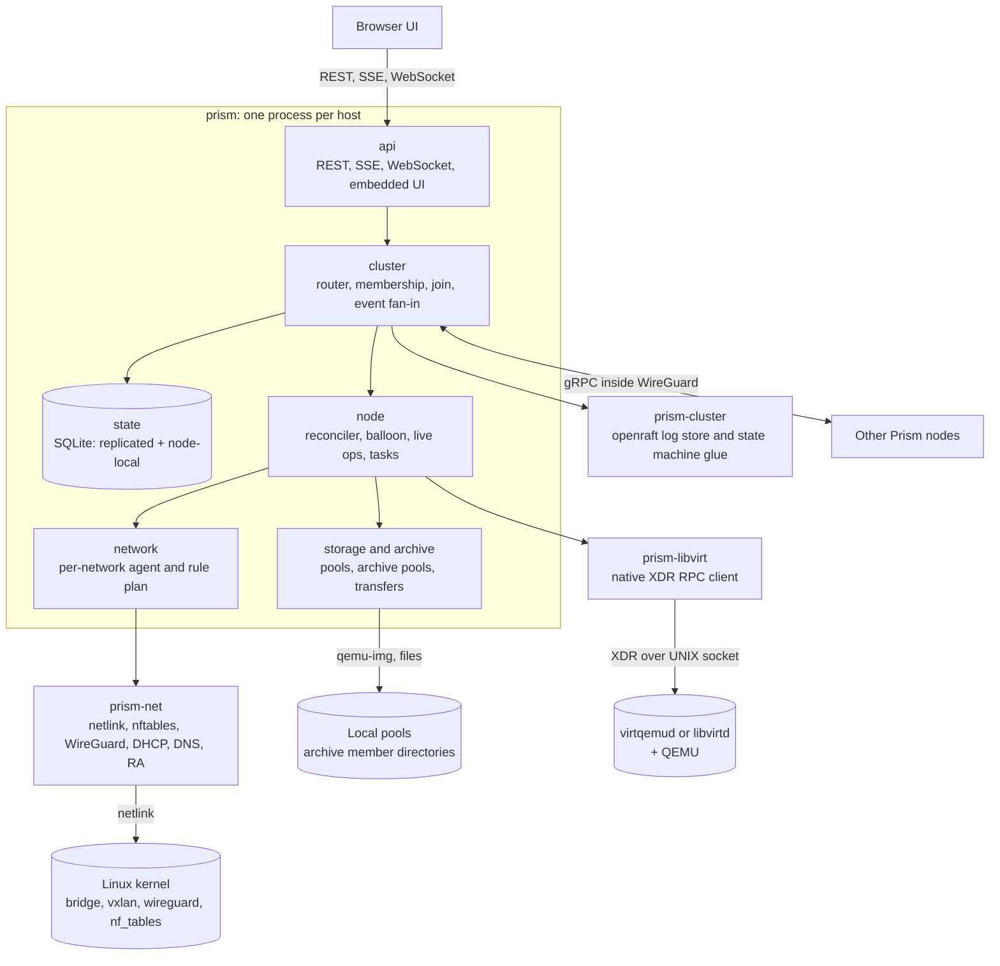
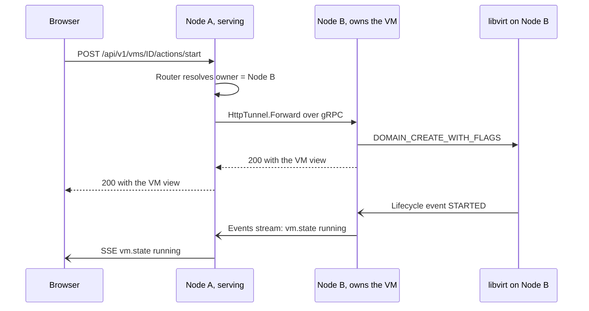
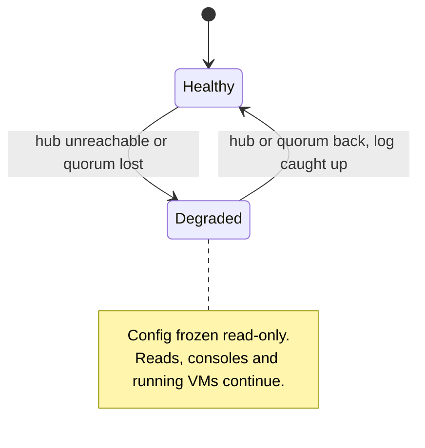
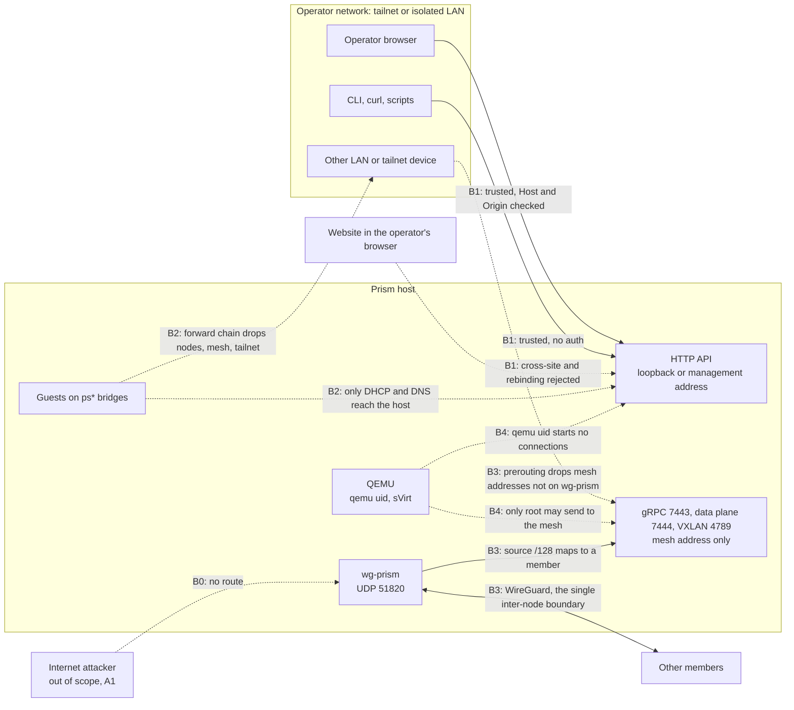
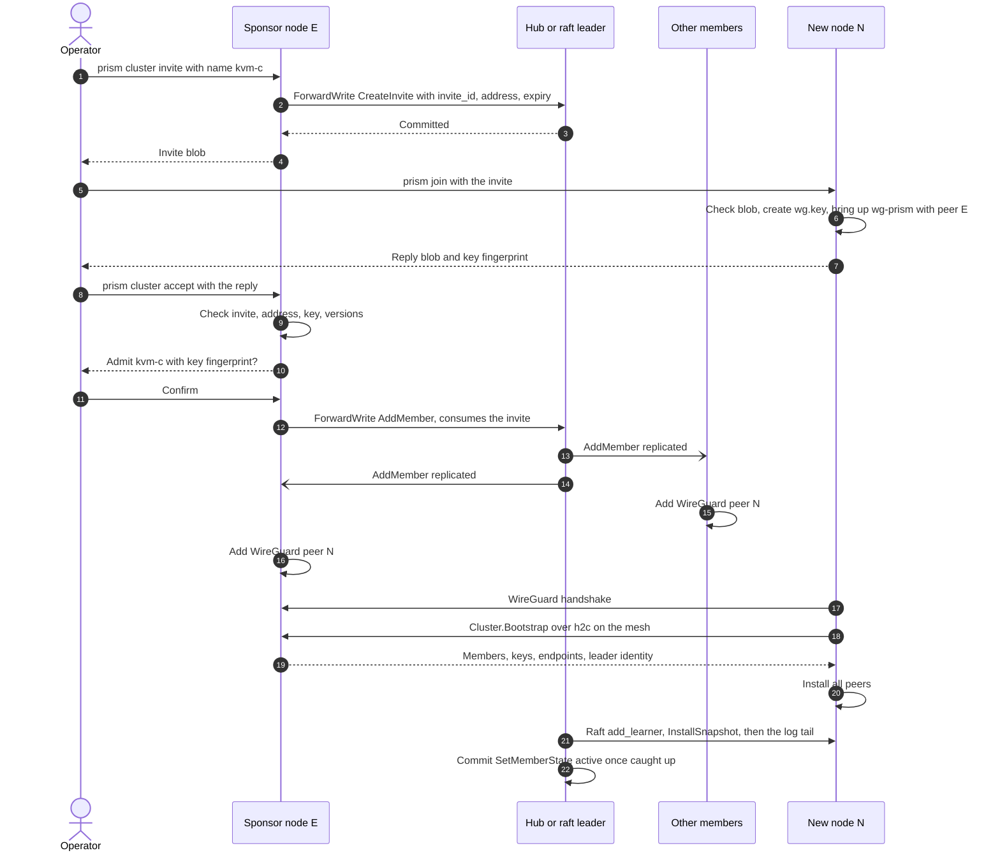
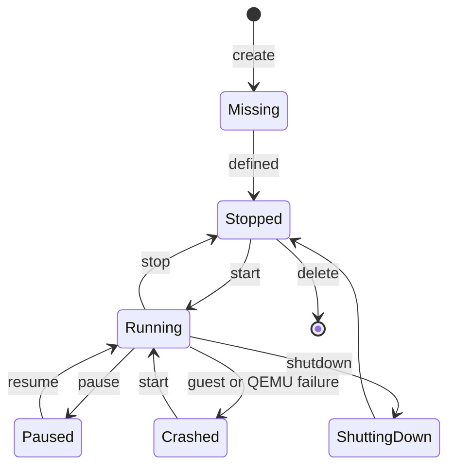
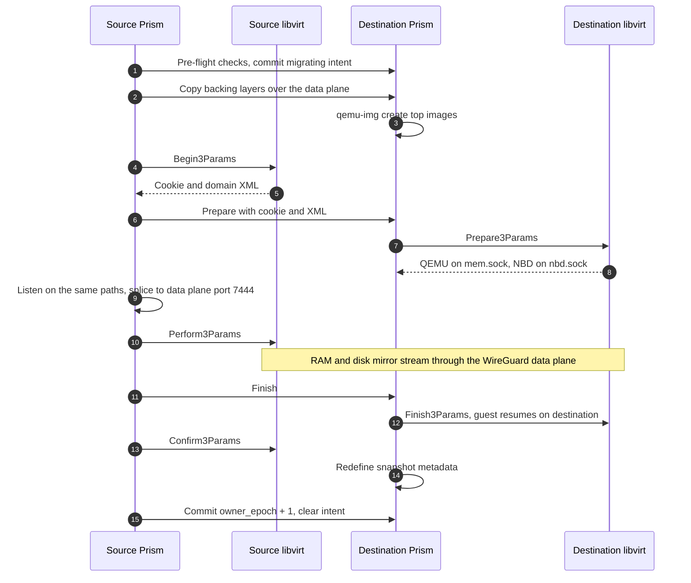
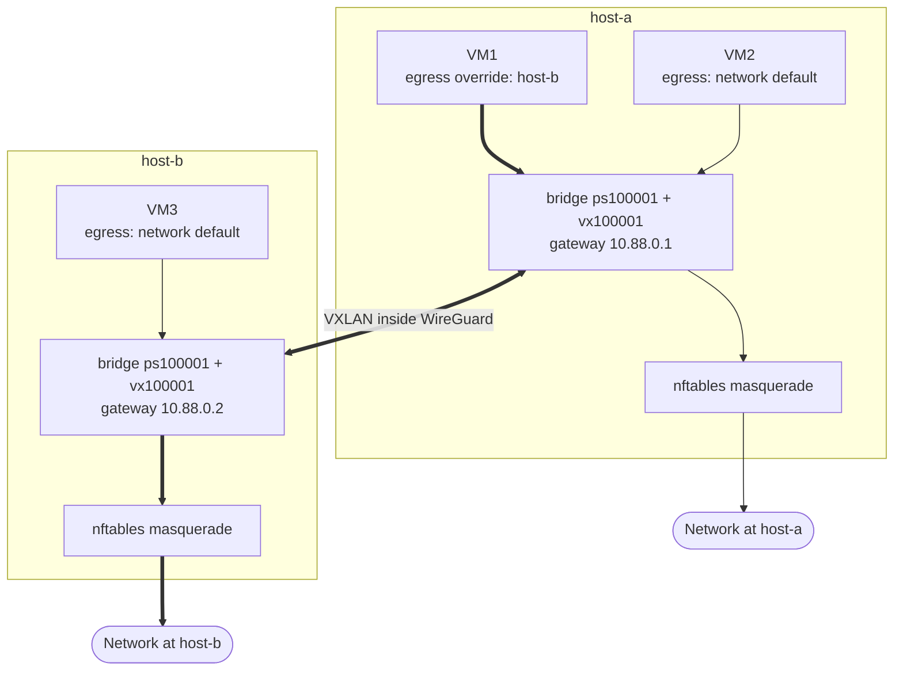
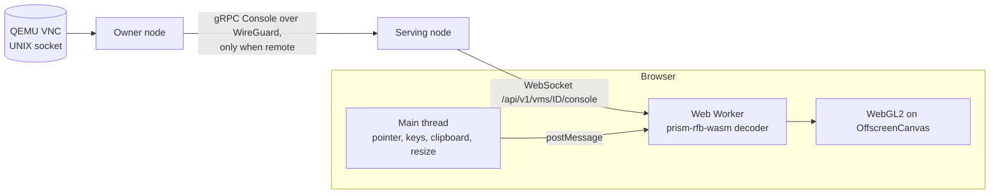
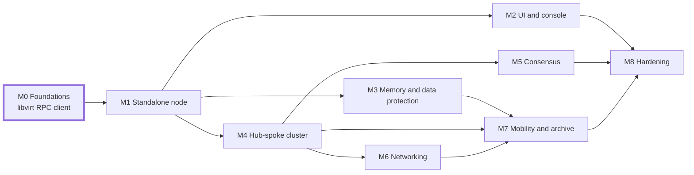

# Prism: design

Version 0.1.0, updated 2026-10-16. This document describes the code as built. The HTTP routes are listed in [API.md](API.md), and the task-oriented user guide is in [guide/](guide/README.md).

## Contents

1. [Summary, goals and non-goals](#summary-goals-and-non-goals)
2. [System architecture](#system-architecture)
3. [Dependency strategy and static build](#dependency-strategy-and-static-build)
4. [Config directory and persistence](#config-directory-and-persistence)
5. [Clustering](#clustering)
6. [Threat model and security](#threat-model-and-security)
7. [Inter-node transport and security](#inter-node-transport-and-security)
8. [VM lifecycle and memory ballooning](#vm-lifecycle-and-memory-ballooning)
9. [Storage](#storage)
10. [Live operations](#live-operations)
11. [Networking](#networking)
12. [HTTP API and SSE event stream](#http-api-and-sse-event-stream)
13. [Web UI](#web-ui)
14. [Build, testing and quality](#build-testing-and-quality)
15. [Implementation milestones](#implementation-milestones)
16. [Known limitations](#known-limitations)

## Summary, goals and non-goals

Prism is one Rust binary, `prism`, that runs on every KVM host. It talks to the local libvirt daemon over libvirt's own RPC protocol, implemented natively in Rust, so the libvirt C library is never linked. Each node serves a REST and SSE API and an embedded React and Tailwind web UI. Clustered nodes talk plaintext gRPC inside an IPv6 WireGuard mesh, which is the only trust boundary between nodes.

The non-goals are authentication, users, HTTP TLS termination and HTTP load balancing. Every HTTP request is trusted. Guests and websites are not trusted clients; see [Threat model](#threat-model-and-security).

Decisions that shaped the build:

- The `virt` crate links C libvirt, glib, gnutls and libxml2, so Prism has its own RPC client, `prism-libvirt`.
- QEMU's VNC server never sends H.264, so the console decodes VNC in the browser with a Rust WASM module.
- libvirt networks (dnsmasq) and libvirt storage drivers are host-local and depend on external binaries, so Prism embeds DHCP, DNS and NAT and manages volumes itself with `qemu-img`.
- Inter-node gRPC runs in plaintext inside WireGuard instead of TLS (owner decision, 2026-10-15). No release shipped the TLS design.
- Port forwards on Prism networks are nftables DNAT. `passt` is an opt-in for user-mode NICs only.
- Clusters use one replicated SQLite state machine under openraft, in hub-spoke or consensus mode.
- Bridged switches, the host-bridge wizard, LVM and ZFS pools, scheduled backups and resumable (tus) uploads from the original plan were not built. Existing host bridges attach to a VM as plain NICs, and uploads are single streamed requests.

### Requirements traceability

| Requirement | How it is met | Section |
| --- | --- | --- |
| Static binary, almost any modern Linux | musl and cargo-zigbuild; SQLite is the only C library Prism compiles itself | Dependencies |
| React and Tailwind web UI, accelerated console | Rust to WASM RFB decoder in a worker, WebGL2 on OffscreenCanvas | Web UI |
| Full API with SSE, no polling | `/api/v1` REST, snapshot-then-stream SSE with replay | API |
| Optional clustering, any node serves any request | Ownership router forwards over gRPC; cluster-wide event fan-in | Clustering |
| Memory ballooning | virtio-balloon with free page reporting and a PSI-driven auto loop | VM lifecycle |
| File-level archive load balancing | Archive pools place whole files by weighted free space | Storage |
| gRPC and Protobuf between nodes | Plaintext h2c gRPC inside the `wg-prism` mesh (replaces the TLS requirement) | Transport |
| Portable config dir as argument | `prism serve --config <dir>`; copy the dir and pass `--adopt` to move a node | Config |
| Easily move VMs and files | Live migration, cold move, archive drain and replicas | Live ops, Storage |
| Storage and pools managed in UI | Storage and Archive pages | Web UI, Storage |
| Move and snapshot without downtime | Managed migration (300 ms maximum pause), live external snapshots, push-mode backups | Live ops |
| Host and bridge networking | NAT and isolated Prism networks; existing host bridges and user-mode NICs attach directly | Networking |
| Cluster virtual switch with remote egress | VXLAN overlay inside WireGuard; egress node per network and per NIC | Networking |
| Internal VM-to-VM switches | Isolated networks, VLAN access and trunk ports, VLAN subnets | Networking |
| Idiomatic Rust, 0 clippy warnings | `clippy -D warnings` over the workspace, pedantic lints on | Build |
| Few non-pure-Rust crates, no OpenSSL | SQLite and ring (through rustls, for URL downloads) are the only C code; no OpenSSL | Dependencies |
| Hub-spoke and consensus clusters, degraded spokes | Single-voter raft with learners, or 3 or 5 voters; changes refused while degraded | Clustering |
| Disks local to the VM's host | Ownership invariant; migration copies disks over NBD | Storage, Live ops |
| Backups on any node, for any VM | Backups stream into any archive pool | Storage, Live ops |
| No auth on a private network (non-goal) | Two boundaries: WireGuard between nodes, the operator network for HTTP | Threat model |
| Copy-paste cluster join | Two secret-free text blobs: an invite from any member, a reply from the new node | Transport |

## System architecture

Prism is a single process on a tokio runtime, built from one Cargo workspace. Every node runs the same binary; cluster role is data, not a build option. The `prism` crate holds the API, the node logic, the state machine and the network agent as modules. Protocol, kernel and consensus plumbing live in separate library crates.



Any node can serve any request. The router resolves which node owns the target and forwards the call there; events flow back so every node's SSE stream sees the change.



| Crate | Role |
| --- | --- |
| `prism-libvirt` | Async libvirt RPC client: XDR types, framing, serial dispatch, keepalive, events, streams. `build.rs` generates the procedure-number constants from the vendored `remote_protocol.x` with `quote` |
| `prism-proto` | `prism.proto` compiled with tonic-prost-build and protox (no protoc) |
| `prism-cluster` | openraft log store (`raft.db`), state machine adapter and network types |
| `prism-net` | Netlink links, bridges, VXLAN, FDB and VLANs; the nftables layer; WireGuard keys and devices; embedded DHCP, DNS and router advertisements |
| `prism-iso` | ISO 9660 writer with Joliet for cloud-init seed images |
| `prism-rfb-wasm` | Rust to WASM VNC (RFB) decoder used by the browser console |
| `prism` | The binary and its modules: `api`, `node`, `state`, `cluster`, `network`, `storage`, `archive`, `tasks`, `events`, `fetch`, `render`, `spec`, `cli` |
| `web` (`prism-web`) | React, TypeScript, Vite and Tailwind UI; its `build.rs` builds the WASM decoder and the UI and embeds both |
| `xtask` | `cargo xtask testbed`: nested-VM Prism nodes on the local libvirt |

The command line has `init`, `serve [--adopt]`, `doctor`, `join <invite>`, `leave [--force]` and `cluster` with `init`, `status`, `invite`, `accept`, `remove`, `promote` and `removed`. The cluster, join and leave subcommands call the running daemon over loopback HTTP.

Local requests go through the `node` module to `prism-libvirt` and the libvirt daemon. Requests for another node's resources are forwarded over gRPC to the owner and run through the same handlers there. libvirt domain events, task progress and state changes enter a per-node event bus. Each node subscribes to every peer's bus, so any node's SSE stream covers the whole cluster.

## Dependency strategy and static build

Prism builds as a static musl binary. SQLite (through `rusqlite` with `bundled`) is C code compiled by the build. rustls with the ring provider, used for HTTPS downloads from a URL, brings ring's C and assembly. Nothing links OpenSSL, native-tls or libvirt. The README gives the cargo-zigbuild commands and the `readelf -d` check that shows no `NEEDED` entries.

### Reaching libvirt without linking it

`prism-libvirt` speaks libvirt's remote RPC protocol (XDR frames over the local UNIX socket) directly, as the pure-Go `go-libvirt` does.

- Only the `remote` program (version 1) and the keepalive program are implemented, and only the procedures Prism uses. The XDR types are written by hand in `proto.rs`, `typed.rs` and `xdr.rs`. The `build.rs` generates only the `REMOTE_PROC_*` constants, so the list cannot drift from the vendored protocol file.
- Frames carry a length and a header (`prog, vers, proc, type, serial, status`). One reader task dispatches replies by serial, so a long call such as `Perform3` runs while `GetJobStats` and `AbortJob` proceed.
- A background task pings the daemon every 30 seconds and closes the connection after 120 seconds of silence. Prism reconnects with backoff (1 s up to 30 s), re-registers event callbacks and reconciles.
- With `libvirt.socket = "auto"` Prism tries `/run/libvirt/virtqemud-sock`, then `/run/libvirt/libvirt-sock`. It uses only the QEMU driver, so it never needs virtnetworkd or virtstoraged.
- Prism runs as root and connects without authentication. A daemon that requires SASL fails the connection.
- The registered events are lifecycle, block job, job completed, balloon change, device removed, agent lifecycle and migration iteration.

libvirt maintainers call this protocol private, but procedures are only ever appended. Prism requires libvirt 8.0 or later. Features that need more are gated on the version at run time: external snapshot revert and delete need libvirt 9.9.

### Crates

| Crate | Purpose | C code |
| --- | --- | --- |
| tokio, tokio-util, tokio-stream, bytes, futures | Runtime and codecs | No |
| axum, tower-http, rust-embed (in `prism-web`) | REST, SSE, WebSocket, embedded UI | No |
| tonic 0.14 (no TLS features), tonic-prost, prost, protox | gRPC (h2c) without protoc | No |
| rusqlite (`bundled`) | Local and replicated state | SQLite amalgamation, static |
| openraft 0.9 | Consensus and hub-spoke replication | No |
| rtnetlink, netlink-packet-route, netlink-packet-wireguard, genetlink | Bridges, VXLAN, FDB, VLANs, WireGuard | No |
| quick-xml, serde, serde_json, toml, ciborium | Domain XML, documents, config, join blobs | No |
| blake3 (`pure`), sha2 | File checksums, download checksums | No |
| x25519-dalek, getrandom | WireGuard key generation and public-key derivation | No |
| dhcproto, hickory-proto | Embedded DHCP and DNS | No |
| rustls (ring provider), tokio-rustls, webpki-roots | HTTPS downloads from a URL | ring: C and assembly |
| rustix | Sockets, `openat2`, `renameat2`, statx | No |
| clap, anyhow, thiserror, uuid, tracing, base64, ipnet, socket2, zeroize | Basics | No |

Prism uses the system allocator. There is no mimalloc.

### Build and enforcement

- The workspace sets `unsafe_code = "forbid"` and enables clippy `all` and `pedantic`. `prism-rfb-wasm` uses `deny` so its WASM export module can allow `#[unsafe(no_mangle)]`.
- The release profile is `lto = "fat"`, `codegen-units = 1`, `panic = "abort"`, `strip = true`.
- The `readelf` check in the README is manual. The repository has no CI configuration and no cargo-deny file.

### Host prerequisites

`prism doctor` checks the libvirt connection and version, `/dev/kvm`, `qemu-img`, the optional `passt` and `ip` programs and the pools in `prism.toml`. It prints a hint for each warning. It does not check kernel modules, IPv6, PSI, `qemu.conf` or directory ownership.

| Requirement | Standalone | Clustered |
| --- | --- | --- |
| libvirt 8.0 or later, QEMU, `qemu-img` | Yes | Yes |
| Kernel with openat2 (5.6 or later) | Yes | Yes |
| Modules: bridge, vxlan, tun, vhost_net, nf_tables (with nat, masq, ct) | Yes | Yes |
| Module: wireguard | No | Yes |
| IPv6 enabled in the kernel (the mesh is IPv6) | No | Yes |
| PSI (`/proc/pressure/memory`) | Optional | Optional |
| Root | Yes | Yes |

The mesh does not need IPv6 forwarding, and the boundary rules hold when forwarding is on. IPv6 networks and NAT66 turn it on.

## Config directory and persistence

The config directory, passed as `prism serve --config <dir>`, is the node's identity: copying it to new hardware moves the node. Only bootstrap settings are hand-edited; everything else is desired state changed through the API. The directory is 0700, and Prism runs with `umask 0077`.

```text
<config>/
  prism.toml          # node-local bootstrap only (operator-edited)
  wg/                 # wg.key (0600), the node's only secret; clustered nodes only
  data/
    identity          # node ID and the machine ID of the host
    state.db          # replicated state machine (SQLite, WAL)
    raft.db           # raft log and vote (absent when standalone)
    node.db           # node-local: tasks
  run/prism.lock      # flock; refuses a second instance
```

`prism.toml` sections are `[node]`, `[http]`, `[libvirt]`, `[storage]`, `[cluster]`, `[pools.<name>]` and `[archive_members.<name>]`. Unknown keys are an error.

```toml
[node]
name = "kvm-a"

[http]
listen = ["127.0.0.1:8080"]   # default; use tailscale serve or a management address, never 0.0.0.0
allowed_hosts = ["kvm-a.example.ts.net"]   # IP literals, localhost and the hostname are always allowed
allowed_origins = []

[libvirt]
socket = "auto"          # virtqemud-sock, then libvirt-sock
uri = "qemu:///system"
domain_type = "auto"     # kvm when /dev/kvm exists, else qemu (TCG)
job_stall_timeout_secs = 300   # abort a snapshot, revert or migration that makes no progress this long; 0 = never

[storage]
pool_roots = ["/var/lib/prism/pools"]   # where the API may create pools

[cluster]               # topology, mesh prefix and wg-prism MTU live in the replicated state
advertise = ["192.168.10.11", "100.101.102.103"]   # underlay endpoints, preference order
wireguard_port = 51820

[pools.default]         # local VM disk pool
type = "dir"
path = "/var/lib/prism/pools/default"
format = "qcow2"

[archive_members.a1]    # contributes a directory to a cluster archive pool
pool = "archive"
path = "/srv/archive"
weight = 1.0
reserve = "50GiB"
```

| Data | Location | Changed by |
| --- | --- | --- |
| Listen addresses, libvirt socket, local pool and archive-member paths, advertised endpoints | `prism.toml` | Operator |
| Cluster mode, membership, mesh prefix, MTU, feature level | `data/state.db` | `prism cluster …`, `prism join` |
| VMs, networks, IPAM, archive pools and file index, backups, invites, tombstones | `data/state.db` (replicated) | API |
| Tasks (kept 7 days) | `data/node.db` | Prism |
| Raft log | `data/raft.db` | Prism |

Cluster mode is never in the toml, so the toml and the stored state cannot disagree. Schema changes run as forward-only SQLite migrations, keyed by `user_version`, at startup. The SSE replay ring is in memory only.

Prism records the machine ID of the host in the config directory. On a mismatch it refuses to start unless run with `--adopt`, so a copied directory cannot run as two nodes by accident.

## Clustering

All modes share one replicated-state engine; they differ only in who may vote. Every config write is a `Command` (a serde enum, carried as JSON) applied deterministically to `state.db`. A node that is not the writer sends the command to the hub or raft leader with the `Cluster.ForwardWrite` gRPC call and waits until its own state machine has applied the log index the leader returns.

| Mode | Voters | Other nodes | Writes go to |
| --- | --- | --- | --- |
| Standalone | None; commands apply directly | none | Local node |
| Hub-spoke (`hub_spoke`) | The hub only | Spokes, as raft learners | Hub |
| Consensus (`consensus`) | 1, 3 or 5 members (1 only while setting up) | Extra nodes, as learners | Raft leader |

The mode is chosen with `prism cluster init [--consensus]` and does not change afterwards. Hub-spoke is a single-voter openraft group, so a spoke that falls behind log compaction receives `InstallSnapshot`, then the tail. Every node, including the hub, runs VMs. Clustering requires the WireGuard mesh described under [Transport](#inter-node-transport-and-security). Membership is full trust: any member is root on every member, and removal is the containment control.

### Desired vs runtime state

The replicated (desired) state is VM specs with their owner `(node, owner_epoch)` and any migration intent, networks with their VNIs and IPAM leases, archive pools, members and file index, backups, cluster members (mesh address, WireGuard public key, state), the cluster `wg-prism` MTU and feature level, open invites, and tombstones `{node_id, wg_pubkey, mesh_addr}`.

The node that owns a resource is authoritative for its runtime state: power state, stats, pool usage and task progress. These never enter raft. Each node subscribes to every peer's `Events` stream, which starts with a runtime snapshot and continues with events, and keeps an in-memory cluster view from them.

VM writes carry the `generation` the client read. A mismatch is refused with 409 (`vm <id> is at generation <n>, not <m>`). Other resources have no revision check.

### Degraded mode

A node is degraded when it sees no leader: a spoke that cannot reach the hub, or a consensus cluster that lost its majority. Config freezes at the last applied state. Every API response carries `X-Prism-Degraded: true`, and any change that must commit to the replicated state fails with 503 `cluster_degraded` (retryable). Reads, consoles and the VMs themselves keep working. The reconciler does not quarantine VMs while the node is degraded, because ownership is frozen.



### Changing the hub

`prism cluster promote <node>` (API `POST /cluster/hub`, also offered by the Leave card in the UI) adds the target as a voter, then removes the old hub's vote, which leaves the old hub as a spoke. These are two membership changes with no data loss. The command waits up to 30 seconds for the new hub to take over. Consensus clusters have no hub; `POST /cluster/members/{node}/voter` changes the voter set, which must stay at 1, 3 or 5.

A hub that is dead and will not return cannot be replaced: there is no forced promotion or quorum recovery. See [Known limitations](#known-limitations).

### Any node serves any request

A middleware in front of the API resolves the owner of each request and forwards it when the owner is another node.

| Request | Owner |
| --- | --- |
| `/vms/{id}/…`, `POST /vms?node=<id>` | The VM's node, or the named node |
| `/nodes/{id}/…` other than `local` | That node |
| `/tasks/{id}` | The node running the task |
| Config write (any change to replicated state) | Hub or raft leader, through `ForwardWrite` |
| Archive file read or write | The handler picks a replica holder or the placed member and forwards there itself |

REST calls are forwarded verbatim over `HttpTunnel.Forward` and run through the owner's own handlers. A forwarded request carries an internal marker, so the owner never forwards it again. WebSocket upgrades are not forwarded by the middleware: console and serial streams are tunnelled over the bidirectional `Console` gRPC stream. A missing owner answers 404 `no_such_node`, and an unreachable one 502 `owner_unreachable`.

### Cluster-wide events

Each node subscribes to every active peer with `Events.Subscribe`. The peer sends a runtime snapshot first, then its own events (events it relayed from others are not repeated). The subscriber applies them to its caches and republishes them on its own bus with the original `origin_node`. A broken stream is retried with backoff and starts again from a fresh snapshot; the `since` field is not used.

### A VM never runs on two nodes

1. A node defines and starts a VM only if committed state names it as the owner. `autostart` is handled by Prism after libvirt connects; libvirt autostart is never used.
2. A cold move increments `owner_epoch` for the destination in the same command that hands the VM over.
3. A live migration first commits a `migrating {src, dst}` intent on the VM, which stops either node from quarantining the domain. After `Confirm3` Prism commits the destination as owner with `owner_epoch + 1` and clears the intent.
4. When Prism connects to libvirt, and after a reconnect, the reconciler defines every VM the node owns and stops and undefines (keeping the disks) any Prism VM that committed state gives to another node and no migration intent covers. It skips the quarantine step while degraded.
5. If a migration fails after the destination may already run the guest, the source is never resumed.

## Threat model and security

Prism has two trust boundaries: the `wg-prism` WireGuard mesh between nodes, and the operator's access-controlled network for HTTP. Prism adds no authentication, no user accounts and no PKI. Kernel-level rules stop guests, websites and LAN devices from passing as the parties those boundaries trust.

### Assumptions

| ID | Assumption | Consequence |
| --- | --- | --- |
| A1 | Prism runs only on an access-controlled network, such as a Tailscale tailnet or an isolated LAN. No Prism port, HTTP or otherwise, is reachable from the internet. | Internet attackers are out of scope. Tailnet ACLs or LAN firewalls are the HTTP access control. |
| A2 | Every HTTP request from the operator network is trusted. | No auth, users, multi-tenancy, HTTP TLS or HTTP load balancing. Any operator-network device can admit a node. |
| A3 | Member hosts are dedicated hypervisors. Local root is fully trusted. | Untrusted local accounts are unsupported. The qemu uid is the only untrusted local principal. |
| A4 | Guests, guest workloads and websites are not part of the trusted network. | Prism keeps them from reaching the API and the mesh, even though guests run on every host. |
| A5 | Cluster membership is all-or-nothing. | A member is root on every member. Removal is the containment control. |

### Assets

| Asset | Where | Why it matters |
| --- | --- | --- |
| HTTP API | Every node; `127.0.0.1:8080` by default | Full control of every VM and, through host paths, root on every host |
| Membership (WireGuard peer set) | Replicated state, `wg-prism` | One admitted key is root everywhere |
| `wg.key` | `<config>/wg/wg.key`, 0600 | The node's mesh identity and the only secret Prism stores |
| Desired state, including cloud-init user-data | `state.db`, `raft.db` on every node | Guest passwords and keys |
| VM disks, RAM and backups | Local pools, archive members, the data plane in flight | Guest data; backups land on any node |
| Network isolation | `ps*` bridges, VXLAN VNIs | L2 separation between networks |
| Host files and devices | Root-owned paths | Prism runs as root |

### Actors

| Actor | Trust | Reaches |
| --- | --- | --- |
| Operator (browser, CLI, curl) | Trusted (A2) | HTTP API |
| Other tailnet or LAN device | Trusted for HTTP (A2), not a member | HTTP API if routed, UDP 51820, any host address |
| Website open in the operator's browser | Untrusted | HTTP API through the browser |
| Guest VM or its workload | Untrusted (A4) | Gateway addresses, DHCP, DNS, masqueraded egress; console, serial, agent and balloon output |
| Escaped QEMU (qemu uid, sVirt) | Untrusted | Loopback, local sockets, its own image files, the host's mesh source address |
| Member node | Fully trusted (A5) | Every gRPC service |
| Joining node | Trusted after `active` | `Cluster.Bootstrap` and `Cluster.Status` only |
| Removed member or holder of a stolen `wg.key` | Untrusted | UDP 51820 |
| Internet attacker | Out of scope (A1) | Nothing |

### Trust boundaries

Solid edges are allowed. Dashed edges are blocked.



| Boundary | Between | Enforced by |
| --- | --- | --- |
| B0 Internet | The internet and everything | A1. Nothing in Prism checks it; the default listen address is loopback |
| B1 HTTP | Operator network and the API | Loopback default or explicit management address; Host allowlist; Origin and `Sec-Fetch-Site` checks |
| B2 Guest | Guest bridges, the host and the operator network | `inet prism` input and forward chains; `bridge prism` table |
| B3 Mesh | Members and everything else | WireGuard cryptokey routing; prerouting interface rule; forward drop on `wg-prism`; source /128 mapped to member and state |
| B4 Local process | QEMU and Prism's services | sVirt and seccomp (libvirt's defaults); output rules on socket uid |

### Scope

| Item | In scope | Reason |
| --- | --- | --- |
| Guests reaching the API, mesh or operator network | Yes | A4: guests are untrusted and Prism builds their networks |
| Websites driving the API through an operator's browser | Yes | The request comes from outside the trusted network |
| LAN or tailnet devices spoofing mesh or VXLAN traffic, directly or through a forwarding node | Yes | A1 trusts them for HTTP, not as members |
| Escaped QEMU reaching Prism services or host files | Yes | QEMU runs non-root; Prism must not hand it root |
| Join blob leakage | Yes | Blobs travel through chat and logs |
| Removed node returning; stolen `wg.key` | Yes | The peer set is the whole credential |
| Root file handling: paths and image headers | Yes | Prism runs as root |
| Guest resource abuse: disk, memory, agent, floods | Partly | The balloon bounds guest memory and archive member reserves bound archive disk use; there are no per-guest rate limits |
| Internet attacker on any port | No | A1: never exposed |
| Misuse by anyone on the trusted network, including admitting a node or altering a pasted blob | No | A2: every request reaching Prism is trusted; use tailnet ACLs |
| Authentication, users, multi-tenancy, HTTP TLS, load balancing | No | A2: non-goals by requirement |
| A compromised member acting as root | Accepted | A5: removal contains it |
| Untrusted non-root local users on a member host | No | A3. The output rules still block non-root sockets toward the mesh |
| Strong isolation between guests on one network | No | No multi-tenancy. The `bridge prism` rules still apply |
| Physical theft of disks | No mechanism | No Prism crypto at rest; use LUKS |
| Post-quantum recording of mesh traffic | No | No WireGuard PSK |

### Threats

The status column says what the code does today: Implemented, Partial (with the gap named), Not implemented, or Accepted.

| ID | Threat | Boundary | Mitigation | Status |
| --- | --- | --- | --- | --- |
| S1 | A guest calls the API at its gateway address or any host address (weak-host model) | B2 | `inet prism` input: from `ps*` accept only UDP 67, UDP and TCP 53 to the gateway address, ICMP echo, ICMPv6 neighbour discovery and established traffic, then drop. HTTP defaults to `127.0.0.1:8080` | Partial: Prism does not refuse a `listen` address on a guest bridge, and `doctor` does not test it |
| S2 | A guest reaches other nodes' APIs or tailnet devices through masquerade | B2 | The forward chain drops `ps*` traffic to the mesh /48, `100.64.0.0/10`, `fd7a:115c:a1e0::/48` and the members' advertised and HTTP addresses. Masquerade only out of the uplink. Per-network `allow_prefixes` (IPv4) opts back in | Implemented |
| S3 | A guest NIC on a host bridge sits on the management LAN | B1, B2 | The operator picks the bridge. Prism lists host bridges and attaches to the one named | Accepted: no warning or refusal |
| S4 | A LAN device, tailnet device or guest injects VXLAN through UDP 4789 | B3 | Prerouting: `udp dport 4789 iifname != "wg-prism" drop` | Implemented, covered by netns tests of the ruleset |
| S5 | A LAN or tailnet device spoofs a member's mesh address, directly or through a node with IPv6 forwarding | B3 | Prerouting drops mesh-prefix source or destination unless the packet arrives on `wg-prism` or `lo`. Forward drops everything entering or leaving `wg-prism` | Implemented |
| S6 | A non-root local process or escaped QEMU sends gRPC, data-plane or VXLAN traffic to a peer from the node's mesh address | B4 | Output: `ip6 daddr <mesh>/48 meta skuid != 0 drop`, except ICMPv6 echo on `wg-prism`. Kernel VXLAN and WireGuard packets have no file-backed socket and are unaffected | Implemented |
| S7 | An escaped QEMU reaches the API on loopback or a management address | B4 | Output: `meta skuid <qemu uid> ct state new drop`. The uid is the `libvirt-qemu` or `qemu` user in `/etc/passwd`; the rule is left out when neither exists | Partial: no check of `qemu.conf` (`user`, `security_driver`, `seccomp_sandbox`) |
| S8 | A website sends cross-site writes, opens console or serial WebSockets, or uses DNS rebinding | B1 | Host allowlist (421); Origin or `Sec-Fetch-Site` check on writes and WebSocket upgrades; `application/json` or `application/octet-stream` required on writes (415); `X-Forwarded-Host` checked as the Host | Implemented. Reads, including SSE, are not origin-checked |
| S9 | XSS or clickjacking through guest-controlled strings | B1 | `index.html` carries a CSP with `frame-ancestors 'none'`, `object-src 'none'` and `script-src 'self' 'wasm-unsafe-eval'`, plus `X-Frame-Options: DENY`. The UI is React, which escapes text | Partial: no lint ban on `dangerouslySetInnerHTML` |
| S10 | Stored XSS from an archive file served inline | B1 | Downloads carry `Content-Disposition: attachment`, `nosniff` and `Content-Security-Policy: sandbox` | Implemented |
| S11 | Guest terminal or RFB abuse: clipboard writes, huge framebuffers | B1 | The terminal loads no clipboard addon. The decoder caps the framebuffer at 8192x8192 | Partial |
| S12 | Path traversal, symlinks or option injection in pool, archive, upload or volume names | Root files | `openat2` with `RESOLVE_BENEATH` and related flags from root fds in pools and archive members; `renameat2(RENAME_NOREPLACE)` for commits. Names match `[A-Za-z0-9._-]` with no leading `-` or `.`. Children get an argv list, never a shell | Implemented |
| S13 | An escaped QEMU swaps a checked image path for a symlink before `qemu-img` opens it | B4 | `qemu-img` runs on paths inside Prism's pool directories; it does not receive file descriptors | Not implemented |
| S14 | A malicious qcow2 header (backing file, data-file) from an upload or an escaped QEMU | B4 | `qemu-img` always gets `-f` and `-F`. Backing files outside the pool, over-deep chains and unflattened imports are refused | Partial: no rlimits on `qemu-img` |
| S15 | A guest spoofs other guests on a shared network: rogue DHCP, RA, ARP, MAC spoofing, VLAN tags | B2 | `bridge prism`: per-tap MAC binding, IPv4 and ARP source bound to the lease (`0.0.0.0` allowed for DHCPDISCOVER), IPv6 source and neighbour messages bound to the NIC's SLAAC and learned addresses and its MAC, drop UDP source ports 67 and 547 and ICMPv6 type 134 (also on tagged frames of trunks), drop tagged ingress on access ports | Implemented. No per-NIC opt-out for router VMs |
| S16 | A guest abuses embedded DNS: open resolver, tailnet name recon | B2 | DNS sockets are bound to the bridge with `SO_BINDTODEVICE`. `ts.net` names are never forwarded | Partial: no per-guest rate limits |
| S17 | A guest abuses the balloon or agent | B2 | Auto-ballooning is bounded by host pressure; a VM that misses its target for 6 ticks is flagged unresponsive. Agent data is used only for display. A quiesced snapshot retries without quiesce if the agent fails | Partial: no local pool reserve or ENOSPC alert |
| S18 | A local process hijacks migration splice sockets | B4 | The sockets live under `/run/prism/mig/<id>/`. The directory and sockets are mode 0777 so that QEMU's uid can reach them | Not implemented: no `SO_PEERCRED` check or 0700 directory |
| S19 | A device on the operator network creates and accepts its own invite | B1 | Accepted (A2): it could call any other API too | Accepted |
| S20 | A blob leaks through chat or logs | B1 | Neither blob holds a secret. An invite is single-use, expires after 1 hour by default (7 days at most) and is consumed on accept | Implemented |
| S21 | A joining node uses services before it is confirmed | B3 | A `joining` member may call only `Cluster.Bootstrap` and `Cluster.Status` | Implemented |
| S22 | A removed node returns, or a member that was offline during the removal still trusts it | B3 | Peers come only from committed state. Tombstones block reuse of keys, node IDs and addresses. `prism cluster removed` lists members that have not applied the removal | Partly accepted: the window until a lagging member catches up remains |
| S23 | A stolen `wg.key` | B3 | `umask 0077`; config dir 0700; `wg.key` created 0600. Response: remove, `prism leave --force`, re-invite | Partial: no check of `wg.key` permissions at start |
| S24 | A compromised member | B3 | Accepted (A5). `prism cluster remove` | Accepted |
| S25 | An eavesdropper or tamperer on the underlay | B3 | WireGuard: ChaCha20-Poly1305, Curve25519 peers, replay counters, 2-minute rekey | Implemented by WireGuard |
| S26 | Secrets in cloud-init | Data | The API returns a `blake3:` hash in place of user-data. The seed ISO is a hidden volume in the pool. User-data is in replicated state, visible to every member | Partial |
| S27 | Disks at rest on any node | Data | Use LUKS | Not implemented |
| S28 | A replica altered on one archive member | Data | The BLAKE3 in the replicated index is the trust anchor, checked by scrub and before an archive ISO is attached or a backup is restored | Implemented |
| S29 | Resource exhaustion through uploads, SSE or tasks | B1 | Uploads stream to disk without a reservation. SSE subscribers have bounded queues, and a slow one gets `reset` | Partial: no connection caps |
| S30 | A compromised build dependency | Build | `Cargo.lock` and `bun.lock` are committed and the build uses frozen installs | Partial: no CI, cargo-deny or attestation |

### Hardening defaults

- HTTP listens on `127.0.0.1:8080` unless configured. Remote access uses `tailscale serve`, an SSH tunnel or an explicit management address.
- One middleware enforces the Host allowlist, the Origin and `Sec-Fetch-Site` checks and the write content types.
- `inet prism` prerouting accepts mesh addresses and VXLAN only on `wg-prism` (and `lo` for mesh addresses). Forward never routes into or out of `wg-prism`.
- `inet prism` output lets only root sockets reach the mesh, and the qemu uid starts no connections.
- Guest bridges reach only DHCP, DNS and ND on the host. The forward chain keeps guests away from nodes, the mesh and the tailnet.
- `bridge prism` binds each tap to its MAC and lease, and drops rogue DHCP, RAs and tagged ingress on access ports.
- `openat2` confinement and argv-only children.
- `umask 0077`, a 0700 config dir, and `wg.key` as the only secret.
- Downloads are attachments with `nosniff` and a sandbox CSP.

## Inter-node transport and security

Clustering requires a kernel WireGuard mesh, `wg-prism`, and it is the only trust and encryption boundary between nodes. gRPC, the bulk data plane and the VXLAN overlay run in plaintext inside it. Standalone nodes need none of this.

This replaces the original requirement "gRPC over a TLS socket (self-signed cert)". WireGuard already provides AEAD confidentiality and integrity, mutual authentication, replay protection and forward secrecy. Dropping TLS removed the cluster CA, node certificates, renewal, revocation and the public join port. The only TLS client left in Prism is the one for HTTPS downloads from a URL.

### Layers

| Layer | Carries | Port | Protection |
| --- | --- | --- | --- |
| WireGuard `wg-prism` | Everything below | UDP 51820 on the underlay, IPv4 or IPv6 | Curve25519 static keys, ChaCha20-Poly1305, replay counters, 2-minute rekey |
| gRPC control plane (h2c) | Raft, bootstrap, events, forwarding, console | TCP 7443 on the mesh address | WireGuard; source /128 mapped to a member |
| Data plane | Migration RAM and NBD disk streams, cold-move and archive volumes | TCP 7444 on the mesh address | WireGuard; single-use session ID bound to the opener's address |
| VXLAN overlay | VM network traffic | UDP 4789 | WireGuard; accepted only from `wg-prism` |

### What makes WireGuard the boundary

Linux uses the weak-host model, IPv6 has no `rp_filter`, and the kernel VXLAN socket binds the wildcard address. So "addressed to the mesh" does not mean "came through WireGuard". Three controls close the gap.

1. Interface rule (prerouting). A packet with a mesh-prefix source or destination is accepted only on `wg-prism` or `lo`. UDP 4789 is accepted only from `wg-prism`. The forward chain drops everything entering or leaving `wg-prism`, because the mesh never routes. These rules sit before routing. Otherwise a node with IPv6 forwarding enabled would encrypt a spoofed LAN packet to its peers as itself.
2. Cryptokey routing. Every peer has `AllowedIPs` = exactly its /128, with no overlaps. WireGuard drops any inner packet whose source is not the sending peer's /128. A mesh source address therefore identifies one key.
3. Process rule (output). WireGuard authenticates hosts, not processes. Only root sockets may send to the mesh, and the qemu uid may not start any connection.

Handlers map `remote_addr()` to a committed member and its state. A `joining` member may call only `Cluster.Bootstrap` and `Cluster.Status`. Raft RPCs carry no role filter: openraft's term and vote rules decide, and a member is fully trusted (A5).

Prism generates these rules over netlink in its own `inet prism` table. With the example mesh prefix `fd12:3456:789a::/48` and qemu uid 64055:

```text
table inet prism {
    chain prerouting {
        type filter hook prerouting priority raw; policy accept;
        iifname != { "wg-prism", "lo" } ip6 saddr fd12:3456:789a::/48 drop
        iifname != { "wg-prism", "lo" } ip6 daddr fd12:3456:789a::/48 drop
        iifname != "wg-prism" udp dport 4789 drop
    }
    chain forward {
        type filter hook forward priority filter; policy accept;
        iifname "wg-prism" drop
        oifname "wg-prism" drop
    }
    chain output {
        type filter hook output priority filter; policy accept;
        meta skuid 64055 ct state new drop
        oifname "wg-prism" ip6 daddr fd12:3456:789a::/48 icmpv6 type echo-request accept
        ip6 daddr fd12:3456:789a::/48 meta skuid != 0 drop
    }
}
```

The same table also holds the guest input and forward chains (see [Networking](#networking)). A drop in any nftables base chain is final, so these rules hold next to Docker and firewalld. Kernel WireGuard and VXLAN packets have no file-backed socket, so `meta skuid` does not match them. The rules use only `meta skuid`, `iifname` and `ct`, which kernel 5.6 supports.

### Ports

| Port | Bound to | Reachable from |
| --- | --- | --- |
| UDP 51820 (`wireguard_port`) | Wildcard, kernel WireGuard | Other members' underlay addresses. Silent to unknown keys |
| TCP 7443 gRPC h2c | Node mesh /128 | Members, through `wg-prism` |
| TCP 7444 data plane | Node mesh /128 | Members, through `wg-prism` |
| UDP 4789 VXLAN | Kernel wildcard | `wg-prism` only (prerouting) |
| TCP 8080 HTTP | `127.0.0.1` by default, or `[http] listen` | Operator network only |
| UDP 67, UDP and TCP 53 | Network gateway addresses, per bridge | Guests on that network |

Between nodes, only UDP 51820 must be open on the underlay. There is no join port. On a tailnet, the ACL must allow `udp:51820` between Prism hosts.

tonic serves HTTP/2 with prior knowledge (h2c). The data plane is a raw TCP listener: `DataPlane.Open` registers a single-use session with a random 128-bit ID bound to the caller's mesh address and returns the ID. The caller connects within 60 seconds and sends the ID first. The ID only matches a stream to its session; it is not a credential. Volume transfers send sparse extents (holes skipped) in 1 MiB chunks and end with a BLAKE3 over the data.

### Mesh addressing (IPv6)

- `prism cluster init` generates a random IPv6 Unique Local Address prefix per [RFC 4193](https://www.rfc-editor.org/rfc/rfc4193): `fdXX:XXXX:XXXX::/48`, with a 40-bit random Global ID. The mesh uses subnet `:1::/64` of it.
- Each node gets an address in that /64, allocated sequentially in replicated state when an invite is created. Addresses are never reused, including after removal or an expired invite.
- `wg-prism` peers use `AllowedIPs = <peer address>/128`.
- A random ULA /48 avoids Tailscale (`100.64.0.0/10`, `fd7a:115c:a1e0::/48`), Docker and site RFC 1918 ranges.
- Only the mesh is IPv6. Underlay endpoints (`advertise`, UDP 51820) may be IPv4 or IPv6, and guest networks are independent of the mesh.
- `PersistentKeepalive = 25` keeps peers behind NAT reachable. At least one side of each peer pair needs a reachable endpoint.

### MTU

The `wg-prism` MTU, W, is one replicated, cluster-wide value. It defaults to 1420, which fits a 1500-byte underlay of either address family, and is carried in the invite. The API and CLI have no setting for another value.

| Underlay | WireGuard overhead | Outer packet at W = 1420 | VXLAN over IPv6 | Network MTU at W = 1420 |
| --- | --- | --- | --- | --- |
| IPv4 | 60 B | 1480 | 70 B | 1350 |
| IPv6 | 80 B | 1500 | 70 B | 1350 |

The network MTU is min(1500, W - 70), and 4 B less on networks with VLANs (1346 by default). A standalone node uses 1500. The MTU reaches guests through the libvirt XML `<mtu>` element and DHCP option 26.

The mesh can run over `tailscale0` (MTU 1280) because kernel WireGuard sends outer IPv4 without the DF bit, so the kernel fragments each outer datagram. Advertise the node's `100.x` address for that path and prefer direct LAN endpoints when nodes share a network. Prism has no in-tunnel MTU probe and no `direct`, `fragmented` or `unhealthy` flags; `GET /cluster/mesh` reports each peer's endpoint and handshake age.

### Joining

A node joins by a copy-paste exchange of two blobs, neither of which contains a secret. The operator copies an invite from any member to the new node, then copies the reply back. Each side generates its own WireGuard private key, and the key never leaves its host. Admission is an ordinary API action. Any device on the operator network can create and accept an invite (A2), so the blobs need integrity against typos, not against attackers.

Each blob is a text prefix, then base64url without padding. The base64 encodes a CBOR map with integer keys, followed by the first 4 bytes of BLAKE3 over the CBOR. The prefix names the blob type and major version: `prism-invite1.` or `prism-reply1.`. Whitespace in a paste is stripped before decoding. Pasting a reply into `prism join`, or an invite into `prism cluster accept`, names the right command.

The invite, from `prism cluster invite [--name kvm-c] [--ttl <seconds>]` or the Cluster page, carries the cluster ID and name, a random 128-bit invite ID, an expiry (default 1 hour, at most 7 days), the mesh prefix, the address reserved for the new node, the cluster MTU, the sponsor (node ID, name, public key, mesh address, endpoints), the sponsor's feature level and version, and an optional suggested name. The new node's reply carries the cluster and invite IDs, the reserved address, its node ID, name and public key, its endpoints (empty behind NAT), its feature level, version and CPU architecture.

Creating an invite commits `CreateInvite` through the hub or leader, so concurrent invites never share an address. Invites are refused while the node is degraded, and the sponsor needs a reachable endpoint (`advertise`).

On the new node, `prism join <invite>` (which needs `prism serve` running) verifies the checksum and version, creates `wg-prism` with the reserved address, generates `wg/wg.key` (0600), adds the sponsor as the only peer and prints the reply and the key fingerprint (the first 8 base64 characters of the public key). The node then waits in the `joining` state. The join finishes in the background, so a Ctrl-C does not abort it.

The operator pastes the reply into any member (`prism cluster accept <reply>` or the invite dialog on the Cluster page). The member refuses with a named error unless all of these hold:

- The cluster ID matches (`cluster_mismatch`).
- The invite exists, is unexpired by the cluster's clock and is unconsumed (`invite_not_found`, `invite_expired`, `invite_consumed`).
- The address matches the reservation (`address_mismatch`).
- The key and node ID are neither members nor tombstoned (`member_exists`, `member_tombstoned`).
- The feature levels differ by at most one (`version_skew`).

The member shows the new node's name, endpoints and key fingerprint, and the operator confirms that the fingerprint matches what the new node printed. That catches a reply pasted into the wrong cluster. On confirmation, `AddMember` is committed through the hub or leader and consumes the invite in the same command.



After acceptance every node's membership reconciler adds the WireGuard peer for the new key (`AllowedIPs` = its /128). The new node calls `Cluster.Bootstrap`, which answers every member's ID, key, endpoints and mesh address plus the leader's identity, and installs all peers. The leader adds the node as a raft learner after it has applied `AddMember`, never from inside state-machine apply. The node receives a snapshot and the log tail, and the leader commits `SetMemberState{active}` once the node has caught up. Only `active` members get full gRPC access, VMs and archive placement. In consensus mode a new member is a learner until someone makes it a voter.

Member states are `invited` (reservation), `joining`, `active` and `removed` (tombstone).

### Removal

`prism cluster remove <node>` cuts a node off by deleting its peer everywhere. No other credential exists to revoke. Prism refuses while the node owns VMs or holds archive replicas, and while it is the hub or a voter whose removal would leave an invalid voter count. It then commits `RemoveMember{node_id}` with a tombstone `{node_id, wg_pubkey, mesh_addr}`, and tombstoned keys, node IDs and addresses are never accepted again. Every node deletes the WireGuard peer, after which the kernel drops that key's packets. `prism cluster removed` lists tombstones and the members that have not yet applied the removal, from their reported log index. `prism leave` on the removed node wipes `data/` and `wg/`; `--force` does this offline. Security does not depend on it running.

A member that was offline during the removal still trusts the removed key until it catches up from another member. After a suspected compromise, catch up or isolate the lagging members before the removed node can reach them.

### Key compromise

There is no in-place key rotation, and no WireGuard preshared key. After a suspected compromise of `wg.key`, treat the host as compromised: run `prism cluster remove <node>` on another member, run `prism leave --force` on the host or reinstall it, then invite and join again. The node gets a new ID, key and mesh address.

### gRPC services (package `prism.v1`)

Every call is plaintext h2c on the mesh. The caller is the member that owns the source /128. A `joining` member may call only `Cluster.Bootstrap` and `Cluster.Status`. Payloads that carry Prism or openraft types are JSON inside `bytes` fields.

| Service | Purpose |
| --- | --- |
| `Raft` | AppendEntries, Vote, InstallSnapshot |
| `Cluster` | `Status`, `Bootstrap` (members for a joining node), `ForwardWrite` (propose a command at the hub or leader) |
| `Events` | `Subscribe`: runtime snapshot, then the node's own events |
| `HttpTunnel` | `Forward`: one REST request as a bidirectional stream |
| `Console` | `Open`: bidirectional VNC and serial byte stream |
| `DataPlane` | `Open`: register a data-plane session and return its ID |

### Rolling upgrades

- Proto changes are additive only and never reuse field numbers.
- Each node advertises `{version, feature_level}`. The cluster level is the minimum all members support and rises by itself once every node runs the new binary. Commands added at a level (`feature_enabled(cluster_level, required)`) are accepted only after that. This release supports level 3: level 2 added networks, level 3 the replicated archive timers.
- Join and accept are refused when the levels differ by more than one (`version_skew`). `GET /cluster` reports `supported_feature_level` beside the cluster's level.
- Upgrade learners and spokes first, then voters, then the hub or leader.

## VM lifecycle and memory ballooning

Prism stores a typed `VmSpec` as the source of truth and renders libvirt domain XML from it; users never edit XML. Ballooning has three modes (`off`, `manual`, `auto`), and Auto returns idle guest memory to the host based on kernel pressure signals.

### VmSpec

- The identity is a UUID, a name (`[A-Za-z0-9._-]`, at most 64 characters), a description and a `generation` counter that rises on every change. The owner is `node` plus `owner_epoch`. A document written before clustering has epoch 0 or none; it loads as epoch 1, so the memory-snapshot revert guard (epoch above 1) sees its first move.
- CPU is a vCPU count (1 to 512) and a model: `host_model` (the default, migratable between similar hosts) or `host_passthrough`.
- Memory is `max_mib` (boot size, at least 64), `min_mib` (balloon floor), `target_mib` and the balloon mode.
- Firmware is BIOS or UEFI. The machine type is pinned at creation when libvirt expands the alias.
- Disks are virtio disks or SATA CD-ROMs in a pool on the owning node. Disks use `cache=none`, `io=native` and `discard=unmap` where the file system supports `O_DIRECT`, and `cache=writeback` where it does not. A disk records its read-only backing layers (snapshot history).
- NICs attach to a Prism network (with optional IPAM lease, egress node, VLAN, trunk and port forwards), to an existing host bridge, or to user-mode networking (`passt`).
- The fixed devices are VNC on a UNIX socket, a PTY serial console, a qemu-guest-agent channel, virtio-rng, a virtio video device and a USB tablet.
- Cloud-init is a NoCloud seed ISO built by `prism-iso`. The API returns a `blake3:` hash in place of the user-data. User-data is in replicated state and visible to every member.
- `autostart` is Prism's own setting: Prism starts the VM after libvirt connects at boot.

### Rendering and reconciling

`render(VmSpec)` is a pure function that writes the domain XML, tested against a golden file (`crates/prism/tests/golden/basic.xml`) and unit tests. The XML carries a `<prism:vm>` metadata element in the `urn:prism:1` namespace.

When Prism connects to libvirt it defines every VM the node owns, refreshes runtime state, and applies the ownership rules from [Clustering](#a-vm-never-runs-on-two-nodes). Domain events (lifecycle, balloon change, guest agent) update runtime state and are published as SSE events.

- Hot-applied: balloon target and mode, NIC and disk hotplug (`ATTACH_DEVICE_FLAGS` and `DETACH_DEVICE_FLAGS`), CD-ROM media changes, disk growth, NIC VLAN and forward changes.
- Applied at the next power cycle: vCPUs, memory size, CPU model, firmware and other spec changes. The VM is flagged `pending_restart` and the UI shows a banner. A start redefines the domain from the stored spec.

### Lifecycle states

The runtime state comes from libvirt's domain state: `stopped`, `running`, `paused`, `shutting_down`, `crashed`, `suspended`, plus `missing` (not defined in libvirt yet) and `unknown`. A migration and a quarantine are not states: a migration is a task and an intent on the spec, and a quarantined domain is stopped and undefined.



The actions are `start`, `shutdown`, `stop`, `reboot`, `reset`, `pause` and `resume`, all through `POST /vms/{id}/actions/{action}`. Each transition comes from a libvirt event and is published as an SSE `vm.state` event.

### Balloon device

```xml
<memballoon model='virtio' autodeflate='on' freePageReporting='on'>
  <stats period='5'/>
</memballoon>
```

With `balloon = off` the XML has `<memballoon model='none'/>`.

- `autodeflate` deflates the balloon when the guest is close to OOM.
- `freePageReporting` (libvirt 6.9 or later, QEMU 5.1 or later) returns freed guest pages to the host automatically.
- The stats period is 5 seconds.

### Auto-balloon policy

A per-host loop runs every 10 seconds over the VMs in `auto` mode. It reads host PSI (`/proc/pressure/memory`, `some` and `full` avg10) and `MemAvailable`, and from each guest the balloon stats, including the delta of major faults.

| Host state | Trigger | Action |
| --- | --- | --- |
| Green | `some` < 1% and MemAvailable at least 15% | Grow VMs that are under guest pressure |
| Yellow | `some` 1 to 10%, or MemAvailable 5 to 15% | Reclaim from VMs above their target |
| Red | `full` > 2%, `some` > 10%, or MemAvailable < 5% | Reclaim toward `min_mib`; refuse `start` (`host memory pressure is critical`) |

- The per-VM target is clamp(`min_mib`, in-use x 1.2, `max_mib`), where in-use is available minus usable.
- Each step is at most 256 MiB or 5% of `max_mib`. A VM does not reverse direction within 30 seconds. Reclaim from a VM stops when its major-fault count jumps by more than 200 in a tick.
- A VM that misses its target for 6 ticks is flagged `balloon_unresponsive`.
- Without `/proc/pressure`, the loop classifies host pressure from `MemAvailable` alone.
- The change goes through `DOMAIN_SET_MEMORY_FLAGS(AFFECT_LIVE)` and appears as a `BALLOON_CHANGE` event, then an SSE update.

Manual mode exposes a target slider in the UI and `PATCH /api/v1/vms/{id}` with a memory target. The default floor is a quarter of the memory size, at least 128 MiB. Prism does not special-case VMs with hugepages or locked memory, because the spec cannot express them.

## Storage

Prism has two storage kinds. Local pools hold live VM disks and are always on the VM's host. Archive pools hold everything else (ISOs, backups) and spread whole files across directories on any nodes.

### Local VM disk pools

A local pool is a directory (`type = "dir"`) with a disk format, `qcow2` (the default) or `raw`. Pools come from `[pools.<name>]` in `prism.toml`, which only a config edit removes, or from the API under a directory listed in `storage.pool_roots`. Each file in a pool is a volume: a disk image, an ISO or a cloud image.

- Prism manages volumes with `qemu-img` and rustix, not through libvirt's storage driver. That removes any virtstoraged dependency and lets the same code run on modular and monolithic libvirt.
- Operations are create, upload (a streamed `PUT` of the raw file), download from an `http` or `https` URL with an optional SHA-256 (the client resolves the host once, checks every address against the `[download]` policy, connects to a checked address and repeats the check on each redirect; loopback, link-local, multicast, reserved, private, mesh and the node's own addresses are blocked unless `allow_private` or `allow` opens them), grow a disk, clone and delete. A volume that a VM uses cannot be deleted.
- A disk belongs to a VM owned by the same node, and the API rejects anything else.
- LVM and ZFS pools, disk moves between pools while running, and a pool `reserve` for local pools were not built. A cold move picks the destination pool.

### File confinement

Prism runs as root, so every file it touches on behalf of the API is confined.

- File operations under a pool or archive member use `openat2` with `RESOLVE_BENEATH` and related flags from a directory fd, and commits use `renameat2(RENAME_NOREPLACE)`.
- Pool, volume and archive path components are letters, digits, dot, dash and underscore, with no leading dash or dot. Archive paths are at most 16 levels deep and may not start with `.prism-partial`.
- Image metadata is untrusted. Prism passes `-f` and `-F` to `qemu-img` and never probes. It refuses a backing file outside the pool, a chain that is too deep and an image with a backing file where a flat one is needed.
- Children get an argv list, never a shell.

### Archive pools

An archive pool is a cluster-wide namespace of files, such as `isos/debian-12.iso`, over member directories declared in each node's `prism.toml` (`[archive_members.<name>]` with `pool`, `path`, `weight` and `reserve`). In standalone mode it is one or more local directories.

The replicated state holds the pool (name and replica count, 1 to 3), its members (node, path, weight, reserve, state `active`, `disabled` or `draining`) and the files (path, size, BLAKE3, kind, replica list). Free space per member is runtime state.

Placement stores each file whole on one member. Prism picks two active members at random, weighted by `weight x (free - reserve)`, and takes the better one ("power of two choices"). Members that would drop below their `reserve` are excluded. Extra replicas go on other nodes.

Writing a file:

1. Stream into `<member>/.prism-partial/` while hashing with BLAKE3.
2. fsync, then rename into place.
3. Commit the file record to the replicated index.
4. Fill extra replicas in the background (an `archive.repair` task).

Health runs every 5 minutes:

- A node that has been offline for 24 hours no longer counts toward a file's replicas, and repair copies the file elsewhere. Until then a download from an offline replica answers 502 or 503 `replica_unavailable`.
- Drain copies files off a member, deletes the source copies and then disables the member.
- Rebalance runs daily and moves up to 20 files per pass from members more than 10 percentage points above the pool's mean fill.
- Scrub re-hashes every replica on every node once a week and repairs bad or missing copies from a good one. The schedule is replicated (feature level 3) so it survives restarts and leader changes.

### Moving files between nodes

- Uploads go through any node as one streamed `PUT`. The receiving node forwards the stream to the chosen member's node. There is no resumable upload protocol.
- Downloads are `GET` with `Range`, served by a node that holds a replica, as an attachment (see [Threat model](#threat-model-and-security), S10).
- The BLAKE3 in the replicated index is the trust anchor, checked by scrub and before an archive ISO is attached or a backup is restored.

### ISOs used by a VM on another node

Attaching an archive ISO fetches it once into a hidden cache volume `archive-<hash>.iso` in the VM's pool, verifies the hash, and attaches the local copy, so guest I/O never depends on another node. Each pool keeps at most 32 GiB of cached ISOs. An hourly sweep removes the least recently used ones that no VM uses and that were not touched in the last 10 minutes. Streaming over remote NBD was rejected for the same dependency reason.

### Backups

Backups are written to staging in the pool of the VM's first disk by libvirt, then streamed into the archive pool the caller chooses, so a backup directory can hold any node's VMs. Each backup records the VM spec, its parent and the BLAKE3 of every disk file, so it can be restored on any node as a new VM. Data from any VM may rest on any node with an archive member, so use LUKS on such nodes.

## Live operations

Migration, snapshots and backups run while the VM keeps running. Each operation is a task with progress and cancellation. Migration sets QEMU's maximum downtime to 300 ms.

| Operation | Guest pause | Mechanism |
| --- | --- | --- |
| Live migration (local disks) | Up to 300 ms switchover | Managed V3 migration, NBD disk mirror, data-plane splice |
| Snapshot | Effectively none for disks only; longer with memory | `SNAPSHOT_CREATE_XML` external snapshot, `QUIESCE` when the agent is up |
| Snapshot revert and delete | Metadata and overlay merge | libvirt's native external snapshot support (libvirt 9.9 or later) |
| Backup (full or incremental) | None | `BACKUP_BEGIN` push mode with checkpoints |
| Cold move | VM is off | Sparse extent copy over the data plane |

### Live migration with local disks

Prism does not use libvirt peer-to-peer migration, which would need libvirt-to-libvirt connectivity. It re-implements libvirt's client-side V3 managed migration, holding one local libvirt connection on each node and coordinating over the mesh.

1. Pre-flight: the VM must be running, in a cluster, with no CD-ROM media inserted and no other task running. Prism commits the `migrating {src, dst}` intent. It exports the snapshot and checkpoint XML and deletes that metadata on the source, because `Begin3` refuses a domain with snapshots. An abort redefines it on the source.
2. Prepare disks: Prism sends the read-only backing layers and any saved memory images over the data plane, and the destination pre-creates the top images with `qemu-img create` at the same virtual size.
3. Begin: `src.Begin3Params` returns a cookie and the domain XML.
4. Prepare: `dst.Prepare3Params` starts the destination QEMU listening on `/run/prism/mig/<id>/mem.sock`, and libvirt's NBD server on `nbd.sock`.
5. Tunnel: the source Prism listens on the same paths locally and splices each connection over the WireGuard data plane to the real sockets. This is the contract libvirt documents for `disks_uri`.
6. Perform: `src.Perform3Params` with `LIVE | PERSIST_DEST | UNDEFINE_SOURCE | NON_SHARED_INC | AUTO_CONVERGE | ABORT_ON_ERROR | CHANGE_PROTECTION`, plus `POSTCOPY` when the request asks for it, and `migrate_disks` naming the disks. Max downtime is 300 ms.
7. Finish and confirm: `dst.Finish3Params`, then `src.Confirm3Params`.
8. Commit: Prism redefines the snapshot metadata on the destination, commits `owner_epoch + 1` for the destination, and clears the intent.



Postcopy is opt-in per request (`postcopy: true`). When it is set and pre-copy does not converge, libvirt switches to postcopy, and from then on the destination always wins. If a migration fails and the source cannot resume, the task reports it, and the source is never resumed once the destination may run the guest. A failed pre-flight or abort removes the destination images and domain and clears the intent.

The splice sockets sit under `/run/prism/mig/<id>/` with mode 0777 so that QEMU's user can use them; see S18 in the threat table.

### Cold move

The VM is shut off. Prism copies every disk and snapshot file to a pool on the destination over the data plane, as sparse extents (holes skipped) with a BLAKE3 over the data. It then commits the ownership change with `owner_epoch + 1`, defines the VM on the destination, and deletes the source files.

### Snapshots

- Created with `SNAPSHOT_CREATE_XML` as external snapshots: disk overlays, plus an external memory file when memory is included. When the guest agent is up, Prism asks for `QUIESCE` and retries without it if the agent fails.
- After every create, revert or delete, Prism re-reads each disk's active layer and backing chain, so the next domain definition never points at a stale layer.
- Revert and delete use libvirt's native external snapshot support and need libvirt 9.9 or later. Older versions answer an error; there is no block-commit fallback.
- Reverting to a memory snapshot of a VM that has moved between nodes needs `confirm_memory=true`. Without it the API answers 409 and the UI asks for confirmation. libvirtd crashed twice on a testbed node on such a revert. A later re-test with a real Ubuntu cloud-image guest did not reproduce it, and the guard stays.
- Live migration of a VM with snapshots fails when the cloud-init seed image is missing from the destination pool.

### Backups

1. A running VM gets a `BACKUP_BEGIN` in push mode to local staging, with a new checkpoint (a persistent dirty bitmap). Incremental backups reference the newest earlier backup whose checkpoint still exists (libvirt 7.6 or later, QEMU 6.1 or later). A stopped VM has its disk chains flattened into a full backup.
2. When the job completes, Prism streams each image into the chosen archive pool as `backups/<vm>/<backup id>/<device>.qcow2`, then clears staging.
3. Restore always creates a new VM. For an incremental backup it fetches the whole chain, verifies each hash and flattens the layers into the target pool.

Backups cover disks only. There is no schedule or retention policy, and the UI has no backup page; backups are an API feature.

### Tasks

- Every long operation is a task with a UUIDv7 ID, stored in the executing node's `node.db` and kept for 7 days.
- States are `running`, `succeeded`, `failed` and `cancelled`. A task has a progress fraction, a message, an error and a result.
- Tasks are published as SSE `task.progress`. `POST /tasks/{id}/cancel` stops a running task; cancellation aborts the libvirt job where there is one.
- Only one task runs per VM or per archive pool at a time.

### AppArmor handling

On hosts where libvirt confines QEMU with AppArmor (Ubuntu does), `prism serve` writes two rules at start and logs a warning when it cannot.

- `/etc/apparmor.d/abstractions/libvirt-qemu.d/prism` holds `/run/prism/mig/** rw,` so QEMU can use the migration sockets. Prism writes it only when the `libvirt-qemu` abstraction exists.
- A block between `# BEGIN prism pools` and `# END prism pools` in `/etc/apparmor.d/local/usr.lib.libvirt.virt-aa-helper` lets libvirt's profile generator read each pool directory, which a VM with a backing file or snapshot layer needs. Prism rewrites only its own block, reloads the profile with `apparmor_parser -r` and updates the block when pools change.

## Networking

Every VM network is a Prism network: a cluster-wide L2 segment built from a Linux bridge on each node, joined by a VXLAN overlay that runs inside the WireGuard mesh. A network's egress node can be set per network and overridden per NIC, so a VM on host-a can send all its traffic out host-b's uplink. A fresh node creates a network named `default`.

### Network types

| Type | Use | Egress |
| --- | --- | --- |
| `nat` | Internet access | Masquerade out of the egress node's uplink |
| `isolated` | VM-to-VM traffic only | None |

A NIC can instead join an existing host bridge (a plain QEMU attachment that Prism does not manage) or use user-mode networking through `passt`. Bridged switches, a host-bridge creation wizard and hidden per-NIC child switches from the original design were not built. `GET /nodes/{node}/bridges` lists the host bridges a NIC can use.

### Data plane on each node

For every network, each node creates:

- a bridge `ps<vni>` with VLAN filtering on, STP off and multicast snooping off;
- a VXLAN device `vx<vni>` with the network's VNI, UDP port 4789, no learning and the node's IPv6 mesh address as the local address.

Forwarding uses unicast FDB entries, no multicast: one all-zeros entry per remote node for broadcast replication, and one entry per remote VM MAC pointing at that node's mesh address. Prism reconciles them from replicated state over rtnetlink.

- VNIs are allocated from 100000 to 999999. A deleted network's VNI is not reused for 24 hours.
- The network MTU is min(1500, W - 70) with W the `wg-prism` MTU (1350 by default), 4 B less with VLANs. It reaches guests through the XML `<mtu>` element and DHCP option 26.

### Egress per network and per NIC

Each node holds one gateway address on every network's bridge. The DHCP reply for a NIC names as its router the gateway of its effective egress node: the NIC's `egress`, else the network's `egress`, else the node the VM runs on. The egress node masquerades through nftables, only out of its uplink (the interface of its default route).

VM1 on host-a with egress override host-b sends its traffic over the overlay to host-b's gateway address, and host-b NATs it out. Return traffic comes back over L2. VM1 stays L2-adjacent to everything else on the network, and no `ip rule` is needed.



Thick edges are VM1's outbound path. VM2 and VM3 keep using their own node's gateway (`10.88.0.0/24` is an example subnet). Static-IP guests must set the matching gateway themselves; cloud-init does this automatically.

There is no egress failover. If the egress node of a network is down, guests that use it lose outbound traffic until someone changes `egress`.

### Isolated networks and VLANs

- An `isolated` network has no gateway or uplink and spans every node through the overlay.
- A network carries 802.1Q tags (2 to 4094) inside its VNI. Each NIC is an access port (`vlan`), a trunk (`trunk` lists tagged VIDs, `vlan` is the native VLAN) or on the untagged default segment. The tag adds 4 B inside the VNI. libvirt's `<vlan>` element does not work on plain Linux bridges, so Prism programs bridge VLANs over netlink when the tap appears. `PUT /vms/{id}/nics/{nic}/vlans` edits both on a running VM, and the reconciler reprograms the port.
- A VLAN without a subnet has no gateway or DHCP, so its guests use static addresses.
- A VLAN subnet gives a VLAN its own address range (`vlan_subnets`, keyed by VID, in the network document). Each node creates a VLAN interface `ps<vni>.<vid>` on the bridge that holds that node's gateway address in the subnet and runs DHCP and DNS bound to it. The agent adds a masquerade rule, an input rule and a forward policy for the interface, as for the bridge. Forwarding between a VLAN and any other segment is dropped. IPAM is per VLAN: a NIC leases from the subnet of its access (or native) VLAN, and a NIC that changes VLAN gets a new address. A subnet cannot change or disappear while a NIC is on the VLAN, and subnets cannot overlap each other, another network or a host route. IPv6 stays on the default segment.
- MACs are random in the `52:54:00` range when a NIC is created. IPAM gives each NIC a static lease on DHCP networks.

### DHCP, DNS and NAT are embedded

libvirt networks are host-local and need dnsmasq, which breaks cluster-wide IPAM and the static-binary goal. Prism embeds:

- DHCP (dhcproto): each node answers only for the MACs of VMs running on it, from IPAM leases, so there are no duplicate offers over the overlay and no lease handover on migration. It sets the router, DNS server, domain, MTU (option 26) and classless routes (option 121).
- DNS (hickory-proto): authoritative for `<vm>.<network>.prism` with A and AAAA records, forwarding everything else to the host's resolvers. `ts.net` names are never forwarded. The sockets are bound to the bridge with `SO_BINDTODEVICE`.
- NAT and filtering: an in-house nftables layer over netlink owns only the tables `inet prism` (prerouting, input, forward, output), `ip prism-nat`, `ip6 prism-nat` and `bridge prism`. `prism leave` removes them.

### IPv6 on networks

A network carries IPv6 next to IPv4 by default. The network document holds `subnet6`, a ULA /64, and `nat66`. Both are absent on networks stored before IPv6 existed, so those stay IPv4-only until someone turns IPv6 on with `PATCH /networks/{id}`.

- The node that creates the network picks `fd` plus 40 random bits and a random 16-bit subnet ID, and retries when the result overlaps another network, the mesh /48 or a prefix the host routes. The state machine rejects an overlap again on apply.
- Guests autoconfigure from router advertisements (SLAAC). Prism starts from the modified EUI-64 address of each NIC's MAC, which Linux forms by default (`nic_ipv6` in the VM view), and replaces it with the addresses it learns the guest using (see below). Each node holds one address in the /64, built from its node ID, and the DNS server listens on it.
- `prism_net::ra` sends advertisements from a raw ICMPv6 socket bound to the bridge's link-local address every 120 seconds and answers router solicitations at most once every 3 seconds. Each carries the prefix, the MTU, the node's address as RDNSS and the network domain as DNSSL. The router lifetime is 1800 seconds on a node that routes the network and zero on the others. A node routes a NAT network when NAT66 is on, the host has an IPv6 default route and the node is the egress node or the network has none.
- NAT66 masquerades traffic from the /64 that leaves through the IPv6 default-route interface. Enabling IPv6 forwarding makes the kernel ignore router advertisements, so Prism first sets `accept_ra=2` on that interface. On `ps*` bridges with IPv6 it sets `accept_ra=0` and `autoconf=0`.
- Filtering matches IPv4: the forward chain drops traffic from `ps*` to anything but the uplinks, to `fd7a:115c:a1e0::/48` and to members' IPv6 endpoints. In `bridge prism`, a tap on an IPv6 network may send only from its own addresses (the EUI-64 one and the learned ones), a link-local address or `::`, and neighbour advertisements may not claim another address of the /64. `allow_prefixes` takes IPv4 and IPv6 prefixes.
- Learned addresses: `GuestAddrs` (`network/learned.rs`) collects, per NIC MAC, the addresses the guest agent reports (every 30 seconds, `node/guest.rs`) and the entries of the bridge's IPv6 neighbour table (`Netlink::neighbours6`, read on every reconcile pass). The bridge accepts neighbour solicitations and advertisements from the /64 whatever their source address, after dropping those whose link-layer address option names another MAC, so the host sees the guest's real addresses. An address stays known 30 minutes after it was last seen; a NIC keeps at most 8; the first MAC to be seen with an address keeps it, and an address in another NIC's agent list is never taken; a NIC with 8 seen addresses ignores new ones; EUI-64 addresses of other NICs and node addresses are never learned. `plan()` takes the learned set as input, uses the first address for AAAA records and IPv6 forwards, and allows all of them plus the EUI-64 address as source. The set is per node, so a node that has not seen a remote guest answers with its EUI-64 address.

### Guest isolation rules

Guests are untrusted (see [Threat model](#threat-model-and-security)), so Prism generates these rules from IPAM and membership:

- Input: from `ps*`, accept only UDP 67, UDP and TCP 53 to the gateway address, ICMP echo, ICMPv6 neighbour discovery and established traffic, then drop. Guests cannot reach the API, gRPC or the data plane on any host address.
- Forward: drop `ps*` traffic to `wg-prism`, the mesh /48, `100.64.0.0/10`, `fd7a:115c:a1e0::/48` and the members' advertised and HTTP addresses. A per-network `allow_prefixes` (at most 16 IPv4 or IPv6 prefixes) opts back in.
- Bridge (`bridge prism`): on each guest tap, require the NIC's MAC as ether source and its lease as ARP and IP source (`0.0.0.0` allowed for DHCPDISCOVER). Drop UDP source ports 67 and 547 and ICMPv6 type 134 (rogue DHCPv4, DHCPv6 and router advertisements). On an IPv6 network, also require one of the NIC's addresses, a link-local address or `::` as IPv6 source, and drop neighbour messages whose link-layer address option names another MAC or is not the first option, neighbour messages sent from a node's addresses (bridge and link-local) and advertisements that claim them; `::` neighbour solicitations (DAD) pass first. On a trunk, the IPv4 and IPv6 source, neighbour advertisement, redirect, DHCP server and router advertisement drops apply to tagged frames too (next header directly after the IPv6 header). Drop 802.1Q and 802.1ad ingress on access ports. There is no opt-out for router or appliance VMs.

### VM attachment

```xml
<interface type='bridge'>
  <source bridge='ps100001'/>
  <target dev='pn<nicid>'/>
  <mac address='52:54:00:…'/>
  <model type='virtio'/>
  <driver name='vhost'/>
  <mtu size='1350'/>
</interface>
```

The deterministic tap name lets Prism match each tap to its NIC for VLAN programming and the `bridge prism` rules.

### Through live migration

Once the destination's ownership commits, every node reconciles its MAC-to-node FDB entries from replicated state. The destination's gateway addresses already exist, and the guest keeps its lease because the lease belongs to the NIC, not the node. Prism does not send `announce-self`; the guest's next ARP or the FDB update teaches the network the new location.

### Port forwards

Downloads from a URL are done in-process (`crates/prism/src/fetch`): HTTP/1.1 over `rustls` (ring provider, bundled webpki roots, no OpenSSL), with redirects, progress, cancellation and optional SHA-256 verification.

Port forwards on a NIC attached to a Prism network are nftables DNAT, not passt. Forwards to an IPv6 guest use `ip6 prism-nat` and the guest's learned address (the EUI-64 one when none was learned). The plan for each node turns every forward of a VM that runs (or is migrating) there into a rule in `ip prism-nat` `prerouting` (`iifname` of the uplink, `tcp` or `udp dport`, an optional `ip daddr`, and `dnat to <lease>:<guest port>`) targeting the NIC's IPAM lease, one rule per uplink of the guest's address family, and turns IPv4 forwarding on. The network agent reconciles them like any other rule, so they apply at once to a running guest, disappear when the VM leaves the node and appear on the destination during a migration. A forward without `host_addr` matches `fib daddr type local`, so it answers on every host address and leaves transit traffic and guest connections to other hosts alone. A `local` flag (on by default) adds an `output` rule so connections that start on the node work, and loopback when no address is set. A `hairpin` flag adds a prerouting rule matched on the guest's own bridge, so other guests on the same network can use the host address. Connections arriving on `wg-prism`, on another network's bridge or on any interface that is not an uplink are never forwarded; with no uplink only the hairpin rule exists. A host port can serve one guest per node (409 otherwise).

passt is an explicit opt-in for user-mode NICs, which have no Prism network behind them. It needs the `passt` package and a libvirt AppArmor profile that does not break it. `GET /api/v1/nodes/{node}/prereqs` and `prism doctor` report whether it is usable, the API refuses user-mode forwards without it (pointing at network forwards as the alternative), and the UI explains the fix. libvirt cannot change a passt forward under a running guest, so those changes apply at the next start and the UI says so.

Known issue, passt under AppArmor (Ubuntu 26.04, passt 0.0~git20260120): libvirt starts passt in a `libvirt-<uuid>//passt` sub-profile. Without `m` on `/usr/bin/passt` passt dies with SIGSEGV; with it, passt starts but `accept()` on QEMU's socket fails with `EACCES` (the denial is not audited), so the guest NIC never comes up. The sub-profile cannot be extended from a `libvirt-qemu.d` drop-in (redefining `profile passt` makes the profile fail to load) and the distribution's `abstractions/passt` is a conffile, so Prism patches neither. `prereqs::passt()` therefore reports port forwarding as unavailable on hosts where libvirt's abstraction defines the passt sub-profile and AppArmor is enabled. Set `PRISM_ALLOW_PASST_APPARMOR=1` for Prism once the distribution fixes its profile.

### Kernel and privileges

- Modules: bridge, vxlan, tun, vhost_net, wireguard, nf_tables, nft_nat, nft_masq, nft_ct, and 8021q for VLAN sub-interfaces.
- Prism runs as root and does not drop capabilities.
- sysctls Prism sets: `net.ipv4.ip_forward=1`, `route_localnet=1` on a bridge that has a loopback forward, `net.ipv6.conf.all.forwarding=1` with `accept_ra=2` on the IPv6 uplink when IPv6 forwards or NAT66 need it, and `accept_ra=0` and `autoconf=0` on `ps*` bridges with IPv6. Prism does not restore them.

## HTTP API and SSE event stream

The API is JSON over REST under `/api/v1`, served identically by every node, with one SSE stream that delivers a snapshot and then live changes. [API.md](API.md) lists every route, the error format and the event types. This section records the design decisions.

- The OpenAPI 3.1 document is built at request time from a hand-maintained operation table (`crates/prism/src/api/openapi.rs`), not generated from handler types. A unit test checks that every router path is in the table. The document has summaries and path parameters but no body schemas.
- Errors are RFC 9457 `application/problem+json` with a stable `code`, `retryable` and `degraded`. 409 is a state conflict, 502 is an unreachable owner node, and 503 is a missing libvirt connection or a degraded cluster. There is no `request_id`.
- VM writes do not use `ETag` or `If-Match`; the VM `generation` is the concurrency check. There is no `Idempotency-Key`, and lists are not paginated.
- Long operations return 202 with the task and a `Location` header.
- Trust: there is no auth. `X-Forwarded-Host` replaces `Host` in the allowlist check. The request-hygiene middleware (Host allowlist, Origin and `Sec-Fetch-Site`, write content types) covers every route, including SSE and WebSockets. It is not authentication; it stops websites and DNS rebinding from driving the API through an operator's browser. CORS headers are never sent, so a cross-origin page cannot read responses.
- Any node serves any path. Forwarded requests carry an internal marker that limits forwarding to one hop. Prism sets no `X-Prism-Served-By` or `X-Prism-Forwarded-By` header.

### Event stream

`GET /api/v1/events?snapshot=1` sends a `snapshot` event with nodes, VMs, pools and a cursor, then deltas. Event IDs are `<node id>.<boot_epoch>.<seq>`. Every event has `type`, `origin_node`, `resource`, `ts`, `op` (`upsert` or `delete`) and `payload`. The types are `snapshot`, `reset`, `vm.state`, `vm.stats`, `vm.config`, `pool`, `volume`, `network`, `backup`, `cluster`, `archive.pool`, `archive.file`, `task.progress` and `node.status`.

- Replay: each node keeps a ring of 10,000 events or 10 minutes in memory. A `Last-Event-ID` inside the ring replays. An ID from another node or boot, or older than the ring, gets `reset` and the client re-snapshots.
- Liveness: a `ping` comment every 15 seconds and `retry: 3000`.
- Backpressure: each subscriber reads from a bounded broadcast channel and a 256-event queue. A slow client that falls behind gets `reset` instead of unbounded memory growth. SSE subscribers and WebSockets are not capped.
- Rate shaping: runtime stats are sampled every 5 seconds, and `vm.stats` is published only when a value changed.

### WebSockets

- `/api/v1/vms/{id}/console` carries binary RFB to and from QEMU's VNC UNIX socket, proxied over the gRPC `Console` stream when the VM is on another node.
- `/api/v1/vms/{id}/serial` carries the serial console stream.

### Versioning

The `/api/v1` contract changes additively. A breaking change would ship as `/api/v2` beside v1.

## Web UI

The UI is a React 19 and TypeScript single-page app built with Vite and Tailwind 4, embedded in the binary by the `prism-web` crate. Its VM console decodes VNC in a Rust to WASM worker and draws with WebGL2 on an OffscreenCanvas, so rendering is GPU-accelerated and off the main thread.

### Stack and data flow

- Routing and data: TanStack Router and TanStack Query. The serial console is xterm.js with its fit addon.
- Live updates: one SSE connection per tab. `snapshot` seeds the query cache, `vm.state`, `vm.stats` and `vm.config` patch it with `setQueryData`, and `reset` invalidates every query. A few pages also poll because their data is not on the stream: the Cluster page (4 s status, 5 s mesh and removals), the Archive page (8 s) and a VM's guest network (10 s).
- Manifest: `manifest.webmanifest` and an icon are served. There is no service worker, so the UI is not cached for offline use.
- Theme: light and dark follow the OS. The command palette (`Ctrl+K`) and keyboard shortcuts (`?` lists them) work on every page.

### Screens

| Screen | Contents |
| --- | --- |
| Overview | A first-run prompt on an empty node, then running VMs, memory and storage meters, host memory pressure and running tasks |
| Machines | The VM list for the whole cluster, with power actions |
| New machine | Guided form: name, CPU, memory, storage and ISO or image, network, cloud-init |
| VM page | Tabs: Overview, Console, Serial, Hardware (disks, NICs, VLANs, forwards, boot order), Snapshots, Settings |
| Storage | Local pools per node: volumes, upload, URL download, new disk |
| Archive | Archive pools and members: replica count, repair, scrub, rebalance, pause, drain. Files are handled through the API |
| Networks | Networks with subnet, IPv6, egress, allowed destinations, VLAN subnets |
| Tasks | Live list with progress and cancel; a task tray shows the running ones |
| Cluster | Create or join; members with Make voter, Demote and Remove; invites with a reply paste box that shows name, endpoint and key fingerprint before admitting; mesh status; removal status; the Leave card |

Backups, migration and cold move have no screen, and the Networks page draws no topology graph.

### Operation flows

- Live migration and cold move are API only. The UI has no dialog for them, and the Machines page shows a VM on any node.
- Snapshots offer a memory toggle, and a revert that needs `confirm_memory` asks first.
- A NIC's egress node, VLAN and port forwards are edited from the Hardware tab. The forward form starts with an unused host port from 2222 and an "Add SSH" shortcut.

Every long action returns a task, and a toast links to it.

### Hardware-accelerated console



- Decoder: `prism-rfb-wasm`, written in Rust from the RFB spec, not copied from noVNC (MPL-2.0). Streaming zlib uses `miniz_oxide`. It is a sans-IO state machine: bytes in, actions out (send, dirty rectangle, resize, cursor, image to decode, bell). JPEG and PNG rectangles pause input until the worker hands back decoded pixels, so later CopyRects see them. It exports a small hand-written ABI (`#[unsafe(no_mangle)]` functions, no `unsafe` blocks), so the worker needs no generated glue. `web/build.rs` builds it with a nested cargo into its own target directory.
- Rendering: the framebuffer lives in WASM memory. Dirty rectangles upload with `texSubImage2D`, then one full-screen quad draws per animation frame. The cursor is its own quad, and scaling happens in the shader.
- The decoder caps the framebuffer at 8192x8192.
- Not used: WebGPU (texture upload is the bottleneck, not compute), H.264 (QEMU's VNC server cannot send it) and SPICE.
- Input: `KeyboardEvent.code` maps to XT scancodes over QEMU's extended key event, so the guest's keyboard layout applies. The toolbar has Ctrl-Alt-Del, and the clipboard button types the clipboard text as keystrokes with a US layout.
- Serial console: xterm.js as its own tab. The terminal loads no clipboard addon.

### Embedding and caching

- Vite emits `assets/[name]-[hash].*`, and rust-embed bakes the build into the binary.
- Hashed assets get `Cache-Control: public, max-age=31536000, immutable`. Everything else is `no-cache`.
- Unknown non-API paths serve `index.html`; unknown paths under `api/` or `assets/` are 404. The decoder is served as `application/wasm`.
- `index.html` carries `Content-Security-Policy: default-src 'self'; script-src 'self' 'wasm-unsafe-eval'; style-src 'self' 'unsafe-inline'; img-src 'self' data: blob:; connect-src 'self'; worker-src 'self' blob:; frame-ancestors 'none'; base-uri 'none'; form-action 'self'; object-src 'none'` and `X-Frame-Options: DENY`.

## Build, testing and quality

There is no CI configuration in the repository. The checks below run by hand.

### Quality gates

- `cargo fmt --check`.
- `cargo clippy --workspace --all-targets -- -D warnings`, with `[workspace.lints]` enabling clippy `all` and `pedantic`.
- `unsafe_code = "forbid"` for the workspace. `prism-rfb-wasm` uses `deny` for its export module.
- Frontend: `bun run typecheck` (`tsc`) and `bun test`.
- Static ELF: `readelf -d` on the musl build shows no `NEEDED` entries (see the README).

### Tests

| Level | What | Where |
| --- | --- | --- |
| Unit | Domain XML golden file, balloon policy, archive placement, IPAM, FDB diffing, nftables rule building, blob encoding, config validation, error mapping | `cargo test` |
| Protocol | libvirt client against a mock RPC server: framing, serial dispatch, keepalive, events | `cargo test -p prism-libvirt` |
| State and cluster | The state machine and its commands; the cluster crate's log store and state machine | `cargo test` |
| Kernel | Bridges, VXLAN, VLANs, nftables rules, DHCP, DNS and the WireGuard mesh inside network namespaces; needs root | `cargo test -p prism-net` (netns tests) |
| UI | Pure model modules such as the new-machine form and boot order | `bun test` in `web/` |
| End to end | Prism nodes in nested VMs on the local libvirt: `cargo xtask testbed up`, `status`, `ssh` | Manual |

## Implementation milestones

The plan had nine milestones. All nine are implemented, with the deviations in the last column. A standalone node is useful after M3, and clustering builds on it.



Arrows are hard dependencies; milestones without one between them can proceed in parallel. M0 is outlined heavily because every later milestone depends on the native libvirt client.

| # | Milestone | Scope as built | Deviations from the plan |
| --- | --- | --- | --- |
| M0 | Foundations | Workspace, libvirt RPC client and events, static build instructions | XDR types are hand-written, with only the procedure constants generated. No `prism-xdrgen` crate and no CI |
| M1 | Standalone node | VM spec and renderer, lifecycle, directory pools, REST and SSE, tasks, request-hygiene middleware, `openat2` confinement | No LVM pools; the `prism-state`, `prism-node`, `prism-storage` and `prism-api` crates are modules of `prism` |
| M2 | UI and console | App shell, WASM VNC console on WebGL2, serial console | No service worker, no topology graph, no screens for backups, migration or cold move |
| M3 | Memory and data protection | Ballooning with an auto loop, live snapshots, backups to an archive pool | Backups have no schedule, retention or UI |
| M4 | Hub-spoke cluster | Copy-paste join, IPv6 WireGuard mesh, nftables boundary rules, raft learners, forwarding, event fan-in, degraded mode | No MTU probe or peer flags, no `backup-config` or `install` command |
| M5 | Consensus | 3 and 5 voters, voter promote and demote, hub handover | No forced promotion, quorum recovery or generation fencing |
| M6 | Networking | Networks, VXLAN, DHCP, DNS, NAT, per-network and per-NIC egress, VLANs and VLAN subnets, IPv6, port forwards, guest isolation rules | No bridged switches, no bridge wizard, no egress failover |
| M7 | Mobility and archive | Live migration, cold move, archive pools with placement, replicas, repair, scrub, rebalance, drain and an ISO cache | No tus uploads; migration sockets are not peer-checked |
| M8 | Hardening | Removal status and tombstones, rolling upgrades through feature levels | No automated end-to-end matrix |

## Known limitations

These limits were checked against the code.

- A hub-spoke cluster whose hub is gone for good cannot be recovered: there is no forced promotion or quorum recovery. `prism leave --force` wipes each node and the cluster is rebuilt.
- A network has no egress failover. Guests that use a failed egress node lose outbound traffic until `egress` is changed.
- The live-migration socket directory and sockets are mode 0777 so QEMU's user can reach them, and Prism does not check the peer's credentials (S18).
- Live migration refuses a VM with CD-ROM media inserted, and fails for a VM with snapshots when the cloud-init seed image is missing from the destination pool.
- Snapshot revert and delete need libvirt 9.9 or later.
- Local pools are directories only.
- Backups are API-only, with no schedule or retention. Restores create a new VM and omit CD-ROMs.
- Archive and volume uploads are single streamed requests that cannot resume, and SSE and WebSocket connections are not capped.
- The mesh MTU is 1420 and cannot be set. Prism does not probe the path.
- Learned IPv6 addresses are per node. A guest on another node that uses a non-EUI-64 address resolves to its EUI-64 address on nodes that have not exchanged traffic with it. A new address is dropped until the next reconcile pass (up to 15 seconds). Tagged-frame checks on trunks do not follow IPv6 extension headers.
- A passt user-mode port forward is unavailable on hosts where libvirt's AppArmor passt profile is broken, and passt forwards change only at the next VM start.
- The UI has no screens for backups, live migration or cold move, polls on a few pages, and the Archive page does not handle files.
- Prism does not check `qemu.conf`, directory ownership or `wg.key` permissions, and the repository has no CI.
